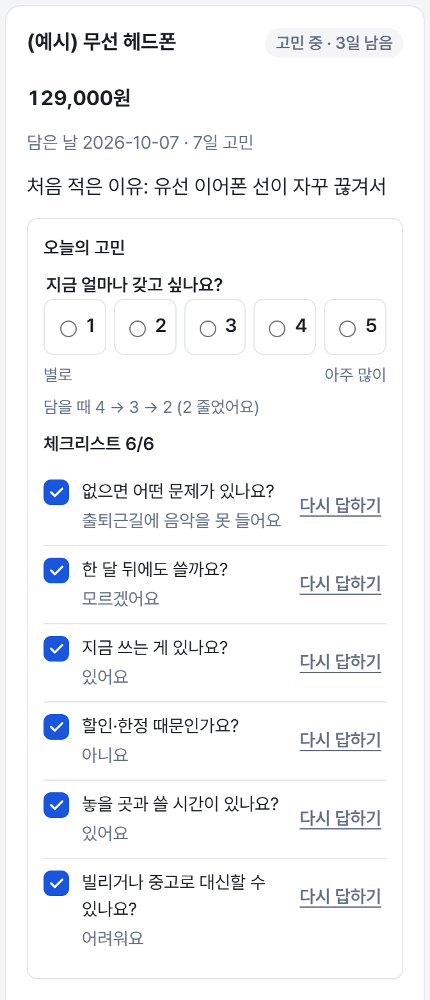
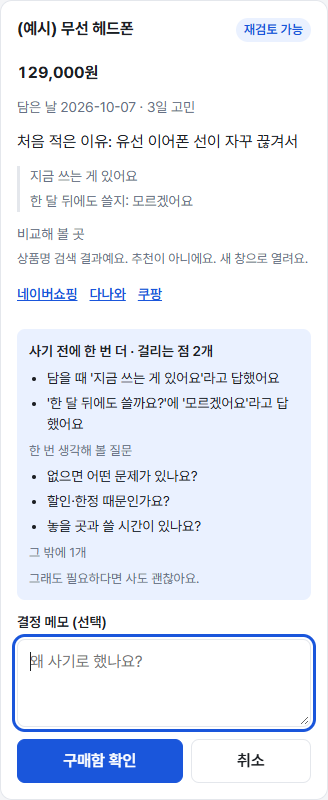
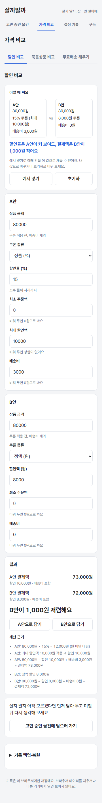
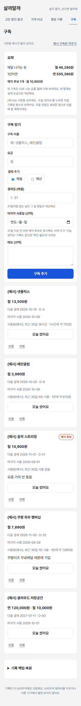

# 살까말까 (Buy or Not)

사고 싶은 물건을 바로 사지 않고 **정말 필요한지 확인하고, 며칠 고민하고, 사기로 했다면 더 싸게** 사도록 돕는 모바일 우선 웹사이트입니다. 20~30대 자취생을 대상으로 만들었습니다.

- 웹사이트: https://lumos0107.github.io/BuyorNot/ (처음이면 **예시 물건 넣기**)
- 상태: 필수·확장·보강 기능 구현·배포(2026-10-11), 구독 이용 분석은 넷플릭스 기록 가져오기(13-1~13-3)까지. 중간 과제 AI 1단계(14-1~14-16, 문서 정리 14-18)와 이어서 AI 성적표·놓을 자리 확인(15-1~15-7)은 `ai-stage1` 브랜치에 구현·커밋했고(2026-10-30) 아직 push·배포 전이다. 15-8a(치수 읽기 실제 호출의 40초 실패를 고침)도 같은 브랜치에서 했다(2026-10-31). 같은 날 다각도 평가 1회차를 하고 16단계(평가 1회차 개선)를 시작해 16-1~16-5를 같은 브랜치에 커밋했고, 16-6·16-7은 제작자 몫이다. 이어서 2026-10-31 평가 B와 17단계(평가 2회차 개선)를 했고 17-1~17-6을 같은 브랜치에 커밋했으며, 17-7은 제작자 몫이다. AI 서버 배포·다시 배포(14-17·15-8)는 제작자 몫이라 남아 있다. 자동 테스트 1551개 통과(2026-10-31)
- 자세한 설명: [상세 설명](docs/상세_설명.md) · [PRD](PRD.md) · [TODO](TODO.md) · [DEVLOG](DEVLOG.md)

## 1. 기획 (PRD 요약)

### 1-1. 프로젝트 개요

- 프로젝트 이름: 살까말까 (Buy or Not)
- 한 줄 소개: 사고 싶은 물건을 담아 두고 며칠 다시 생각하게 하고, 사기로 했다면 실제로 내는 돈을 비교해 주는 모바일 웹사이트
- 만드는 사람: 강승준 (AI 도구: Claude, 검토 일부 GPT)
- 완성 목표일: 2026-10-17 (1주)
- 중간 과제(인공지능 프로그래밍) 마감: 미정 (제작자 확인 필요)

### 1-2. 왜 만드나요?

- 사고 싶은 순간 바로 결제하고, 며칠 지나면 왜 샀는지 모르는 물건이 생긴다.
- 할인율·용량·배송비가 제각각이라 실제로 얼마를 내는지 비교하기 어렵다.
- 안 쓰는 구독료가 매달 빠져나간다.

그래서 **필요한지 다시 생각할 시간과 근거**를 주고, 사기로 했다면 **실제 결제액으로 비교**해 주는 도구를 만든다. 구매 여부는 사용자가 정한다.

### 1-3. 누가 사용하나요?

- 주 사용자: 20~30대 자취생
- 사용 환경: 주로 스마트폰(360px 기준), PC에서도 사용
- 알아야 할 점: 생활비와 보관 공간이 한정돼 있다. 회원가입 없이 바로 쓸 수 있어야 해서 기록은 이 브라우저에만 저장한다.

**대표 사용자 페르소나** (가상 인물)

- 이름/나이: 김지우, 28세, 자취하는 직장인
- 상황: 퇴근 후 스마트폰으로 식품·생활용품을 주문하고, 작은 가전이나 인테리어 소품도 살펴본다.
- 바라는 것: 제한된 생활비와 보관 공간에 맞춰 필요한 물건을 적당한 양과 가격에 사기
- 불편해하는 것: 용량과 할인 조건이 복잡하고, 대용량을 샀다가 남기거나 즉흥적으로 산 물건을 쓰지 않는 것

### 1-4. 꼭 있어야 하는 기능

1. 사용자는 사고 싶은 물건을 이유·가격·고민 기간과 함께 담아 두고, 날마다 **갖고 싶은 정도**와 **질문 6개 체크리스트**로 다시 생각할 수 있다.
2. 사용자는 사기 직전에 내 기록에서 찾은 걸리는 점(**사기 전에 한 번 더**)을 보고, 살지 말지 직접 정할 수 있다.
3. 사용자는 할인 조건·묶음 용량을 할인율이 아니라 **실제 결제액·총지출**로 비교할 수 있다.
4. 사용자는 산 것·포기한 것과 고민하는 동안 마음이 어떻게 바뀌었는지 돌아볼 수 있다.
5. 사용자는 구독의 다음 결제일, 월·연 합계, 오래 안 쓴 구독을 확인할 수 있다.

**중간 과제로 더한 AI 기능** (선택 기능이라 AI 없이도 위 1~5는 그대로 쓴다. 6~8과 10은 AI 서버 주소(빌드 변수 `VITE_AI_SERVER_URL`)가 있는 빌드에서만 보이고, 9와 11은 늘 보인다. 11의 캡처에서 치수 읽기만 서버 주소가 있을 때 보인다.)

6. 사용자는 가격 비교의 **가격표 사진** 탭에서 매장 가격표를 찍어 상품명·가격을 읽어 오고(고칠 수 있다), "온라인 가격 확인"으로 다나와의 같은 상품을 찾아 "조회 시점 다나와 표시 상품가가 매장 가격보다 920원 높아요"처럼 비교해 볼 수 있다(공개 배포 기본값은 다나와 자동 조회 꺼짐이라 다나와 검색 링크만 보이고, 켜도 같은 상품을 찾았을 때만 비교 문장이 나온다). (F31)
7. 사용자는 묶음상품 비교의 상품 카드에서 **사진으로 채우기**로 가격·용량·개수를 채울 수 있다. (F32)
8. 사용자는 고민 목록의 담기 폼에서 **말로 담기**로 "무선 청소기 삼만 오천 원, 이유는 바닥 청소"처럼 말해 상품명·가격·이유를 채울 수 있다. 녹음은 20초까지다. (F33)
9. 사용자는 고민 기간이 남은 물건 카드에서 그 기간이 끝나는 날을 **구글 캘린더**나 **캘린더 파일(.ics)**로 넣을 수 있다. (F35)
10. 사용자는 기록 백업·복원 아래의 **AI 성적표**에서 AI가 직접 모은 작은 자료로 얼마나 맞히고 어디서 틀렸는지(표본 수와 틀린 예 포함)를 볼 수 있다. 평가 결과를 담은 요약 파일이 아직 비어 있어 지금은 이 카드가 보이지 않는다. (F43)
11. 사용자는 고민 중인 물건 카드의 **놓을 자리 확인**에서 놓을 곳과 물건의 가로·깊이·높이(cm)를 적어 "입력 치수상 싱크대 옆 칸에 들어가요"처럼 들어가는지 볼 수 있고, 저장한 결과가 안 들어가요·빠듯해요면 사기 전에 한 번 더의 걸리는 점으로도 나온다. 서버 주소가 있는 빌드에서는 **상품 페이지 캡처에서 치수 읽기**로 물건 치수 칸을 채울 수 있다. 읽은 치수는 'AI가 읽은 내용'으로 보여 주고, 고른 캡처를 크게 보며 사진과 같은지 확인할 수 있다. (F44)

AI가 읽은 값은 고칠 수 있는 칸이나 확인 상자에 보여 줄 뿐이고, 사용자가 누르기 전에는 저장하지 않는다. 담기 폼에는 빈 칸만 채우고 이미 적어 둔 칸은 덮어쓰지 않는다(말로 담기에서 고민 기간은 늘 값이 있는 칸이라 말했으면 바꾼다). 치수 읽기도 확인 상자에서 '넣기'를 눌러야 물건 치수 칸에 들어가고, 저장은 '확인하고 저장'을 눌러야 한다. 놓을 자리 확인은 입력한 치수만 비교해 보여 줄 뿐 사라·말라는 말은 하지 않는다. 묶음 비교 카드는 확인 상자에서 '채우기'를 눌러야 바뀌고, 누르면 그 카드의 가격·단위·용량·개수를 읽은 값으로 바꾼다. 읽지 못한 값은 칸을 비우되, 용량은 읽었는데 개수만 모르면 개수 칸에 계산용 1을 넣고(확인 상자에 '× 1개(계산용 1묶음)'로 보인다) 단위를 모르면 확인 상자에서 고르게 한다. 살지 말지는 판단해 주지 않는다. 사진과 녹음은 읽기 위해 Google Gemini로 보내지고(무료 서비스라 구글이 서비스 개선에 쓸 수 있다는 안내가 화면에 있다), 우리 AI 서버는 사진·녹음·읽은 글을 저장하지 않는다. 다나와 조회는 서버의 배포 기본값이 꺼져 있고 켤지는 제작자가 정한다(꺼져 있으면 사진에서 읽은 값과 다나와 링크만 보인다). 서버는 아직 배포하지 않아(14-17) 배포된 웹사이트에는 AI 기능이 보이지 않는다.

AI가 실제 자료에서 얼마나 맞히는지는 **아직 재지 못했다.** 채점 코드와 평가 스크립트 4개를 만들었지만, 실제 서버와 Gemini까지 돌려 본 것은 가격표 사진 스크립트가 사전 시험에 쓴 사진 8장으로 한 번뿐이고 그것도 작동 확인이다. 말로 담기·다나와·치수 읽기 스크립트는 직접 만든 합성 평가용 자료를 `--check`(자료 검사)로 확인했을 뿐 Gemini를 부르지 않았다. 치수 읽기는 모의 응답으로 시험했다. 앱에서 손으로 실제 Gemini를 불렀을 때 40초 시간 초과(502)가 났고 모델이 숫자 칸을 끝없이 이어 쓰는 반복을 직접 봐서, 출력 상한을 두고 치수는 글자로 받게 고쳤다. 새 합성 입력 6회에서 숫자 반복 미재현 및 추출 정상 확인. 실제 자료로 잰 정확도는 아직 없다. 실제 사진·목소리·다나와 페이지·상품 페이지 캡처로 재는 일이 남아 있다. 지금 상태와 한계는 [AI 정확도 평가 기록](docs/ai-eval.md)에 있다.

하지 않는 것: 로그인과 사용자 데이터를 저장하는 서버, 쇼핑몰 가격 자동 수집(가격표 사진 탭에서 조회를 켜 두었을 때만 사용자가 누를 때 다나와를 한 번 읽는다. 공개 배포 기본값은 꺼짐이라 검색 링크만 보인다), 결제, AI 구매 추천, 푸시 알림, 기기 간 자동 동기화. 기능별 규칙과 검증 사례는 [PRD](PRD.md)에 있다.

## 2. 서비스 화면

소비 시점 순서로 네 화면이 있습니다: **고민 중인 물건**(구매 전) → **가격 비교**(구매할 때) → **결정 기록**(구매 후) → **구독**(매달).

<p>
  
  
  
  
</p>

중간 과제로 더한 기능은 같은 화면 안에 들어갑니다(AI 화면은 아직 스크린샷이 없습니다). 가격 비교에는 **가격표 사진** 탭이 세 번째로, 묶음상품 비교의 상품 카드에는 **사진으로 채우기**가, 고민 중인 물건의 담기 폼 맨 위에는 **말로 담기**가 생기고, 고민 기간이 남은 물건 카드에는 **구글 캘린더**·**캘린더 파일(.ics)** 줄이 생깁니다. 고민 중인 물건 카드에는 접이식 **놓을 자리 확인**이 생기고(그 안의 **캡처에서 치수 읽기**는 AI 서버 주소가 있을 때만), 기록 백업·복원 아래에는 **AI 성적표** 카드가 생깁니다. 가격표 탭·사진으로 채우기·말로 담기는 AI 서버 주소가 있는 빌드에서만 보이고, 성적표는 서버 주소가 있고 요약 파일에 평가 결과가 들어 있을 때만 보입니다(지금은 비어 있어 보이지 않습니다). 캘린더 줄과 놓을 자리 확인은 늘 보입니다.

만들 때 지킨 원칙:

- 충동구매라고 단정하지 않는다. 근거만 보여 주고 결정은 사용자가 한다.
- 회원가입·데이터베이스 없이 기록은 이 브라우저에만 저장한다. 다른 기기로는 백업 파일로 옮긴다. AI 기능용 서버는 사진·녹음을 저장하지 않는다.
- 외부 데이터는 공식 API나 사용자가 내려받은 파일만 쓴다. 예외는 가격표 사진 탭에서 사용자가 누를 때 한 번 읽는 다나와 검색 결과다(공개 배포 기본값은 꺼짐이라 읽지 않고 검색 링크만 보인다).
- 예시는 모두 이름에 "(예시)"가 붙은 가짜 데이터다. 만든 이유는 [상세 설명](docs/상세_설명.md#예시가짜-데이터와-만든-이유)에 있다.

## 3. 개발 진행 (TODO)

작업 236개 중 227개를 마쳤습니다. 자세한 목록은 [TODO](TODO.md)에 있습니다.

- **나눈 방식:** 필수 → 확장 → 보강. 각각을 단계(눈으로 확인할 수 있는 기능 하나)와 작업(번호를 붙인 작은 일)으로 나눴다.
- **이렇게 나눈 이유:** 시간이 부족할 수 있어 필수 기능만으로도 제출할 수 있는 상태를 먼저 만들었다. 프로토타입(1단계)부터 만들고 자동 배포를 붙여, 단계마다 배포 링크로 바로 확인했다. (중간 과제 14단계부터는 브랜치 `ai-stage1`에서 로컬로만 확인했고 아직 배포하지 않았다.)
- **한 단계의 구성:** 목표 → 작업(계산 규칙·테스트 → 화면 → 검증 → 커밋) → 숫자로 정한 확인 방법 → 제작자 확인 후 다음 단계

| 구분 | 단계별 내용 | 상태 |
| --- | --- | --- |
| 필수 | 1 프로토타입·자동 배포 · 2 묶음 비교 · 3 할인 비교 · 4 고민·결정 기록 · 5 문서 · 6 최종 점검 | 완료 |
| 확장 | 7 연장·메모 · 8 무료배송 비교(10/13 화면에서 뺌) · 9 질문·링크·알림 · 10 기록 요약·회고 · 11 구독 · 12 통합 검증 | 완료 |
| 보강 | 사기 전 점검·백업, 고민 노트, 담기 폼 줄이기, 보안 점검, 체크리스트 | 완료 |
| 보강 (진행 중) | 구독 이용 분석: 13-1~13-3 넷플릭스 기록 가져오기 완료, 13-4~13-7 기간·실제 낸 금액·배달 순혜택 | 진행 중 |
| 중간 과제 (AI) | 14 AI 1단계: AI 서버, 가격표 사진으로 온라인 가격 확인, 사진으로 묶음 비교 채우기, 말로 담기, 고민 끝나는 날 캘린더, 평가 도구 (14-1~14-16·14-18 완료, 14-17 서버 배포는 제작자 대기) | 진행 중 |
| 중간 과제 (AI) | 15 AI 1단계 이어서: AI 성적표, 놓을 자리 확인(직접 입력·캡처에서 치수 읽기), 치수 읽기 평가 도구 (15-1~15-7 완료, 15-8a 치수 읽기 40초 실패 고침 완료, 15-8 서버 다시 배포는 제작자 대기) | 진행 중 |
| 중간 과제 (평가) | 16 평가 1회차 개선: 담은 직후 새 카드, 치수 읽기 문구·크게 보기, 사진 초안 링크, 결과 화면 문구, README (16-1~16-5) | 진행 중 (16-6·16-7은 제작자 대기) |

## 4. 스킬로 과제를 한 방법

중간 과제(인공지능 프로그래밍)는 스킬을 만들어 과제를 수행하는 것이 조건이라, 반복되는 일을 Claude Code 스킬 13개로 만들어 두고 썼습니다. 스킬은 저장소의 `.claude/skills/<이름>/SKILL.md`에 적은 작업 지침이고, 기계로 볼 수 있는 규칙은 같은 폴더의 `scripts/`에 스크립트로 두었습니다. Claude Code가 SKILL.md 머리의 description을 보고 상황에 맞는 스킬을 불러 씁니다. 스킬마다 만든 방법과 시험 결과는 [.claude/skills/README.md](.claude/skills/README.md)에 있습니다.

### 4-1. 만든 스킬 13개와 쓴 곳

'이 과제에서 쓴 곳'은 [DEVLOG](DEVLOG.md)·[AI 정확도 평가 기록](docs/ai-eval.md)과 구현 때 남긴 작업 기록에 있는 것만 적었습니다.

| 스킬 | 언제 쓰나 | 이 과제에서 쓴 곳 | 스크립트 |
| --- | --- | --- | --- |
| `updating-prd` | PRD에 기능·검증 사례·결정을 넣거나 고칠 때 | PRD를 고칠 때 `check_prd_refs.py`를 돌림(v0.25~v0.28 때 OK). 평가 1회차 P5에서 이 스킬의 규칙('확인 전 결정은 9장에 한 줄')이 판정 R10~R27에서 지켜지지 않은 것이 드러나 스크립트에 대조 검사를 더함 | `check_prd_refs.py`: 버전·번호 참조·완료 기준·입력과 결과 개수·'제작자 확인 전' 결정이 9장 남은 결정에 있는지(2026-10-31 평가 1회차 P5에서 더함) |
| `checking-ui-copy` | 사용자가 보는 문구를 넣거나 고칠 때 | 화면 문구를 바꾼 16-2·16-3·16-4에서 `check_copy.py`를 돌림 | `check_copy.py`: 금지어·구매 권유·옛 용어·이모지·조사 |
| `checking-privacy` | 밖으로 나가는 데이터, 서버 코드, 평가 자료를 다룰 때 | AI 평가 도구(14-16)에 지정. 14-7에서 안내 주석만으로 검사가 통과되던 것을 판정 R5로 스크립트를 고쳐 막음(`36b5180`) | `check_privacy.py`: 서버 로그·키·전송 안내·평가 자료 출처·.gitignore |
| `tuning-prompts` | Gemini 프롬프트·설정을 고치거나 점수를 올려 달라는 요청을 받을 때 | 치수 읽기 40초 실패를 고친 15-8a에서 원인을 '모델 한계'로 나누고 치수 읽기 프롬프트·스키마 판을 `929dac41` → `e2c918b8`로 바꿔 [docs/ai-eval.md](docs/ai-eval.md)의 판 기록·설정 바꾼 기록에 남김(DEVLOG 994~1005줄). 평가용 실행 전이라 평가 오염 없음 | 없음(판단 규칙) |
| `consulting-gpt` | 결정·명세·계획을 GPT(Codex CLI)와 상의하고 기록할 때 | GPT 상담 45번(DEVLOG 621줄)·46번(751줄)·48번(894줄)·49번(998줄)·50번(1024줄). 질문·답·확인 파일(`_개인기록/gpt/`)을 이 스킬의 `append_record.py`로 비공개 기록(`_개인기록/GPT_검토_기록.md`, 커밋하지 않음)에 붙였다 | `append_record.py`: 기록 형식·번호 중복·LF |
| `adding-ai-endpoint` | 새 AI 서버 주소와 앱 연결을 만들거나 설계할 때 | 치수 읽기 서버 `/api/read-size`(15-5)에 지정 | 없음(틀과 범위 규칙) |
| `evaluating-ai` | AI 정확도를 재고 성적표(F43) 숫자를 만들 때 | AI 평가 도구(14-16)와 AI 성적표(15-1)에 지정 | 없음(평가 스크립트는 `eval/`) |
| `checking-before-commit` | 커밋하기 직전 | 구현 서브에이전트 규칙의 기본 스킬. 14-18과 16-1~16-4의 검증 결과에 `check_all`이 적혀 있음 | `check_all.py`: 금지 파일·CR·문구·개인정보·PRD·TODO 검사 + 전체 테스트·린트·타입 |
| `writing-tests-from-spec` | PRD 검증 사례를 테스트로 옮길 때 | 구현 서브에이전트 규칙의 기본 스킬. 테스트 이름을 '한국어 문장 + AC 번호'로 쓰는 판정 R2의 근거 | 없음 |
| `updating-devlog` | 작업이 끝나 DEVLOG·README를 남길 때 | 작업마다 '코드 커밋 → 해시로 TODO·DEVLOG 기록 → 기록 커밋' 순서로 쓰기로 정함(판정 R3) | 없음 |
| `syncing-todo` | PRD·계획이 바뀌었거나 작업이 끝났을 때 TODO 맞추기 | `check_todo.py`를 PRD·TODO를 고칠 때 돌림(14·15단계 준비, v0.26 때 OK). `mark_done.py`는 14-10 전에 더했고(`7461cd6`), 14·15단계 완료 줄 끝에 커밋 해시가 붙어 있음 | `check_todo.py`: 기준 버전·기능·계획 작업 수·완료 해시 · `mark_done.py`: 작업 한 줄 완료 표시(2026-10-30 추가, GPT 46번) |
| `testing-ai-screens` | AI 서버를 부르는 화면의 테스트를 쓰거나 리뷰할 때(2026-10-30 구현 중 추가, GPT 46번) | 가격표 사진 탭(14-10), 사진으로 묶음 비교 채우기(14-11), 말로 담기 화면(14-14), 캡처 치수 읽기(15-6)의 구현·리뷰 지시에 지정 | 없음(서버 흉내·늦은 응답·숨은 화면 포커스·미리보기 해제·60초 규칙) |
| `applying-ai-results` | AI가 읽은 값을 사용자가 고칠 수 있는 칸·확인 상자에 넣는 코드를 짜거나 리뷰할 때(2026-10-30 구현 중 추가, GPT 47번) | 말로 담기 빈 칸 채우기(14-13)에서 처음 지정, 말로 담기 화면(14-14)과 캡처 치수 읽기(15-6)에도 지정 | 없음(무효화 경로·채우기 규칙·지어낸 값·확인 문장·포커스 규칙) |

<!-- 학생 서술 칸: 비워 둠 (판정 R29 (3)) -->
> **(제작자가 직접 쓸 칸)** 스킬을 만들며 배운 점:
>

### 4-2. 스킬을 써 본 결과

스킬을 만들 때 같은 일을 스킬 없이 한 번, 스킬과 함께 한 번 시켜 비교했습니다. 숫자는 [.claude/skills/README.md](.claude/skills/README.md)의 '시험 결과'를 그대로 옮겼습니다.

| 묶음 | 스킬 없이 → 함께 | 토큰 | 시간 |
| --- | --- | --- | --- |
| 첫 묶음 (2026-10-29): 화면 문구 점검·개인정보 점검·프롬프트 고치기·PRD 고치기 | 스킬 없이도 결과는 맞았다 → 같은 결과 + 빠진 문장 찾기(화면 문구)·과잉 교정 확인(프롬프트)·제작자 확인 전 표시(PRD) | 합계 약 26% 감소 | 합계 약 31% 감소 |
| 두 번째 묶음 (2026-10-29): GPT 상의·새 AI 기능 틀·AI 평가·커밋 전 점검·명세→테스트·DEVLOG·README·TODO 관리 | 대부분 결과는 맞았다 → 같은 결과 + 실행 실수(GPT 출력 버림)를 막고, 범위를 넘는 작업(기능 전체 설계, README 발표 문단 수정)을 멈추게 하고, 저장소의 형식 약속(테스트 이름, TODO 작업 번호)을 지키게 함 | 약 75.6만 → 60.7만(약 20% 감소). '새 AI 기능 틀'을 빼면 약 11.5% | 1,009초 → 603초(약 40% 감소) |
| 구현 중 추가 (2026-10-30): `testing-ai-screens`·`applying-ai-results` | `testing-ai-screens`: 일부러 넣은 버그 18개 중 16개를 잡음 → 22개 중 20개를 잡음. `applying-ai-results`: 설계만 시킨 시험에서 늦은 실패 처리·공용 문구 모듈이 빠짐 → 둘 다 들어감 | `testing-ai-screens` 약 26.9만 → 27.9만, `applying-ai-results` 약 14.3만 → 14.6만 | `testing-ai-screens` 1,151초 → 1,070초, `applying-ai-results` 318초 → 369초 |

한계: 과제마다 1회만 비교했다. 같은 초기 저장소 상태·산출 범위·모델 설정으로 3~5회 반복하고 실행 순서를 섞어야 일반적인 효과라고 말할 수 있다.

<!-- 학생 서술 칸: 비워 둠 (판정 R29 (3)) -->
> **(제작자가 직접 쓸 칸)** 스킬이 없었다면 틀렸을 일 하나:
>

### 4-3. 평가와 판정

개발한 앱과 문서를 평가 에이전트에게 평가시키고, 다음 순서로 고칠 것을 정했습니다.

| 단계 | 한 일 |
| --- | --- |
| 1. 평가 | 평가 에이전트 5명(실제 사용자·교수·보안·접근성·기능 기획)이 `ai-stage1` 브랜치의 커밋 `1759e1d`(2026-10-31)를 각자의 관점으로 평가했다. 교수 관점은 README에 '스킬'이 없고 장단점·개선점·결론 장(지금 번호로 5~7장)이 1주 과제 그대로라고 지적했다(P4) |
| 2. 토론 | 평가 결과를 세 관점(사용자 가치·채점 가치·비용 위험)으로 2라운드 토론했다 |
| 3. GPT 상의 | GPT(Codex CLI) 50번으로 상의했다 |
| 4. 판정 | 판정 R29: 개발 1회차에서 할 일을 정했다(README 사실 정정과 스킬 장 뼈대, PRD 9장 정리, 사진 초안의 옛 링크 제거, 치수 읽기 문구·캡처 크게 보기, 담은 직후 새 카드, 결과 화면 문구). 나머지는 평가 B 뒤 2회차에서 다시 판단한다 |
| 5. 고정 기준 | 다음 평가와 비교할 수 있게 조건과 평가 항목을 [docs/평가/평가기준.md](docs/평가/평가기준.md)에 고정했다. 평가 B(개발 1회차 뒤)와 평가 C(개발 2회차 뒤)가 같이 쓴다 |
| 6. 기록 | [docs/평가/2026-10-31-1회차.md](docs/평가/2026-10-31-1회차.md)에 정리했고, 평가자별 원문과 토론은 같은 이름의 폴더 `docs/평가/2026-10-31-1회차/`에 있다. 평가 B는 [docs/평가/2026-10-31-2회차.md](docs/평가/2026-10-31-2회차.md)에 있다 |

평가가 찾은 스킬 규칙 위반(P5): `updating-prd`의 '확인 전 결정은 9장 남은 결정에 한 줄' 규칙이 판정 R10~R27에서 지켜지지 않았다. `check_prd_refs.py`에 '제작자 확인 전' 표시마다 9장 줄이 있는지 대조하는 검사를 더하자 PRD v0.34에서 17곳이 빠졌다고 나왔고, 9장을 채운 뒤(v0.35·v0.36) 30곳 모두 9장에 있음을 확인했다(2026-10-31).

평가 1회차와 평가 B에서 '치수 읽기가 사진에 없는 숫자를 냈다'고 기록한 것은 앞선 화면 확인이 브라우저에 남긴 모의 응답이었고, 서버 로그로 확인해 판정을 정정했다([AI 정확도 평가 기록 '평가 도구를 점검한 기록'](docs/ai-eval.md)).

제작자 판정표: [docs/평가/판정표.md](docs/평가/판정표.md)에 PRD에서 'Claude 결정, 제작자 확인 전'으로 표시된 결정 34개를 한 줄씩 적어 두었다. '제작자 판정(예/아니오/바꿈)' 칸은 제작자만 쓰며, 2026-10-31 기준 33줄 모두 비어 있다.

<!-- 학생 서술 칸: 비워 둠 (판정 R29 (3)) -->
> **(제작자가 직접 쓸 칸)** 판정표를 보고 바꾼 결정:
>

## 5. PRD·TODO 리스트를 쓰고 개발했을 때의 장단점

PRD(무엇을 만들지)와 TODO 리스트(어떤 순서로 만들지)를 먼저 써 두고, 코드는 Claude에게 말로 요청해 만드는 바이브 코딩으로 진행했습니다. 역할은 이렇게 나눴습니다.

| 역할 | 맡은 일 |
| --- | --- |
| Claude | 요청을 코드와 문서로 만든다 |
| 제작자 | 범위와 방향 결정, 결과 확인. 예: "고민하다 보면 구매욕이 줄어드는 느낌이어야 한다" → 고민 노트 |

단계별 코드 검토 일부는 GPT(Codex CLI)에 맡겼고(13단계에서 중단했다가 10/13 목적 점검부터 다시 상의했고, 중간 과제에서는 결정·명세·계획을 GPT 33~51번으로 상의했다), 그 과정은 [DEVLOG](DEVLOG.md)에 남겼다.

**장점**

- PRD와 TODO 리스트를 미리 다 써 두고 맡기니, 하나하나 묻지 않고 알아서 개발까지 이어 가서 좋았다.
- 기능을 말로 설명하면 PRD의 기능 번호와 TODO 작업 단위로 빠르게 구현하고 수정도 대신 해 줘서, 혼자서도 어느 정도 결과물을 만들어 볼 수 있었다.
- 계획과 수정 사항이 PRD·TODO·[DEVLOG](DEVLOG.md)에 문서로 남아, 나중에 어떤 작업이 있었는지 확인하기 쉬웠다.

**단점**

- PRD에 없던 요청이 많아질수록 화면이 복잡해졌다. 기능 하나를 추가하고 싶었는데 담기 폼을 다시 고쳐야 하는 일이 생겼다(F24 담기 폼 줄이기, 질문을 체크리스트로 합침).
- PRD에 적지 않은 부분은 Claude가 알아서 채워 넣어, 디자인이 Claude가 흔히 만드는 비슷한 모양으로 나왔다. 원하는 모양이 있으면 미리 정해서 적어 둬야 했다.
- TODO의 확인 항목을 Claude는 코드와 테스트로만 확인하고 문제없다고 답하는 경향이 있었다. 코드상으로는 문제가 없어도 화면에 보이는 정보가 이상한 경우가 있어서(내가 보는 화면과 Claude가 보는 것이 달랐다) 직접 화면을 확인해야 했다.

**단점을 보완한 방법과 그 비용**

| 보완한 방법 | 효과 | 비용 |
| --- | --- | --- |
| 기능마다 검증 사례(입력과 기대 결과)를 먼저 정하기 | Claude에게 무엇이 맞는지 기준을 줌 | PRD가 길어짐 |
| 테스트를 먼저 쓰고 실패를 확인한 뒤 구현(TDD) | 고칠 때 다른 기능이 깨지는지 바로 앎(자동 테스트 1주 과제 532개, 중간 과제 뒤 1551개) | 바꿀 때마다 함께 고칠 테스트가 늘어남 |

## 6. 개선이 필요한 점

**서비스**

| 부족한 점 | 개선 방향 |
| --- | --- |
| 효과를 확인하지 못했다. 실제 사용자 없이 만들어, 고민하게 하면 구매욕이 줄어드는지 모른다 | 자취생 몇 명에게 1~2주 써 보게 하고, 담은 물건 중 포기한 비율과 갖고 싶은 정도의 변화를 본다 |
| 다시 들어올 이유가 약하다. 알림이 없어 고민 기간이 끝나도 직접 열어야 한다 | 고민 기간 종료·구독 결제일 알림 |
| 기록이 브라우저에만 있어, 기기를 바꾸면 백업 파일로 옮겨야 한다 | 로그인과 서버 저장(개인정보 보호 방안과 함께) |
| 구독 사용량을 직접 적어야 한다. 넷플릭스는 시청 기록 파일 가져오기까지만 했다 | 남은 구독 분석(13-4~13-7) 마무리, 앱으로 만들면 기기 사용 시간 연동 |

**방법론 (PRD·TODO 리스트)** (5절의 단점에서)

| 부족했던 점 | 개선 방향 |
| --- | --- |
| PRD에 없던 요청이 쌓이면서 화면이 복잡해졌다 | 새 요청은 PRD에 먼저 적고, 어느 화면에 들어가는지와 무엇을 뺄지 함께 정한 뒤 TODO로 내린다. 예: 무료배송 비교를 빼고 필요한 양 비교를 넣음(10/13) |
| PRD에 디자인을 적지 않아 Claude가 흔히 만드는 비슷한 모양이 나왔다 | 기능보다 먼저 화면 구성(대략적인 배치)과 디자인 기준(색·글꼴·참고 화면)을 PRD에 적는다 |
| TODO의 확인 항목을 코드와 테스트로만 확인해 화면 문제를 놓쳤다 | TODO의 확인 방법에 "360px 화면을 직접 보고 확인"처럼 눈으로 보는 기준을 넣고, 단계마다 실제 스마트폰으로 확인한다. 실기기 확인은 아직 남아 있다 |
| 기능 단위로 계획하다 보니 목적과 거리가 먼 기능도 생겼다 | PRD 맨 앞에 목적 한 줄("충동구매를 줄여 절약을 돕는다")을 두고, 기능을 더할 때마다 목적에 맞는지 먼저 점검한다. 10/13 점검에서 구독 분석이 목적과 멀다는 것을 뒤늦게 알았다 |

## 7. 결론

사기 전에 생각을 한 번 더 하게 해서 절약을 돕는 앱을 만들어 보았습니다.

바이브 코딩으로 Claude를 활용하니 짧은 기간에 원하는 것을 만들 수 있어 좋았고, 계획을 미리 잘 세워 둘수록 다시 고칠 일이 줄어들고 더 좋은 결과물이 나온다는 걸 배웠습니다.

다음에는 주변 자취생들에게 실제로 써 보게 해서, 정말 충동구매가 줄어드는지 확인해 보고 싶습니다.

## 8. 실행

React 19 · TypeScript 6 · Vite 8 · Vitest · localStorage · GitHub Pages (Node.js 24) · AI 서버는 Cloudflare Workers + Google Gemini

```bash
npm ci && npm run dev   # 개발 서버 http://localhost:5173/BuyorNot/
npm test                # 자동 테스트 1551개 (AI 서버 코드와 평가 채점기 테스트 포함, 실제 Gemini는 부르지 않음)
npm run build           # 타입 검사 + 빌드
```

main에 push하면 GitHub Actions가 테스트 → 빌드 → GitHub Pages 배포를 실행합니다.

### AI 기능을 내 PC에서 켜기 (선택)

AI 서버(`worker/`)는 Gemini 키를 숨겨 두고 사진·녹음을 대신 보내 읽는 작은 서버입니다. 키는 저장소에 올리지 않고 `worker/.dev.vars`에만 둡니다(이 파일은 `.gitignore`에 있어 커밋되지 않습니다).

```bash
# 1. worker/.dev.vars 파일을 만들어 두 줄을 적는다 (키는 본인의 Gemini API 키)
#      GEMINI_API_KEY=<본인 키>
#      ALLOWED_ORIGINS=http://localhost:5173
#    다나와 조회를 시험하려면 DANAWA_ENABLED=true 한 줄을 더한다 (배포 기본값은 꺼짐)
# 2. AI 서버 실행 (http://localhost:8787)
npm run worker:dev
# 3. .env.development.local 파일(커밋되지 않음)에 서버 주소를 적고 개발 서버를 다시 켠다
#      VITE_AI_SERVER_URL=http://localhost:8787
npm run dev
```

`VITE_AI_SERVER_URL`이 없으면 AI 탭과 버튼은 보이지 않고 나머지는 그대로 동작합니다. 배포용 서버는 제작자가 Cloudflare 계정으로 `npm run worker:deploy`로 올리고, 키는 `npx wrangler secret put GEMINI_API_KEY --config worker/wrangler.jsonc`로 등록합니다. 서버를 올린 뒤 나온 https 주소를 `.env.production`에 `VITE_AI_SERVER_URL=<서버 주소>`로 적어 커밋해야 GitHub Pages 빌드에 AI 기능이 들어갑니다. `worker:deploy`만으로는 사이트의 AI 기능이 켜지지 않습니다. 서버 배포도 이 파일도 아직 없습니다(TODO 14-17).

### AI 정확도 평가 (손으로 실행)

`eval/`의 스크립트가 실제 Gemini를 불러 정답과 비교해 칸별로 채점합니다. `npm test`에서는 돌지 않습니다. 평가에 쓰는 사진·녹음·다나와 페이지 사본과 결과 파일은 `_개인기록/평가/`에 두고 저장소에는 올리지 않습니다. 정답 파일 형식과 채점 규칙은 [eval/README.md](eval/README.md)에, 결과 기록은 [docs/ai-eval.md](docs/ai-eval.md)에 있습니다. 실제 자료로 잰 정확도는 아직 없습니다.

```bash
# 자료 검사 (모델을 부르지 않음. 커밋하지 않는 `_개인기록/평가/`의 자료 파일이 있어야 한다)
node eval/readTag.eval.ts --set 평가용 --check
node eval/voiceFill.eval.ts --set 평가용 --check
node eval/lowestPrice.eval.ts --set 평가용 --check
node eval/readSize.eval.ts --set 평가용 --check

# 정답 잠금: 실행 전에 정답 파일의 SHA-256을 docs/ai-eval.md에 적어 둔다
sha256sum eval/cases/*.json

# 실행 (위 AI 서버를 켜 둔 상태에서 한 번에 하나씩. 평가용은 프롬프트를 다 고친 뒤 마지막에 한 번)
node eval/readTag.eval.ts --set 조정용 --server http://localhost:8787
node eval/voiceFill.eval.ts --set 조정용 --server http://localhost:8787   # 조정용 녹음이 생기기 전까지는 사례가 0개라 아무것도 보내지 않고 종료 코드 1로 끝난다
node eval/lowestPrice.eval.ts --set 조정용    # 서버 없이 페이지 사본과 서버 함수를 직접 부른다. 조정용 다나와 페이지 사본이 생기기 전까지는 위와 같이 종료 코드 1
node eval/readSize.eval.ts --set 조정용 --server http://localhost:8787    # 상품 페이지 캡처의 치수 읽기. 조정용 치수 캡처가 생기기 전까지는 위와 같이 종료 코드 1

# 평가용 결과를 마지막 판에서 한 번 낸 뒤: 그 결과 파일들로만 앱 성적표 요약을 만든다 (손으로 숫자를 고치지 않음)
node eval/summarize.ts --out src/ai/evalSummary.json <평가용 결과 파일들>
```

제작: 강승준
