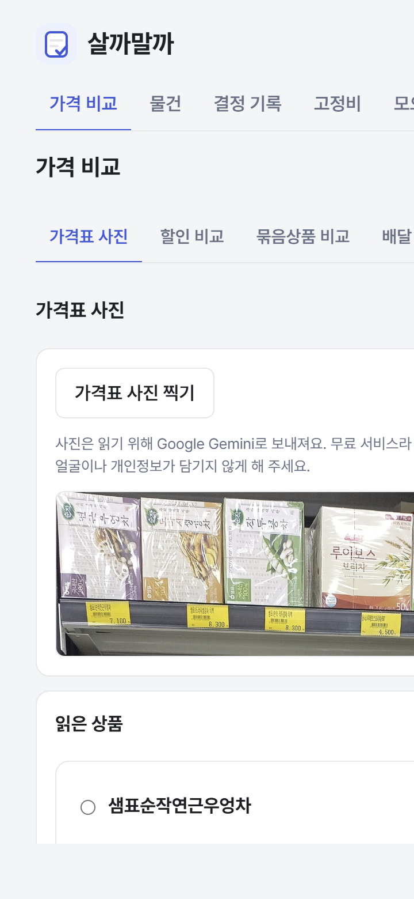
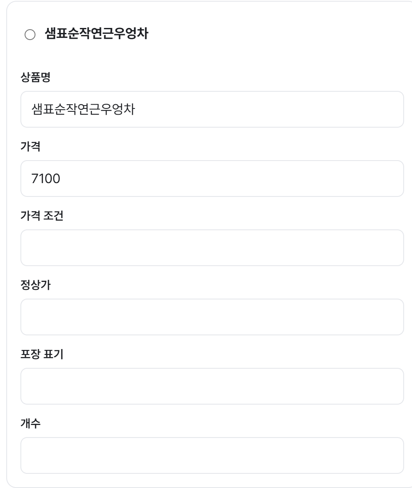

# 살까말까 (Buy or Not)

**사기 전에 한 번 더 생각하고, 산다면 실제로 드는 돈을 비교하는 웹앱**입니다. 물건을 며칠 보류하고, 집에 있는 것과 매달 나가는 돈을 확인한 뒤 직접 결정하도록 돕습니다. 20~30대 자취생을 생각하며 만들었습니다.

**직접 실행:** [1차 실습 과제(v1)](https://lumos0107.github.io/BuyorNot/v1/) · [중간 과제 개선본](https://lumos0107.github.io/BuyorNot/) · [GitHub 커밋 비교](https://github.com/lumos0107/BuyorNot/compare/v1...main)

> 개선본은 공개 사이트에서 실행됩니다. **사진·음성 AI는 아직 공개 서버가 연결되지 않아 교수님이 공개 링크에서 사용할 수 없습니다.** 아래에는 로컬 서버에서 실제 Gemini를 호출한 최신 화면을 따로 실었습니다. 나머지 기능은 AI 없이 사용할 수 있습니다.

## 1. 무엇을 만들었고, 1차 이후 무엇이 달라졌나

비교 기준은 2026-10-13 제출 커밋 `7d64fdc`(태그 `v1`)입니다. 같은 저장소에서 작업을 이어 갔습니다.

| 1차 실습 과제 | 중간 과제에서 추가·개선 |
| --- | --- |
| 사고 싶은 물건의 이름·가격·이유를 적고 며칠 고민 | **빠른 담기:** 이름·가격부터 적고 이유는 나중에 씀. 오늘과 7일 안에 볼 일을 기존 기록에서 보여 줌 |
| 질문 6개와 구매 직전 걸리는 점 확인 | **구매 근거 확장:** 집에 같은 물건, 놓을 자리, 할부 총액, 사용 횟수, 대용량 소비 기간, 목표가를 사기 전 한곳에서 확인 |
| 할인·배송비와 묶음 가격을 손으로 비교 | **비교 방법 확장:** 배달 앱의 최종 결제액, 생필품의 이전 가격을 비교. 로컬 AI 서버에서는 가격표·묶음 사진으로 입력 가능 |
| 구독 목록과 월·연 요금 | **생활비 확장:** 고정비·공과금·무료 체험·해지·정기배송, 앞으로 30일 결제 달력 |
| 집에 있는 것과 장보기 기록 없음 | **장보기 연결:** 재고, 먼저 쓸 식재료, 이번 주 집밥 계획과 장보기 초안. 이미 있어서 안 산 일도 기록 |
| 절약·저축 기록 없음 | **모으기:** 참은 구매, 실제 옮긴 돈, 줄어든 고정비를 구분. 작은 지출 시도, 받을 수 있는 돈·카드 실적·쿠폰 만료도 기록 |
| 결정과 구매 후 회고 | **산 뒤 확인:** 만족도·반품 기한·환불·되팔기를 기록하고 다음 결정에 참고 |
| 네 메뉴, 물건 화면에서 시작 | **다섯 메뉴, 가격 비교에서 시작.** 사진 AI가 연결되면 가격표 사진부터, 공개 빌드에서는 할인 비교부터 표시 |

기능별 조건은 [PRD의 1차 이후 상세 대조](PRD.md#1차-이후-비ai-요구사항-상세-대조)에, 구현·보류 시점은 [TODO 변경 이력](TODO.md#1차-제출본-이후-todo-변경-이력)에 적었습니다. 1차 제출 당시 상태는 [v1 기준점](docs/v1_기준점.md)에서 확인할 수 있습니다.

### 실제 화면 전후

| 1차: 물건부터 담기 | 개선본: 가격 비교부터 시작 |
| :---: | :---: |
|  |  |

| 1차: 구독 요금 | 개선본: 고정비·30일 결제 달력 |
| :---: | :---: |
|  |  |

개선본의 [물건·오늘 할 일 화면](docs/midterm_compare/05-wishlist.png)과 [두 칸 빠른 담기 화면](docs/midterm_compare/06-quick-add.png)도 현재 공개 버전에서 찍었습니다. 촬영 조건과 더 큰 전후 그림은 [화면 비교 기록](docs/midterm_compare/README.md)에 있습니다.

## 2. PRD와 Todo 리스트를 어떻게 바꿨나

[PRD](PRD.md)는 목표·사용자·기능 조건·검증 사례를, [TODO](TODO.md)는 구현 순서·완료 근거·보류 항목을 담습니다.

| 처음 계획 또는 1차 상태 | 개발 중 변경한 내용과 이유 |
| --- | --- |
| 물건을 담을 때 이유까지 입력 | 입력이 길어져 상품명·가격을 먼저 받고 이유는 선택으로 변경 |
| 사진 AI가 없어 직접 비교만 가능 | 사진·음성 입력을 더했지만, 읽은 값의 오류를 고칠 수 있게 확인 단계를 추가. 서버가 없는 공개 빌드는 직접 비교를 유지 |
| 구독을 월·연 요금으로 정리 | 반복 결제의 범위가 넓어 고정비·공과금·정기배송·결제 달력으로 확장 |
| 집밥과 장보기 선택이 따로 있어 중복 | 장보기에서 이번 주 요리 선택을 한곳으로 합침 |
| 구매 전 질문과 구매 후 메모가 따로 있음 | 기존 재고·가격·사용 기록을 사기 전 근거에 모으고, 반품·되팔기까지 구매 후 기록에 연결 |
| 백업 판 1과 자동 테스트 532개 | 새 기록을 포함하는 백업 판 3(옛 백업 복원 가능), 검증 사례 AC202까지·자동 테스트 1,990개로 확장 |

기능별 **추가·수정·보류 표시**는 [PRD](PRD.md#1차-실습-제출본v1에서-바뀐-요구사항), 작업 단계별 계획과 실제 결과는 [TODO](TODO.md#1차-제출본-이후-todo-변경-이력), 문제와 수정 이유는 [DEVLOG](DEVLOG.md)에 있습니다. 1차 이전에 뺀 무료배송 비교를 중간 과제의 변경으로 세지 않았습니다.

## 3. AI 시연과 검증 범위

### 공개 시연의 한계

**교수님이 공개 링크를 열어도 현재 사진·음성 AI를 직접 시험할 수 없습니다.** 화면에서 없어진 것은 `가격 비교 → 가격표 사진` 탭과 `가격 비교 → 묶음상품 비교 → 사진으로 채우기` 버튼입니다. 물건을 말로 담는 버튼과 상품 캡처의 치수 읽기 버튼도 같은 이유로 보이지 않습니다. AI 서버가 배포되지 않았고 공개 사이트에 서버 주소도 설정되지 않았기 때문입니다. 할인·묶음 비교의 직접 입력, 물건·고정비·모으기 등은 공개 링크에서 실행할 수 있습니다.

사진 비교 기능은 코드에 남아 있으며 로컬 AI 서버에서는 작동합니다. 공개 시연에는 Cloudflare Worker 배포, Gemini 키 등록, 사이트의 서버 주소 설정과 재배포가 필요합니다. 현재 작업 환경에는 Cloudflare 로그인이 없어 배포를 마치지 못했습니다.

따라서 아래에 **공개 화면과 로컬에서 실제 Gemini를 호출한 화면을 함께 캡처**해 두었습니다. 로컬 사진은 [Wikimedia Commons의 CC0 차 진열 사진](https://commons.wikimedia.org/wiki/File:Various_Teas_from_South_Korea.jpg)을 잘라 쓴 조정용 자료입니다. 2026-11-02 현재 앱 코드에서 상품명과 가격을 읽었고, 사용자가 각 칸을 고쳐 확인할 수 있습니다. 모의 응답이나 이전 버전 화면이 아닙니다.

| 교수님이 보는 공개 화면: AI 버튼 없음 | 로컬 AI 화면: 실제 사진 읽기 |
| :---: | :---: |
|  |  |

실제 응답의 첫 상품에는 **상품명 ‘샘표순작연근우엉차’와 가격 7,100원**이 채워졌습니다. 아래 입력 칸에서 사용자가 수정할 수 있습니다.



### 검증의 한계

같은 조정용 사진 **8장에 실제 요청 8번을 다시 보내 모두 200 응답**을 받았습니다(2026-11-02, `gemini-3.5-flash-lite`). 값 있는 칸은 73/89칸 맞았고, 1칸 틀렸으며 15칸은 못 읽었습니다. 표기 없는 칸 103개 중 11개를 잘못 채웠고 정답에 없는 항목 10개를 더 읽었습니다. **8장 모두 정답 자체가 애매한 부분이 있는 개발용 사진**이므로 이 숫자를 실제 사용 정확도나 일반 성능으로 내세우지 않습니다. 평가 스크립트도 확정 성적으로 인정하지 않아 종료 코드 1을 냈습니다. 범위·한계·기존 실행 기록은 [AI 평가 기록](docs/ai-eval.md)에 있습니다.

로컬에서 AI를 실행하는 방법과 평가 절차는 [AI 평가 실행 안내](eval/README.md)에 있습니다.

## 4. 스킬을 어떻게 썼나

반복 작업을 위해 만든 Claude Code 스킬 14개의 원문은 [.claude/skills/](.claude/skills/)의 각 `SKILL.md`에 있습니다. 아래는 지침 내용과 사용 예입니다.

| 스킬 원문 | 핵심 지침과 이번 작업에서 쓴 곳 |
| --- | --- |
| [updating-prd](.claude/skills/updating-prd/SKILL.md) · [syncing-todo](.claude/skills/syncing-todo/SKILL.md) · [updating-devlog](.claude/skills/updating-devlog/SKILL.md) | 기능과 검증 사례를 연결하고, TODO 완료에 검사·커밋 근거를 남긴다. PRD·TODO·개발 기록의 변경을 맞출 때 사용 |
| [writing-tests-from-spec](.claude/skills/writing-tests-from-spec/SKILL.md) · [checking-before-commit](.claude/skills/checking-before-commit/SKILL.md) | PRD의 입력·기대 결과를 테스트로 옮기고 커밋 전 테스트·타입·린트·문서 참조를 확인 |
| [checking-ui-copy](.claude/skills/checking-ui-copy/SKILL.md) · [simplifying-entry-flows](.claude/skills/simplifying-entry-flows/SKILL.md) | 구매를 권하는 표현을 피하고 새 필수 입력을 늘리기 전에 기존 기록을 활용. 빠른 담기·첫 화면 문구를 정할 때 사용 |
| [adding-ai-endpoint](.claude/skills/adding-ai-endpoint/SKILL.md) · [applying-ai-results](.claude/skills/applying-ai-results/SKILL.md) · [testing-ai-screens](.claude/skills/testing-ai-screens/SKILL.md) | AI 요청·실패를 분리하고, 읽은 값을 확인·수정한 뒤 적용하며 취소·늦은 응답도 점검. 사진·음성·치수 화면에서 사용 |
| [checking-privacy](.claude/skills/checking-privacy/SKILL.md) · [tuning-prompts](.claude/skills/tuning-prompts/SKILL.md) · [evaluating-ai](.claude/skills/evaluating-ai/SKILL.md) | 키·전송 안내를 점검하고, 프롬프트 판과 평가 자료·결과를 구분. AI 서버와 평가 기록에 사용 |
| [consulting-gpt](.claude/skills/consulting-gpt/SKILL.md) | GPT 의견의 질문·답·결정 출처를 남긴다. 기능 계획과 평가 후 수정안을 대조할 때 사용 |

직접 만든 이유는 **같은 종류의 누락을 반복하지 않기 위해서**입니다. 예를 들어 AI 화면 평가에서 브라우저에 남은 모의 응답을 실제 결과로 착각한 일을 발견해 [testing-ai-screens](.claude/skills/testing-ai-screens/SKILL.md)에 실제 서버 호출 확인 절차를 보강했습니다. 스킬별 제작·시험 기록은 [스킬 설명](.claude/skills/README.md)에 있습니다. 비교 실험은 과제마다 대부분 한 번이어서 일반적인 효과로 단정하지 않습니다.

## 5. 느낀 점과 결론

PRD와 TODO를 먼저 쓰니 기능을 늘릴 때 **무엇을 위해 만들고 어떻게 확인할지** 되돌아볼 수 있었습니다. 반면 기록이 길어져 핵심 변화가 잘 보이지 않았습니다. 그래서 이 README는 1차 이후 추가·개선을 보여 주고, 상세 조건과 작업 이력은 PRD·TODO로 연결했습니다.

Claude와 GPT로 빠르게 만들 수 있었지만 자동 테스트 통과만으로 실제 사용 경험이나 AI 정확도를 보장할 수는 없었습니다. 화면 평가에서 입력이 복잡하다는 문제를 찾아 빠른 담기와 장보기 선택 통합으로 다시 줄였습니다. 다음에는 실제 휴대폰과 새 사진·녹음으로 확인하고, 다른 자취생이 써 보며 충동구매에 도움이 되는지도 살펴보려 합니다.

## 6. 실행과 공개 상태

React · TypeScript · Vite · Vitest · 브라우저 `localStorage`로 만들었습니다. Node.js 24.15 이상에서 실행합니다.

```bash
npm ci
npm run dev
npm test -- --testTimeout=20000
npm run build
```

개발 주소는 `http://localhost:5173/BuyorNot/`입니다. 코드는 [Public 저장소](https://github.com/lumos0107/BuyorNot)에 있으며 `main`을 push하면 GitHub Actions가 검사·빌드·Pages 배포를 수행합니다. 1차 이후 커밋은 이 문서 반영분까지 **259개**입니다. 다만 중간 과제 개발 중에는 로컬 브랜치에서 작업한 뒤 11월 2일에 원격으로 올렸으므로, 그 기간에 일정한 간격으로 push했다고 주장하지 않습니다. 기록은 사용하는 브라우저에만 남아 다른 기기와 자동 동기화되지 않습니다.

제작: 강승준
