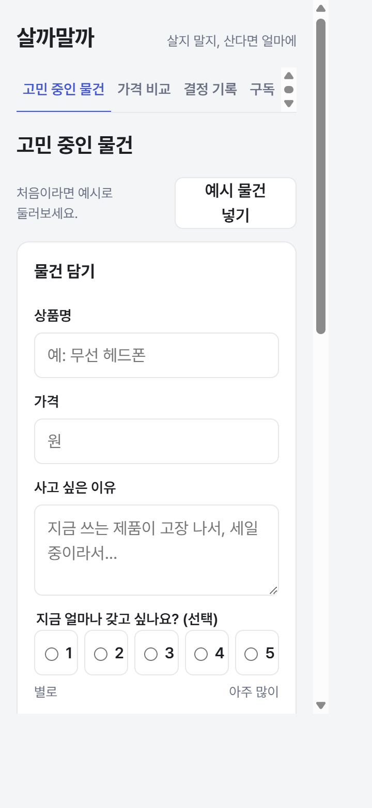
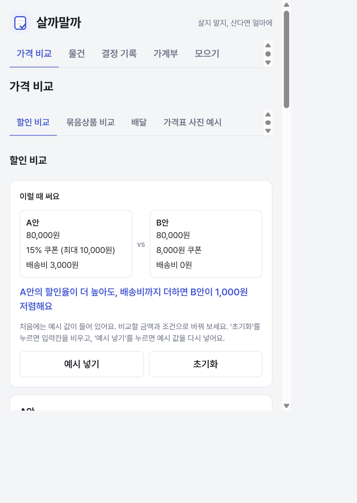
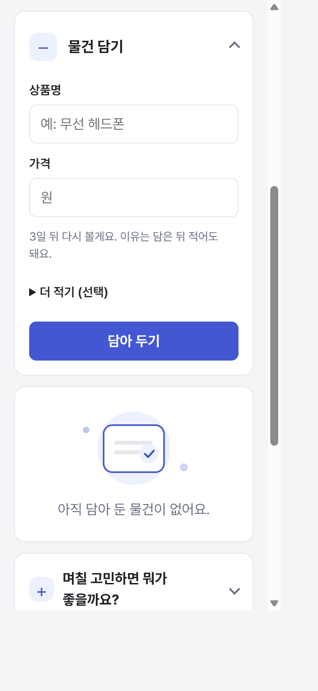
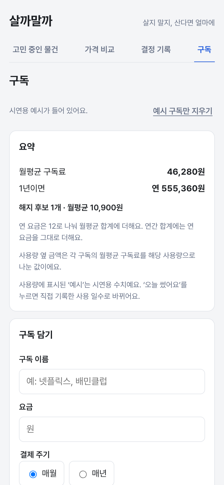
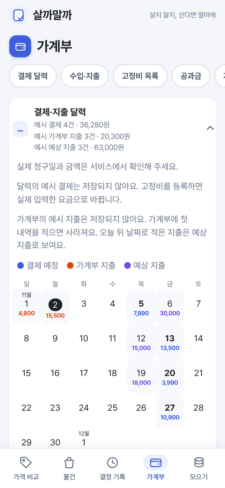
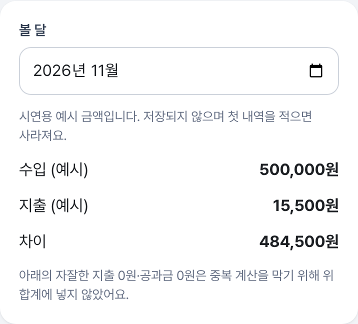
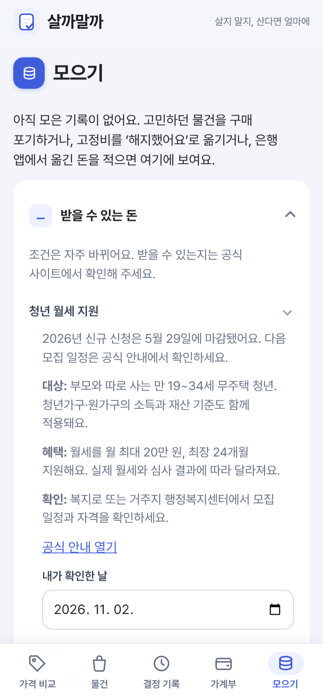
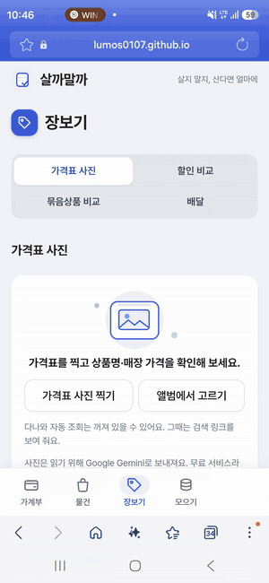
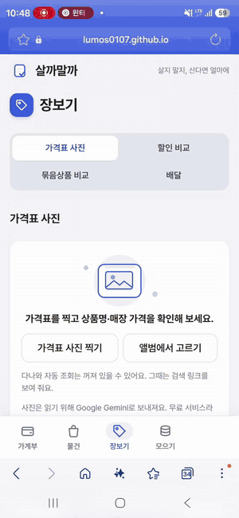

# 살까말까 (Buy or Not)

**사기 전에 한 번 더 생각하고, 산다면 실제로 드는 돈을 비교하는 웹앱**입니다. 물건을 며칠 보류하고, 집에 있는 것과 매달 나가는 돈을 확인한 뒤 직접 결정하도록 돕습니다. 20\~30대 자취생을 생각하며 만들었습니다.

**직접 실행해 보기**

| 버전 | 주소 |
| --- | --- |
| 1차 실습 과제 (v1, 2026-10-13) | https://lumos0107.github.io/BuyorNot/v1/ |
| 2차 중간 과제 (지금 버전) | https://lumos0107.github.io/BuyorNot/ (가계부에서 시작) |
| 가격표 사진(실제 AI)으로 바로 가기 | https://lumos0107.github.io/BuyorNot/?tab=photo |
| 1차 → 2차 코드 변경 비교 (GitHub) | https://github.com/lumos0107/BuyorNot/compare/v1...main |

> 개선본은 공개 사이트에서 실행됩니다. **공개 링크에서도 실제 AI가 동작합니다(2026-11-03부터).** `장보기 → 가격표 사진`에서 가격표를 찍으면 Gemini가 상품명·가격을 읽고, 상품을 골라 `온라인 가격 확인`을 누르면 다나와를 그 자리에서 검색해 비교합니다. 가끔 같은 상품을 찾지 못하는 등 온라인 비교가 잘 되지 않는 경우가 있으며, 실제로 해 본 영상과 남은 문제는 [3장](#3-ai-시연과-검증-범위)에 있습니다.

### 한눈에 보기

- **기능:** 1차의 '사기 전에 며칠 고민하기'에 가격 비교 확장, 집에 있는 것·장보기, 가계부(결제·지출 달력, 이달 현황판 막대, 분류별 지출, 이번 달 모을 금액), 물건 분류 아이콘, 모으기·받을 수 있는 돈을 더했습니다. → [1장](#1-무엇을-만들었고-1차-이후-무엇이-달라졌나)
- **화면:** 기능이 늘어 탭이 길어지자 메뉴를 가계부·물건·장보기·모으기 **네 개**로 줄이고 매일 쓰는 가계부를 첫 화면으로 했습니다. 휴대폰 하단 메뉴, 잘리지 않는 탭, 큰 숫자 요약 등으로 배치를 다시 짰고, 같은 조건으로 찍은 전후 사진으로 비교합니다. → [실제 화면 전후](#실제-화면-전후)
- **PRD·TODO:** PRD는 v0.22 → v1.08, 검증 사례는 AC50 → AC226, TODO는 14\~47단계를 더했습니다. 자동 테스트는 532개 → 2,042개입니다. README에는 무엇이 달라졌는지만 적고 상세 변경 내역은 별도 문서로 연결했습니다. → [2장](#2-prd와-todo-리스트를-어떻게-바꿨나)
- **AI:** 처음에는 로컬에서만 Gemini로 가격표를 읽고 공개 사이트에는 저장된 결과만 보여 줬는데, 2026-11-03부터 **공개 사이트에서도 사진을 올리면 Gemini가 가격표를 읽고 다나와 가격을 실시간으로 가져옵니다.** → [3장](#3-ai-시연과-검증-범위)
- **스킬·회고:** 직접 만든 스킬 14개를 하나씩 쉬운 말로 설명하고, 스킬을 썼을 때 아낀(또는 더 든) 토큰, 실제로 잡아낸 실패, 방법론의 장단점과 느낀 점을 정리했습니다. → [4장](#4-스킬을-어떻게-썼나) · [5장](#5-prdtodo로-개발한-방법의-장단점) · [7장](#7-느낀-점과-결론)

## 1. 무엇을 만들었고, 1차 이후 무엇이 달라졌나

비교 기준은 2026-10-13 제출 커밋 `7d64fdc`(태그 `v1`)입니다. 같은 저장소에서 작업을 이어 갔습니다.

| 1차 실습 과제 | 중간 과제에서 추가·개선 |
| --- | --- |
| 사고 싶은 물건의 이름·가격·이유를 적고 며칠 고민 | **빠른 담기:** 이름·가격부터 적고 이유는 나중에 씀. 오늘과 7일 안에 볼 일을 기존 기록에서 보여 줌. 취미·식비 등 **분류를 고르면 카드 표식이 분류 아이콘**으로 바뀜(선택). `말로 담기`로 녹음하면 Gemini가 받아써 칸을 채움(공개 사이트에서는 아직 따로 확인하지 않음) |
| 질문 6개와 구매 직전 걸리는 점 확인 | **구매 근거 확장:** 집에 같은 물건, 놓을 자리, 할부 총액, 사용 횟수, 대용량 소비 기간, 목표가를 사기 전 한곳에서 확인 |
| 할인·배송비와 묶음 가격을 손으로 비교 | **비교 방법 확장:** 배달 앱의 최종 결제액, 생필품의 이전 가격을 비교. **가격표를 찍으면 AI가 읽고 다나와 가격과 비교**(공개 사이트, 2026-11-03부터). 가끔 같은 상품을 찾지 못하면 후보 줄을 직접 골라 확인 |
| 구독 목록과 월·연 요금 | **가계부로 확장:** 수입·지출을 직접 적고 월별 합계를 확인. ‹ › 로 달을 넘기고, 수입을 지출·모을 금액·남는 돈으로 나눈 **이달 현황판 막대**, 분류별 지출 순위, 날짜별 내역, 지난달 대비 지출을 보여 줌. 요약은 수입·지출·차이·**이번 달 모을 금액** 네 칸. 가계부 맨 위의 **결제·지출 달력**은 이번 달 1일부터 결제 예정(파랑)·적은 지출(주황)·앞으로 쓸 예상 지출(보라)을 날짜 아래 금액으로 보여 줌. 고정비·공과금·자잘한 지출은 같은 탭 아래에 접어 둠 |
| 집에 있는 것과 장보기 기록 없음 | **장보기 메뉴:** 가격 비교와 함께 재고, 먼저 쓸 식재료, 이번 주 집밥 계획과 장보기 초안. 이미 있어서 안 산 일도 기록 |
| 절약·저축 기록 없음 | **모으기:** 참은 구매, 실제 옮긴 돈, 줄어든 고정비를 구분. 받을 수 있는 돈·카드 실적·쿠폰 만료도 기록. 자잘한 지출은 가계부로 이동 |
| 결정과 구매 후 회고 | **산 뒤 확인:** 만족도·반품 기한·환불·되팔기를 기록하고 다음 결정에 참고 |
| 네 메뉴, 물건 화면에서 시작 | **네 메뉴, 가계부에서 시작.** 가계부·물건(고민 중·결정 기록)·장보기(가격 비교·집에 있는 것)·모으기. 가격표 사진은 장보기의 첫 탭이고 [바로가기 주소](https://lumos0107.github.io/BuyorNot/?tab=photo)로 바로 열림. 한때 다섯 메뉴·가격 비교 시작이었다가 화면이 길어져 줄임(45단계) |
| 화면 위쪽 글자 탭, 선으로 나눈 카드 | **쓰기 편한 배치:** 휴대폰에서는 주요 메뉴를 엄지가 닿는 화면 아래에 아이콘과 함께 고정. 하위 탭은 잘리지 않는 분할 버튼, 긴 가계부에는 구역 바로가기 버튼 줄. 기능·문구는 그대로 |

기능별 조건은 [PRD의 1차 이후 상세 대조](PRD.md#1차-이후-비ai-요구사항-상세-대조)에, 구현·보류 시점은 [TODO 변경 이력](TODO.md#1차-제출본-이후-todo-변경-이력)에 적었습니다. 1차 제출 당시 상태는 [v1 기준점](docs/v1_기준점.md)에서 확인할 수 있습니다.

### 실제 화면 전후

모든 사진은 [1차 제출본](https://lumos0107.github.io/BuyorNot/v1/)과 [개선본](https://lumos0107.github.io/BuyorNot/)을 같은 조건(새 브라우저, 휴대폰 화면 390×844, 2배 해상도)으로 찍었습니다. 전후 사진은 **같은 비율·같은 폭**이라 바로 옆끼리 비교할 수 있습니다. 촬영 스크립트는 [capture.cjs](docs/midterm_compare/capture.cjs), 큰 사진과 설명은 [화면 비교 기록](docs/midterm_compare/README.md)에 있습니다.

| 1차: 물건 담기에서 시작 | 개선본: 가계부에서 시작 |
| :---: | :---: |
|  |  |

- **1차:** 위쪽 메뉴 4개(고민 중인 물건·가격 비교·결정 기록·구독). 처음부터 이유까지 적는 긴 폼
- **개선본:** 아래쪽 메뉴 4개(가계부·물건·장보기·모으기). 열자마자 **결제·지출 달력**이 보이고, 자잘한 설명은 눌러야 펼침. 금액은 입력 전 **저장되지 않는 예시**

| 1차: 이유까지 적어야 담김 | 개선본: 이름·가격 두 칸이면 담김 |
| :---: | :---: |
|  |  |

- **1차:** 사고 싶은 이유를 비우면 담을 수 없음
- **개선본:** 이름·가격만 적으면 담기고, 이유·갖고 싶은 정도는 `더 적기 (선택)` 버튼 안. `말로 담기`로 녹음해 채울 수도 있음

| 1차: 구독 요금 | 개선본: 가계부의 결제·지출 달력 |
| :---: | :---: |
|  |  |

- **1차:** 구독만 월·연 합계로 정리
- **개선본:** 고정비·공과금·자잘한 지출을 가계부 탭 아래에 접어 모으고, 결제 예정(파랑)·적은 지출(주황)·예상 지출(보라)을 날짜 아래 금액으로 달력에 표시. 달력 아래 버튼으로 각 구역에 바로 이동. 달력의 예시 금액은 저장되지 않음

1차에 없던 화면은 다음과 같습니다. 처음 방문하면 입력 전에 **저장되지 않는 예시 금액**이 보이고, 직접 기록하면 사라집니다.

| 새 가계부 요약과 이달 현황판 | 새 모으기·받을 수 있는 돈 |
| :---: | :---: |
| <br> |  |

- **가계부:** 수입·지출을 직접 적고 월별 합계 확인. 이번 달 모을 금액을 요약 칸에서 바로 보고, 수입을 지출·모을 금액·남는 돈으로 나눈 막대로 한 달 현황을 봄
- **모으기:** 참은 구매·옮긴 돈·줄어든 고정비를 구분하고, 받을 수 있는 돈은 맨 아래에 접어 둠

[물건 탭 첫 화면](docs/midterm_compare/05-wishlist.png)(고민 중·결정 기록 하위 탭, 오늘 확인할 것)과 [결제 달력 확대](docs/midterm_compare/09-calendar-current.png)는 화면 비교 기록에서 볼 수 있습니다.

## 2. PRD와 Todo 리스트를 어떻게 바꿨나

[PRD](PRD.md)는 무엇을 만들지(목표·사용자·기능 조건·검증 사례), [TODO](TODO.md)는 어떤 순서로 만들고 무엇으로 완료를 확인할지(작업 단계·완료 근거·보류 항목)를 담습니다. 1차 제출(`v1`, 2026-10-13)과 지금을 숫자로 비교하면 다음과 같습니다.

| 항목 | 1차 제출(v1) | 지금(중간 과제) |
| --- | --- | --- |
| PRD 판 | v0.22 | v1.08 |
| 기능 번호 | F01\~F30 | F31\~F86을 더함(일부는 2·3단계 계획) |
| 검증 사례(입력과 기대 결과) | AC50까지 | AC226까지 |
| TODO 작업 단계 | 1\~13단계 | 14\~47단계를 더함 |
| TODO 완료 줄(남은 줄) | 191개(4개) | 361개(30개: 26개는 제작자 판정·실기기 확인·AI 개선, 4개는 구독 이용 분석 13-4\~13-7) |
| 자동 테스트 | 532개 | 2,042개 |

### PRD에서 달라진 것

**1) 문서의 짜임이 바뀌었습니다.** 1차 PRD는 서비스 개요부터 검증 사례까지 수업 양식대로 위에서 아래로 읽는 문서였습니다. 지금은 맨 위에 **'1차 실습 제출본(v1)에서 바뀐 요구사항' 표**를 두어 무엇이 달라졌는지 먼저 보이고, 판마다 바뀐 내용은 맨 아래 '개정 이력'으로 옮겼습니다. 9장 '남은 결정'에는 Claude가 정했지만 제가 아직 확인하지 않은 결정 95곳을 한 줄씩 모았고, 10·11장에 확장 기능과 확장 검증 사례를 따로 둡니다.

**2) 기능 영역별로 이렇게 늘었습니다.**

| 영역 | 1차(F01\~F30) | 중간 과제에서 더한 기능 |
| --- | --- | --- |
| 물건·결정 | 담기, 고민 기간, 결정·회고, 질문 6개, 고민 노트 | 빠른 담기(F73), 오늘 확인할 것(F72), 사기 전 근거 한곳에(F61\~F67·F79), 산 뒤 반품·되팔기, 분류 아이콘(F85) |
| 가격 비교 | 할인·묶음 비교 | 배달 최종 결제액(F60), 생필품 이전 가격(F56), AI 가격표 사진·묶음 사진(F31·F32), 공개 사이트의 실시간 다나와 비교와 그 전의 저장된 사진 예시(F31·F83) |
| 매달 나가는 돈 | 구독 목록·월·연 합계 | 고정비 정리함·무료 체험·해지(F45\~F47), 요금 바뀜·약정·공과금(F50\~F53), 결제·지출 달력(F74), 정기배송 중복(F77) |
| 가계부 | 없음 | 수입·지출 기록(F82), 달 넘기기·분류별 지출·이달 현황판·모을 금액(F84) |
| 집·장보기 | 없음 | 집에 있는 것·먼저 쓸 식재료(F54·F55), 자주 해 먹는 것(F57), 장보기 초안(F75), 이번 주 집밥(F76) |
| 모으기 | 없음 | 참은 구매·옮긴 돈·줄어든 고정비(F48), 받을 수 있는 돈·카드 실적·쿠폰·친구 정산(F68\~F71) |
| AI | 없음 | 말로 담기(F33), AI 성적표(F43), 놓을 자리 치수 읽기(F44) |

**3) 조건을 더 엄격하게 적었습니다.**

- **AI 결과:** AI가 읽은 값은 빈 칸만 채우고 사용자가 고친 뒤에만 적용합니다. AI가 단가 가격표로 잘못 읽으면 사용자가 되돌릴 수 있습니다. AI 서버가 없는 빌드에서는 '저장된 결과'라고 화면에 밝힙니다(F83).
- **외부 가격:** 다나와 가격은 '최저가'라고 하지 않고 조회 시점의 표시 상품가이며 배송비·총 결제액은 확인하지 않았다고 적습니다. 같은 상품인지 AI가 확정하지 못하면 사용자가 규격을 확인한 뒤에만 비교 문장을 보입니다.
- **예시 값:** 처음 쓰는 사람을 위한 예시 금액은 저장하지 않고, 첫 기록을 적으면 사라진다고 화면에 적습니다(F82·F84).
- **옛 기록 호환:** 새 칸(분류, 달별 모을 금액 등)은 모두 선택 칸으로 두어, 1차 때 만든 기록과 백업 파일도 그대로 열리게 합니다.

**4) 줄인 요구사항도 기록했습니다.** 물건 담기는 이유까지 필수로 받던 것을 상품명·가격만 먼저 받도록 줄였습니다. 무료배송 비교처럼 화면에서 뺀 기능도 PRD에 '하지 않기로 한 것'과 날짜를 남겼습니다.

### TODO에서 달라진 것

**1) 단계가 14\~47단계로 늘었습니다.** 요청이 들어온 순서대로 단계를 쌓았습니다.

| 단계 | 내용 | 상태 |
| --- | --- | --- |
| 14\~17 | AI 1단계(사진·음성·캘린더), AI 성적표·놓을 자리, 평가 1·2회차 뒤 개선 | 구현 완료, 서버 배포는 제작자 |
| 18\~22 | 절약·저축 1\~4단계: 고정비·모으기·공과금·식재료·작은 지출·할부·지원 제도 등 | 구현 완료, 제작자 판정 대기 |
| 23\~31 | 사용 흐름: 오늘 확인할 것·빠른 담기, 결제 달력·장보기, 집밥·정기배송, 사기 전 근거, 사진 첫 화면 | 구현 완료, 실기기 확인 대기 |
| 32\~36 | 고정비·모으기 화면 정리, 가계부 통합, 공개 AI 예시, 다나와 조회값, 제출용 README 사진 | 완료·배포 |
| 37\~38 | 디자인·배치(하단 메뉴·블루 색감), 가계부 보기(현황판·분류별 지출) | 완료·배포 |
| 39\~42 | 사진 예시 세 장(실제 Gemini)·다나와 가격·버튼, 분류 아이콘, 결제·지출 달력, 가계부 예시와 예상 지출 | 완료·배포 |
| 43 | 문서 읽기 쉽게: PRD 맨 위에 바뀐 요구사항 표, 개정 이력은 맨 아래, GitHub 취소선 고침, README 상세화 | 완료 |
| 44 | 빈 화면 예시: 물건·결정 기록 예시 줄, 모으기 요약의 빈 칸 예시 금액 | 완료·배포 |
| 45 | 주요 메뉴 네 개(가계부·물건·장보기·모으기), 첫 화면 가계부, 자주 쓰지 않는 칸 접기 | 완료·배포 |
| 46 | 공개 AI 서버 연결(서버 지역 고정·자동 배포), 휴대폰 카메라로 가격표 찍기 | 완료·배포(말로 담기·치수 읽기 공개 확인은 남음) |
| 47 | 휴대폰 시험 뒤 다듬기: 가계부 달력 맨 위·설명 접기, 상품 고르기 카드, 다나와 0건 구분, 단가 오분류 줄이기·되돌리기 | 완료·배포 |

**2) 단계마다 '사용자 확인 방법'을 붙였습니다.** 예: "가계부에 지난 날짜 지출을 적으면 달력 그 날짜 아래 주황 금액이 보인다"처럼, 테스트와 별개로 사람이 화면에서 확인할 문장을 먼저 씁니다.

**3) 완료 줄에 근거를 남깁니다.** 완료한 작업 끝에 커밋 해시와 통과한 검사(예: 전체 테스트 2,042개)를 적습니다. 검사 스크립트가 없는 해시나 PRD와 다른 기준 판을 찾아내므로, '완료'라고 적고 실제로는 안 한 일이 남지 않습니다.

**4) 사람이 할 일을 따로 표시합니다.** '(제작자)'가 붙은 줄은 서버 배포, 판정표 확인, 스마트폰 실기기 확인처럼 제가 직접 해야 하는 일입니다. 남은 30줄 중 26줄이 이것과 AI 개선 과제이고, 나머지 4줄은 13단계 구독 이용 분석입니다.

### 바뀐 이유 몇 가지

| 처음 계획 또는 1차 상태 | 개발 중 변경한 내용과 이유 |
| --- | --- |
| 물건을 담을 때 이유까지 입력 | 입력이 길어져 상품명·가격을 먼저 받고 이유는 선택으로 변경 |
| 사진 AI가 없어 직접 비교만 가능 | 사진·음성 AI와 결과 수정 단계를 추가. 처음엔 공개 서버 연결이 실패해 저장된 결과만 보여 줬지만, 2026-11-03 서버 지역을 고정해 공개 사이트에서도 실시간 사진 읽기·다나와 비교가 동작 |
| 구독을 월·연 요금으로 정리 | 반복 결제의 범위가 넓어 고정비·공과금·정기배송·결제 달력으로 확장. 이후 달력에 가계부 지출도 함께 보이도록 바꿈 |
| 카드 이름 앞의 첫 글자 표식 | 글자만으로는 무슨 물건인지 구분이 안 돼 분류(취미·식비 등)를 고르면 아이콘으로 보이게 함. 담기 필수 입력은 늘리지 않음 |
| 화면 위쪽 글자 탭, 비슷한 모양의 카드와 긴 입력 폼 반복 | 제작자 화면 피드백으로 휴대폰 하단 메뉴·잘리지 않는 하위 탭·비교 입력 2열·결론 강조로 배치를 바꿈. 색은 실제 화면에 입힌 시안 3개 중 블루를 고르고, 그라데이션은 단색으로 되돌림 |
| 가계부는 달별 합계와 내역만 | 가계부 앱(뱅크샐러드)의 공통 방식을 참고해 달 넘기기·이달 현황판 막대·분류별 지출·날짜별 내역·지난달 비교·이번 달 모을 금액을 추가. 은행·카드 연동은 '기록은 브라우저에만' 원칙과 맞지 않아 넣지 않음 |

### 상세 변경 사항은 별도 문서에

README에는 무엇이 달라졌는지만 요약했습니다. **나머지 상세 변경 사항은 아래 문서에 따로 기록되어 있습니다.**

- 기능별 1차 대비 추가·수정·보류 표시: [PRD의 1차 이후 바뀐 요구사항](PRD.md#1차-실습-제출본v1에서-바뀐-요구사항), [비AI 요구사항 상세 대조](PRD.md#1차-이후-비ai-요구사항-상세-대조), PRD 맨 위의 판별 변경 줄
- 작업 단계별 계획과 실제 결과: [TODO 변경 이력](TODO.md#1차-제출본-이후-todo-변경-이력)과 TODO 14\~47단계
- 작업마다 요청·문제·수정 이유·검증 결과·커밋: [개발 기록(DEVLOG)](DEVLOG.md)
- 화면 전후 사진과 촬영 조건: [화면 비교 설명](docs/midterm_compare/README.md)
- AI 호출·평가 기록: [AI 평가 기록](docs/ai-eval.md)

1차 이전에 뺀 무료배송 비교는 중간 과제의 변경으로 세지 않았습니다.

## 3. AI 시연과 검증 범위

### 공개 사이트의 AI (2026-11-03부터 동작)

**목표:** 매장에서 가격표 사진을 찍으면 AI가 상품명과 가격을 읽고, 온라인 가격을 찾아 매장 가격과 비교하는 것입니다.

**지금 공개 사이트에서 되는 것:** [공개 링크](https://lumos0107.github.io/BuyorNot/?tab=photo)의 `장보기 → 가격표 사진`에서 휴대폰으로 가격표를 찍거나 앨범에서 고르면, Cloudflare 서버를 거쳐 Gemini(`gemini-3.5-flash-lite`)가 상품명·가격을 읽습니다. 상품을 골라 `온라인 가격 확인`을 누르면 서버가 그 자리에서 다나와를 검색하고, Gemini가 같은 상품으로 보이는 줄을 고릅니다. **대부분 동작하지만 가끔 온라인 비교가 잘 되지 않는 경우가 있습니다**(아래 '아직 잘 되지 않는 경우').

| 단계 | 공개 사이트 (2026-11-03) |
| --- | --- |
| 사진에서 상품명·가격 읽기 | **됨.** 제작자 휴대폰으로 편의점·과자 가격표를 직접 찍어 확인. 같은 사진도 읽을 때마다 조금씩 다를 수 있음 |
| 온라인 가격 조회(다나와) | **됨.** 매번 실제로 검색함. 같은 상품을 확정하지 못하거나 다나와에 없는 상품이면 후보 줄이나 안내만 보임 |
| 사진 가격과 다나와 가격 비교 문장 | 다나와 줄을 누르고 `규격이 같아요`까지 눌러야 나옴 |
| 말로 담기(음성)·치수 읽기 | 공개 사이트에 버튼은 있지만 아직 따로 확인하지 않음 |

**처음엔 안 됐던 이유와 해결:** 처음 배포했을 때는 공개 서버로 보낸 사진 요청이 상위 서버 오류로 실패해, 한동안 공개 사이트에는 로컬에서 읽어 둔 결과만 저장해 보여 줬습니다(지금은 AI 서버가 없는 빌드에서만 나오는 `가격표 사진 예시` 탭). 원인을 '한국에서 접속하면 Cloudflare가 Gemini를 쓸 수 없는 지역의 지점에서 서버를 돌릴 수 있다'로 보고, 서버를 미국 GCP 지역(`gcp:us-central1`)에서만 돌게 고정해 GitHub Actions로 다시 배포했습니다(`.github/workflows/worker.yml`, 키는 저장소 비밀 값). 다나와 조회도 켰습니다. 그 뒤 제작자의 한국 휴대폰에서 과자 가격표를 찍어 ‘마이쮸 핑크리치&써니피치’ 284 g을 읽고 다나와의 ‘크라운제과 마이쮸 핑크리치 + 써니피치 284g · 1개 · 3,210원’을 가져오는 것을 처음 확인했습니다.

### 휴대폰으로 직접 해 본 결과 (2026-11-03)

**문제가 있었지만 해결했습니다. 다만 아직 잘 되지 않는 경우가 있습니다.** 아래 영상 두 개는 2026-11-03 밤 제작자가 편의점에서 공개 링크로 직접 해 본 화면 녹화입니다(소리 없음, 크기만 줄임).

| ① 과자 진열대 (22:47, 29초) | ② 빼빼로 진열대 (22:48, 26초) |
| :---: | :---: |
| <a href="docs/demo/convenience-store-2026-11-03.mp4"></a> | <a href="docs/demo/pepero-2026-11-03.mp4"></a> |
| 상품 4개를 읽음. ‘맛:군밤 3,900원’을 고르자 포장 표기 60g·가격 조건 2+1이 함께 읽혔고, 다나와에서 AI가 같은 상품으로 ‘CJ제일제당 맛군밤 60g · 1개 묶음 · 2,670원’을 고름 | 상품 3개(빼빼로 아몬드·초코필드, 각 2,000원)를 읽음. ‘롯데)빼빼로초코필드롯데’를 고르자 포장 표기 53 g이 읽혔고, 다나와에서 ‘롯데제과 초코필드 빼빼로 53g · 1개 묶음 · 1,180원 · 판매처 130곳’을 고름 |
| [영상 파일(mp4) 보기](docs/demo/convenience-store-2026-11-03.mp4) | [영상 파일(mp4) 보기](docs/demo/pepero-2026-11-03.mp4) |

**휴대폰으로 써 보며 찾아 고친 문제**

| 문제 | 원인 | 고친 것 |
| --- | --- | --- |
| 다나와 비교가 ‘가져오지 못했어요’로 실패 | 가격표 이름 앞의 매장 표시(‘MDS)’) 때문에 다나와 검색 결과가 0건이었는데, 접속 실패와 같은 문장을 보였음 | 매장 표시를 떼고 검색하고, 0건이면 상품명만으로 한 번 더 찾음. 그래도 없으면 ‘찾은 상품이 없어요. 상품명을 줄여서 다시 확인해 보세요’로 구분 |
| ‘온라인 가격 확인’ 버튼이 사라짐 | 판매가 아래 작은 글씨 ‘10g당 79원 / 120g’을 보고 AI가 100g당 단가 가격표로 읽음(라면 사진 6개 중 5개) | 프롬프트에 ‘작은 단위가격 안내는 단가 가격표가 아니고, 그 총 용량은 포장 표기’라는 규칙 한 줄(6개 중 1개로 줄어듦). 그래도 틀리면 ‘상품 하나 가격이에요’ 버튼으로 되돌림 |
| 어떤 상품을 골라야 하는지 모름 | 상품마다 칸 6개를 모두 펼치고 제목 옆 작은 동그라미로 고르게 했음 | ‘상품명 · 가격’ 카드에서 고르고 고른 상품의 칸만 펼침. 자동으로 잘 안 채워지는 칸은 접고, 쓰이지 않는 정상가 칸은 뺌 |

**아직 잘 되지 않는 경우**

- 같은 사진도 읽을 때마다 상품명·용량이 조금씩 다릅니다(예: ‘신통푸’ → ‘신룽푸’, 용량을 읽거나 못 읽거나).
- 가격표에 용량만 있고 개수가 없으면(예: 신라면 120g) 다나와의 1개·여러 개 묶음 중 같은 상품을 확정하지 못해 ‘같은 상품인지 확인하지 못했어요’가 나옵니다. 이때는 후보 줄을 직접 눌러 확인해야 합니다.
- 단가 가격표로 잘못 읽는 일이 아직 가끔 있습니다(화장품 ‘10ml당’ 가격표). 사용자가 버튼으로 되돌려야 합니다.
- 행사가와 정상가가 함께 있는 가격표를 서로 다른 두 상품으로 읽은 경우가 있습니다(같은 화장품이 19,900원·23,450원으로 두 번).
- 다나와에 없는 상품(일부 수입·편의점 전용 상품)은 비교할 수 없습니다.
- 사진 가격과 다나와 가격의 차이 문장은 다나와 줄을 누르고 ‘규격이 같아요’까지 눌러야 나옵니다(영상에는 이 단계가 없습니다).

이 결과는 휴대폰 몇 번의 시험이며 정확도 숫자가 아닙니다. 바꾼 프롬프트와 전후 비교는 [AI 평가 기록](docs/ai-eval.md)의 판 기록에 있습니다.

### 검증의 한계

같은 조정용 사진 **8장에 실제 요청 8번을 다시 보내 모두 200 응답**을 받았습니다(2026-11-02, `gemini-3.5-flash-lite`). 값 있는 칸은 73/89칸 맞았고, 1칸 틀렸으며 15칸은 못 읽었습니다. 표기 없는 칸 103개 중 11개를 잘못 채웠고 정답에 없는 항목 10개를 더 읽었습니다. **8장 모두 정답 자체가 애매한 부분이 있는 개발용 사진**이므로 이 숫자를 실제 사용 정확도나 일반 성능으로 내세우지 않습니다. 평가 스크립트도 확정 성적으로 인정하지 않아 종료 코드 1을 냈습니다. 범위·한계·기존 실행 기록은 [AI 평가 기록](docs/ai-eval.md)에 있습니다.

로컬에서 AI를 실행하는 방법과 평가 절차는 [AI 평가 실행 안내](eval/README.md)에 있습니다.

## 4. 스킬을 어떻게 썼나

**스킬**은 Claude Code에게 "이런 일을 할 때는 이 순서와 규칙으로 해"라고 미리 적어 둔 작업 설명서입니다. 같은 실수를 반복하지 않으려고 14개를 직접 만들었고, 원문은 [.claude/skills/](.claude/skills/)의 각 `SKILL.md`에 있습니다. 일부 스킬에는 규칙을 기계로 확인하는 검사 스크립트가 붙어 있습니다.

### 스킬별 설명과 아낀 토큰

**토큰**은 AI가 읽고 쓴 글자 양이라 작업 비용과 같습니다. 아래 토큰 칸은 스킬을 만들 때(2026-10-29\~30) **같은 일을 스킬 없이 한 번, 스킬과 함께 한 번** 시켜 잰 값입니다(약 만 단위, [스킬 설명의 시험 결과](.claude/skills/README.md#시험-결과)에서 옮김). 과제마다 **한 번씩만** 비교했으므로 정확한 효과라기보다 경향으로 봐 주세요.

| 스킬 | 쉽게 말하면 | 쓴 곳(예) | 토큰(스킬 없이 → 함께) |
| --- | --- | --- | --- |
| [updating-prd](.claude/skills/updating-prd/SKILL.md) | PRD를 고칠 때 기능 번호·검증 사례·판 번호를 서로 맞게 고친다 | 물건 분류(F85)·결제·지출 달력·모을 금액 칸을 PRD에 넣을 때. 검사가 '11장 제목의 끝 번호(AC208)가 표의 마지막(AC211)과 다르다'를 잡음 | 15.3만 → 11.9만 (**22% 아낌**) |
| [syncing-todo](.claude/skills/syncing-todo/SKILL.md) | TODO에 단계를 넣고, 끝난 일에는 커밋 번호를 붙여 완료를 증명한다 | 39\~41단계 추가·완료 표시. 검사가 '없는 커밋 번호'를 찾아내, 내려받은 기록이 일부뿐이라는 것을 알아냄 | 12.2만 → 11.8만 (3% 아낌) |
| [updating-devlog](.claude/skills/updating-devlog/SKILL.md) | 작업이 끝나면 요청·문제·고친 이유·검증 결과·커밋을 개발 기록에 남긴다 | 다나와 가격, 분류 아이콘, 달력 작업마다 기록 | 9.1만 → 8.2만 (10% 아낌) |
| [writing-tests-from-spec](.claude/skills/writing-tests-from-spec/SKILL.md) | PRD의 '입력 → 기대 결과'를 그대로 자동 테스트로 옮긴다 | AC209\~AC215(분류 저장·수정·옛 기록, 달력 금액, 모을 금액 칸)를 테스트로 | 6.8만 → 6.3만 (7% 아낌) |
| [checking-before-commit](.claude/skills/checking-before-commit/SKILL.md) | 커밋 직전에 비밀 파일·화면 문구·개인정보·문서 번호·전체 테스트를 한 번에 검사한다 | 중간 과제의 모든 커밋. Gemini 키 파일(`worker/.dev.vars`) 같은 금지 파일이 스테이징되지 않았는지 보고, 테스트(지금 2,042개)를 매번 돌림 | 6.0만 → 4.7만 (**22% 아낌**) |
| [checking-ui-copy](.claude/skills/checking-ui-copy/SKILL.md) | 화면 문장이 구매를 권하거나 단정하지 않는지 본다 | 다나와 문장의 '최저가'를 두 번 막아, '다른 판매처 가격과 비교한 결과가 아닙니다'·'다나와 표시 가격 비교'로 고침 | 8.2만 → 6.1만 (**26% 아낌**) |
| [simplifying-entry-flows](.claude/skills/simplifying-entry-flows/SKILL.md) | 입력 칸을 늘리기 전에 기존 기록을 쓰거나 선택으로 숨길 수 있는지 먼저 본다 | 분류 고르기를 빠른 담기의 필수 칸이 아니라 접힌 '더 적기' 안에 둠 | 비교 시험 안 함 |
| [checking-privacy](.claude/skills/checking-privacy/SKILL.md) | 사진·녹음·키가 밖으로 새지 않는지 본다 | 직접 찍은 라면·젤리 사진에 얼굴·영수증·위치 정보가 없는지 확인, Gemini 응답 원본은 Git 밖에 보관 | 7.9만 → 5.2만 (**34% 아낌**) |
| [adding-ai-endpoint](.claude/skills/adding-ai-endpoint/SKILL.md) | 새 AI 서버 주소를 만들 때 정해진 틀과 범위만 만든다 | 치수 읽기 서버 `/api/read-size`(15-5)를 만들 때 | 22.8만 → 14.0만 (**39% 아낌**, 범위를 넘는 설계를 멈춘 효과가 큼) |
| [applying-ai-results](.claude/skills/applying-ai-results/SKILL.md) | AI가 읽은 값을 칸에 넣을 때 빈 칸만 채우고 사용자가 고칠 수 있게 한다 | 말로 담기 빈 칸 채우기(14-13)·캡처 치수 읽기(15-6). 같은 '지어낸 값 금지' 원칙으로 공개 예시에서도 Gemini가 못 읽은 젤리 가격 3개를 '가격표를 읽지 못함'으로 둠 | 14.3만 → 14.6만 (2% 더 듦) |
| [testing-ai-screens](.claude/skills/testing-ai-screens/SKILL.md) | AI 화면 테스트와 브라우저 확인에서 모의 응답·늦은 응답·실제 호출 수를 점검한다 | 공개 화면에서 사진 버튼을 눌러도 AI 요청이 0건인지 브라우저로 확인 | 26.9만 → 27.9만 (4% 더 듦, 대신 넣은 버그를 18개 중 16개 → 22개 중 20개 찾음) |
| [tuning-prompts](.claude/skills/tuning-prompts/SKILL.md) | 점수를 올리려고 평가 사진에 맞춰 프롬프트를 고치는 '부정'을 막는다 | Gemini 출력 길이 상한·치수 읽기 방식을 바꿀 때(판정 R25\~R27). 2026-11-03 가격표 단가 오분류를 고칠 때 규칙 한 줄만 바꾸고 같은 사진으로 전후를 여러 번 재 판 기록에 남김 | 9.1만 → 6.9만 (**24% 아낌**) |
| [evaluating-ai](.claude/skills/evaluating-ai/SKILL.md) | AI 정확도를 잴 때 조정용·평가용 자료를 나누고 정답을 먼저 잠근다 | 라면·젤리 사진은 정답 파일이 없어 '정확도를 주장하지 않는다'고 AI 평가 기록에 적음 | 11.0만 → 9.2만 (16% 아낌) |
| [consulting-gpt](.claude/skills/consulting-gpt/SKILL.md) | GPT와 상의한 질문·답·결정을 번호를 붙여 기록한다 | 중간 과제 결정·명세·계획(GPT 33\~53번) | 7.8만 → 6.6만 (15% 아낌) |

비교한 13개를 더하면 토큰은 약 157.4만 → 133.4만으로 **약 15% 줄었습니다.** 아낀 양의 3분의 1 이상(약 37%)은 `adding-ai-endpoint` 하나에서 나왔는데, 같은 일을 싸게 한 것이 아니라 스킬이 "여기까지만"이라고 범위를 정해 일을 덜 한 효과입니다. 반대로 AI 화면 스킬 두 개는 토큰이 조금 더 들었지만 테스트가 버그를 더 많이 잡았습니다.

### 스킬이 실제로 잡아낸 것

| 상황 | 쓴 스킬 | 결과 |
| --- | --- | --- |
| 다나와 가격 문장을 고침(2026-11-02) | `checking-ui-copy` · `checking-before-commit` | '최저가'라는 판단 말이 바뀐 줄에 들어가 커밋 전 검사에서 두 번 막힘. 사실과 다른 '최저'라는 인상을 줄 수 있어 문장을 바꿈 |
| 분류 아이콘을 PRD에 넣음 | `updating-prd` | 표에는 AC211까지 있는데 장 제목은 AC208로 남아 검사가 실패. 제목을 고침 |
| TODO 완료 표시 | `syncing-todo` | 예전 완료 줄의 커밋 번호를 '없는 커밋'이라고 경고. 확인해 보니 클라우드 환경이 기록 일부만 내려받은 상태라 전체 기록을 받아 해결 |
| 하단 메뉴로 디자인을 바꾸며 기존 CSS 규칙의 선택자를 고침 | `checking-before-commit` | 커밋 전 전체 시험에서 '좁은 화면 메뉴 44px' 검증 사례(AC98)가 실패해, 기존 규칙은 두고 새 규칙의 우선순위를 올리는 방식으로 고친 뒤 커밋 |
| 가계부에 분류별 지출을 추가 | `writing-tests-from-spec` · `updating-prd` · `checking-before-commit` | 명세(AC203\~AC208)를 먼저 적고 시험을 써서 실패를 확인한 뒤 구현. 전체 시험에서 다른 화면 시험이 같은 금액 글자와 겹치는 문제를 찾아 시험 범위를 바로잡음 |
| AI 사진 화면 평가 | `testing-ai-screens` | 브라우저에 남은 모의 응답을 실제 AI 결과로 착각한 일을 발견. 이후 시작 전 응답 상태 확인, 서버 로그 대조, 끝난 뒤 정리 절차를 스킬에 추가 |

### 스킬을 써 보며 느낀 점

처음에는 스킬을 "AI를 더 똑똑하게 만드는 장치"라고 생각했습니다. 그런데 시험해 보니 **스킬이 없어도 결과 자체는 대부분 맞았습니다.** 저장소의 PRD와 계획에 규칙이 이미 적혀 있어서 AI가 찾아 읽었기 때문입니다. 스킬이 실제로 해 준 일은 세 가지였습니다. 흩어진 규칙을 한곳에 모아 찾는 시간을 줄였고, 커밋 전처럼 정해진 순간에 같은 검사를 빠짐없이 돌리게 했고, "여기까지만 하고 제작자에게 물어본다"처럼 멈출 곳을 정해 줬습니다. 토큰이 줄어든 것도 대부분 이 세 가지 덕분이었습니다.

가장 도움이 된 것은 **사람이 매번 기억하기 어려운 검사를 기계에 맡긴 것**입니다. 이번에도 '최저가' 같은 낱말 하나, 장 제목의 번호 하나처럼 눈으로 보면 놓치기 쉬운 것을 커밋 전에 잡았습니다. 기능이 40단계를 넘어가면서 PRD가 1,600줄이 되자 제가 직접 번호를 맞추는 것은 불가능에 가까웠는데, 검사 스크립트가 있어서 문서끼리 어긋난 채로 공개되는 일을 막을 수 있었습니다.

반대로 **스킬도 틀릴 수 있다**는 것을 배웠습니다. 브라우저 정리 절차에 잘못된 설명이 있었고, 틀린 지침은 여러 작업에 똑같이 반복됩니다. 사람의 실수는 한 번 일어나지만 스킬의 실수는 쓸 때마다 일어납니다. 그래서 스킬도 코드처럼 시험하고 고쳐야 했습니다. 또 검사 스크립트는 정해진 낱말과 형식만 보기 때문에, '최저가'는 막아도 같은 뜻의 다른 표현은 사람이 봐야 합니다.

마지막으로 **스킬은 "무엇을 하지 않을지"를 정할 때 특히 쓸모 있었습니다.** 실제 Gemini 응답만 화면에 넣고 호출이 안 되면 넣지 않기, 정답 파일 없이 정확도를 주장하지 않기, 다나와에서 같은 용량을 못 찾으면 가격을 적지 않기 같은 원칙은 급할수록 어기고 싶어지는데, 스킬과 기록에 적혀 있어서 지킬 수 있었습니다. 다만 비교 시험을 과제마다 한 번씩만 했기 때문에, 위의 토큰 숫자를 일반적인 효과라고 말하려면 같은 조건으로 여러 번 다시 재야 합니다.

## 5. PRD·TODO로 개발한 방법의 장단점

PRD에는 무엇을 만들지, TODO에는 어떤 순서로 확인할지를 먼저 적고 Claude에게 구현을 요청했습니다. 저는 범위와 방향을 정하고 실제 화면을 확인했습니다. 일부 결정과 검토는 GPT와 상의하고 [개발 기록](DEVLOG.md)에 남겼습니다. 마지막 날에는 "다나와 가격이 없는데?", "글자 말고 버튼으로", "가계부 달력에 지출도"처럼 화면을 보며 짧게 요청했는데, 그때마다 PRD에 한 줄, TODO에 한 단계, 테스트에 한 사례를 더하는 같은 흐름으로 처리했습니다.

**좋았던 점**

- **말로 한 요청이 사라지지 않습니다.** 대화로 한 요청도 PRD의 기능 조건과 TODO의 작업 단위로 옮겨 두니, 며칠 뒤 다른 세션이나 다른 환경에서 이어서 작업해도 같은 기준으로 구현할 수 있었습니다. 실제로 이번 마지막 작업은 클라우드 환경에서 인계 문서와 PRD·TODO만 읽고 이어 갔습니다.
- **기존 기능과 연결할 곳이 보입니다.** 새 기능을 넣을 때 PRD에서 관련 기능 번호를 찾으면 어떤 저장 형식·화면·검증 사례에 영향이 가는지 알 수 있었습니다. 분류 아이콘을 넣을 때도 백업·옛 기록 호환 조건을 PRD에서 먼저 확인했습니다.
- **고칠 때 이전 동작이 깨지는지 알 수 있습니다.** 검증 사례에 입력과 기대 결과를 먼저 적고 테스트로 옮겨 두니, 달력 이름 하나를 바꿔도 어느 테스트와 어느 바로가기 버튼이 영향을 받는지 바로 드러났습니다.
- **왜 바꿨는지 되짚을 수 있습니다.** 1차 이후에도 같은 저장소에서 커밋을 쌓고 PRD 판마다 변경 줄을 남겨, 어떤 요청 때문에 무엇이 바뀌었는지 날짜와 함께 확인할 수 있습니다.

**어려웠던 점**

- **화면이 복잡해졌습니다.** 요구사항을 하나씩 더하다 보니 기능은 늘었는데 화면이 보기 좋지 않다는 피드백을 받고 나서야 하단 메뉴·색감·배치를 따로 다듬었습니다. 물건 등록에 질문을 늘린 뒤 다시 빠른 담기로 줄이고, 장보기에서 겹친 선택을 하나로 합친 것이 그 예입니다. 마지막에는 다섯 탭을 실제 화면으로 재 보니 가계부가 휴대폰 6화면이 넘어, 메뉴를 네 개로 줄이고 가끔 쓰는 칸을 접었습니다(가계부 3.9화면).
- **문서가 길어졌습니다.** PRD가 1,600줄, TODO가 47단계가 되면서 사람이 처음부터 읽기 어려워졌습니다. 그래서 README에는 요약만 두고 상세 내용은 별도 문서로 나눴습니다.
- **테스트 통과가 완성을 뜻하지 않았습니다.** 자동 테스트가 모두 통과해도 모바일 화면의 배치, 실제 AI 호출, 공개 사이트에서의 모습은 따로 확인해야 했습니다. 공개 사이트에서 다나와 가격이 라면·젤리에는 없다는 것도 화면을 직접 보고서야 알았습니다.
- **작은 요청에도 비용이 듭니다.** 버튼 하나를 바꿔도 PRD·TODO·개발 기록·테스트·화면 사진을 같이 고치고 전체 테스트(약 10분)를 돌려야 해서, 빠르게 여러 개를 고치고 싶을 때는 느리게 느껴졌습니다.

| 보완해 본 방법 | 도움이 된 점 | 함께 든 비용 |
| --- | --- | --- |
| 기능마다 검증 사례를 적고 테스트로 옮기기 | 바뀐 입력·계산이 다른 기능에 미치는 영향을 빨리 확인 | PRD와 테스트가 길어져 화면 변경 때 같이 고쳐야 함 |
| 새 기능 뒤 모바일 화면 캡처를 보고 다시 줄이기 | 빠른 담기와 장보기 선택 통합처럼 사용 흐름을 단순하게 만듦 | 구현 뒤 다시 손보는 시간이 듦 |
| GPT 검토 의견과 제작자 결정을 구분해 기록 | 왜 수정했는지 되돌아볼 수 있음 | 문서가 길어지고 발표용 요약을 따로 정리해야 함 |
| 디자인을 말로 정하지 않고 실제 화면에 시안을 입혀 비교 | 색감처럼 취향이 갈리는 결정을 사진 세 장으로 빨리 고름. 그라데이션처럼 해 보고 아닌 것도 바로 되돌림 | 시안마다 화면 캡처와 README 사진을 다시 만들어야 함 |
| 'AI 결과·외부 가격은 실제로 확인한 것만 넣기'를 원칙으로 적기 | 실제 Gemini 응답과 직접 확인한 다나와 가격만 화면에 들어가 설명이 정직해짐 | 접속이 막히면 작업이 멈추고 환경 설정을 바꿔야 함 |

## 6. 개선이 필요한 점

**서비스**

- **효과를 사람에게 확인하지 못했습니다.** ‘며칠 고민하면 구매 욕구가 줄어드는가’, ‘달력에 지출을 함께 보면 덜 쓰게 되는가’는 자동 테스트로 답할 수 없습니다. 실제 자취생 몇 명이 1\~2주 써 보고 결정 기록과 가계부가 어떻게 달라지는지 봐야 합니다.
- **앱을 열어야만 알 수 있습니다.** 알림이 없어서 고민 기간이 끝나거나 결제일이 와도 사용자가 앱을 다시 열어야 합니다. 캘린더 파일 내보내기는 있지만 앱 자체의 알림은 없습니다.
- **기록이 이 브라우저에만 있습니다.** 다른 기기에서는 백업 파일로 옮겨야 하고, 브라우저 기록을 지우면 사라질 수 있습니다.
- **직접 적는 일이 많습니다.** 은행·카드 연동이 없어 가계부 지출은 손으로 적어야 하고, 구독 사용량도 넷플릭스 시청 기록 파일 가져오기를 빼면 직접 적습니다.
- **온라인 비교가 가끔 잘 되지 않습니다.** 공개 사이트에서 실제로 동작하지만, 같은 사진도 읽을 때마다 조금씩 다르고, 가격표에 개수가 없으면 다나와의 같은 상품을 확정하지 못하며, 행사가·정상가를 두 상품으로 읽기도 합니다. 정답이 있는 실제 가격표 사진으로 정확도를 재고 고쳐야 합니다.
- **바꾼 홈 화면이 맞는지 확인해야 합니다.** 매일 여는 이유가 가계부에 가까워 첫 화면을 가격 비교에서 가계부로 바꿨지만(45단계), 실제로 더 자주 열고 덜 헤매는지는 사람이 써 봐야 알 수 있습니다.

**개발 방법**

- **기능을 더하기 전에 줄일 것도 정하겠습니다.** 새 기능을 넣기 전에 기존 화면에서 무엇을 빼거나 접을지를 PRD에 함께 적겠습니다.
- **화면 확인을 TODO의 완료 조건에 넣겠습니다.** 작은 화면의 실제 캡처와 공개 사이트 확인을 테스트처럼 단계마다 넣어, '테스트는 통과했는데 화면이 이상한' 상태로 끝나지 않게 하겠습니다.
- **디자인 기준을 더 자세히 적겠습니다.** 색과 카드 모양뿐 아니라 정보의 순서, 처음 펼쳐 둘 것, 버튼과 링크를 구분하는 방법까지 PRD에 적겠습니다.
- **AI 검증을 늘리겠습니다.** 모의 응답 테스트와 실제 서버 호출을 구분해 기록하고, 정답 파일이 있는 새 사진·녹음으로 같은 조건을 여러 번 재겠습니다.
- **스킬 효과도 다시 재겠습니다.** 지금 토큰 비교는 과제마다 한 번씩이라, 같은 조건으로 3\~5번 반복해 평균을 보겠습니다.

## 7. 느낀 점과 결론

결국 1차의 ‘사기 전에 생각하기’에서 한 걸음 더 나아가 가격·집에 있는 것·매달 나가는 돈·이미 쓴 돈까지 함께 살피는 앱이 됐습니다. 바이브 코딩으로 짧은 기간에 넓은 범위를 만들 수 있었지만, 기능을 더하는 일만큼 덜어 내고 직접 검증하는 일이 중요했습니다.

1차 이후 가장 크게 달라진 제 작업은 기능을 나열하는 것에서 **그 기능이 실제 사용자에게 어떻게 보이고 작동하는지 확인하는 쪽**으로 옮겨 간 것입니다. 자동 테스트가 통과했는데도 공개 사이트에는 AI 탭이 없었고, 요약 카드가 길어서 달력을 보기 어려웠고, 라면·젤리 사진에는 다나와 가격이 빠져 있었습니다. 모두 화면을 직접 보고서야 알았습니다. 그래서 마지막에는 색을 말로 정하지 않고 실제 화면에 시안 세 개를 입혀 고르고, 가계부 앱을 참고해 숫자를 먼저 보여 주는 화면으로 바꾸고, 달력에는 앞으로 나갈 돈과 이미 쓴 돈을 다른 색으로 함께 보이게 했습니다.

AI와 함께 만들면서 가장 크게 달라진 것은 **요청하는 방식**입니다. 처음에는 "가계부 기능 만들어 줘"처럼 크게 말했고, 그러면 제가 생각한 것과 다른 화면이 나와 여러 번 고쳐야 했습니다. 마지막에는 화면 사진을 찍어 "이 칸 비율이 이상함", "날짜 숫자를 위로, 금액은 아래에"처럼 **보이는 것을 짚어서 짧게** 요청했고, 그쪽이 훨씬 빠르고 정확했습니다. AI는 시키는 일은 빨리 하지만 무엇이 어색한지는 사람이 화면을 보고 알려 줘야 했습니다. 결국 제 역할은 코드를 쓰는 사람이 아니라 **화면을 써 보고 무엇이 불편한지 찾아내는 첫 번째 사용자**에 가까웠다고 느꼈습니다.

PRD·TODO·스킬은 처음에는 일을 늘리는 것처럼 보였지만, 기능이 40단계를 넘어가자 오히려 그것이 없으면 이어 갈 수 없었습니다. 요청을 기록으로 바꾸고, 기록을 테스트로 바꾸고, 테스트와 화면 확인으로 완료를 말하는 흐름이 바이브 코딩에서도 필요하다는 것을 배웠습니다. 다음에는 자취생이 1\~2주 써 보며 실제로 충동구매와 지출 판단에 도움이 되는지 확인하고 싶습니다.

## 8. 실행과 공개 상태

React · TypeScript · Vite · Vitest · 브라우저 `localStorage`로 만들었습니다. Node.js 24.15 이상에서 실행합니다.

```bash
npm ci
npm run dev
npm test -- --testTimeout=20000
npm run build
```

개발 주소는 `http://localhost:5173/BuyorNot/`입니다. 코드는 [Public 저장소](https://github.com/lumos0107/BuyorNot)에 있으며 `main`을 push하면 GitHub Actions가 검사·빌드·Pages 배포를 수행하고, `worker/`가 바뀌면 AI 서버(Cloudflare Worker `buyornot-ai`)도 다시 배포합니다. 1차(`v1`) 이후 커밋은 2026-11-03 공개 AI 시험 결과를 반영한 이 README 갱신 직전까지 **318개**이며, [커밋 비교](https://github.com/lumos0107/BuyorNot/compare/v1...main)에서 확인할 수 있습니다. 다만 중간 과제 개발 중에는 로컬 브랜치에서 작업한 뒤 11월 2일에 원격으로 올렸으므로, 그 기간에 일정한 간격으로 push했다고 주장하지 않습니다. 기록은 사용하는 브라우저에만 남아 다른 기기와 자동 동기화되지 않습니다.

다른 개발 환경에서 이어서 작업할 때는 [클라우드 세션 인계](docs/handoff/클라우드_이어받기_2026-11-02.md)를 먼저 읽어 주세요.

제작: 강승준
