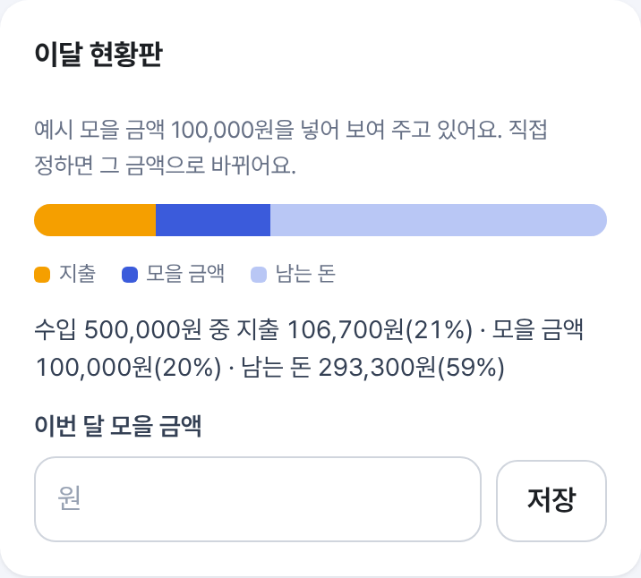
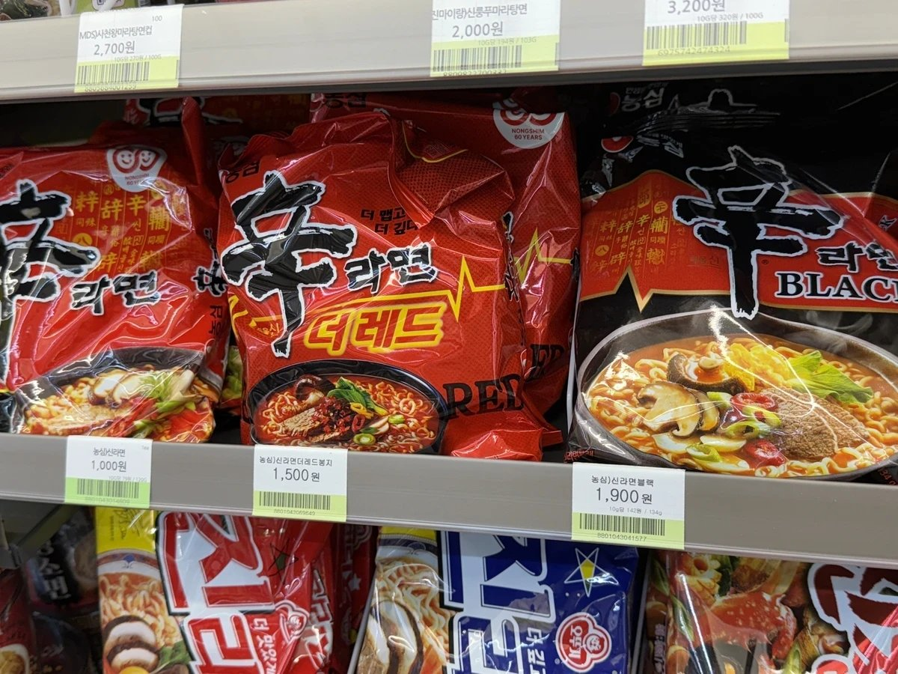
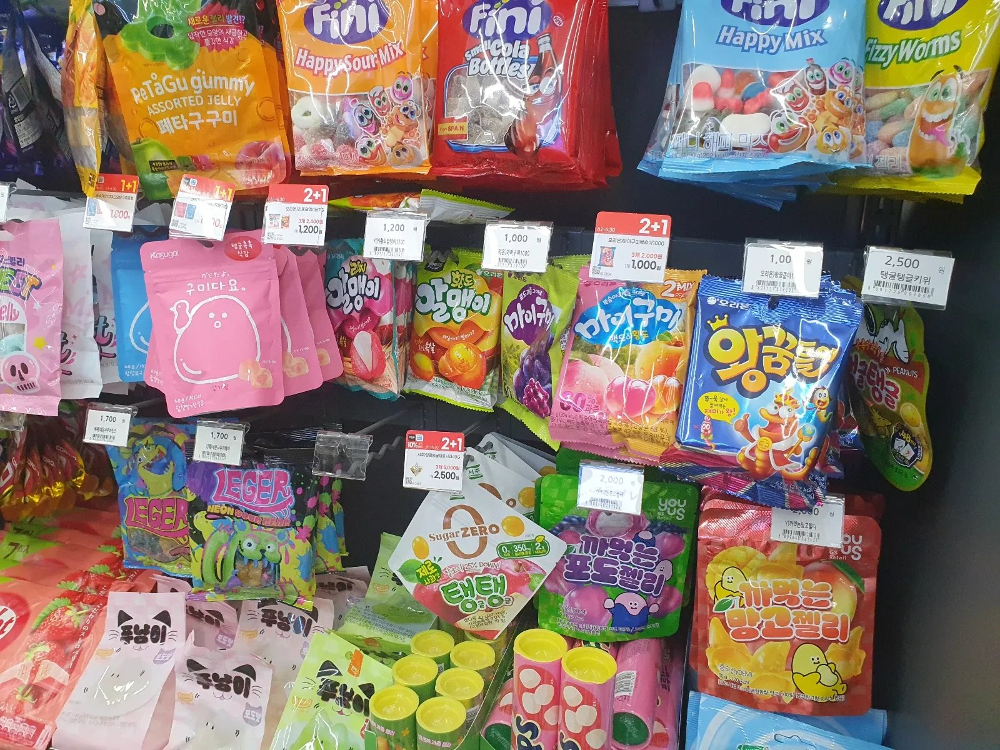

# 살까말까 (Buy or Not)

**사기 전에 한 번 더 생각하고, 산다면 실제로 드는 돈을 비교하는 웹앱**입니다. 물건을 며칠 보류하고, 집에 있는 것과 매달 나가는 돈을 확인한 뒤 직접 결정하도록 돕습니다. 20~30대 자취생을 생각하며 만들었습니다.

**직접 실행:** [1차 실습 과제(v1)](https://lumos0107.github.io/BuyorNot/v1/) · [중간 과제 개선본](https://lumos0107.github.io/BuyorNot/) · [GitHub 커밋 비교](https://github.com/lumos0107/BuyorNot/compare/v1...main)

> 개선본은 공개 사이트에서 실행됩니다. **실시간 사진·음성 AI는 공개 링크에서 사용할 수 없습니다.** 공개 사이트의 사진·음성 버튼은 미리 저장해 둔 결과(사진 3장의 읽기 결과, 준비한 음성 문장)를 다시 보여 줄 뿐이며, 버튼을 눌러도 AI나 마이크를 호출하지 않습니다. 실제 Gemini가 읽은 로컬 화면은 [3장](#3-ai-시연과-검증-범위)에 따로 표시했습니다.

### 한눈에 보기

- **기능:** 1차의 '사기 전에 며칠 고민하기'에 가격 비교 확장, 집에 있는 것·장보기, 가계부(이달 현황판 막대·분류별 지출), 모으기·받을 수 있는 돈을 더했습니다. → [1장](#1-무엇을-만들었고-1차-이후-무엇이-달라졌나)
- **화면:** 휴대폰 하단 메뉴, 잘리지 않는 탭, 큰 숫자 요약 등으로 배치를 다시 짰고, 같은 조건으로 찍은 전후 사진으로 비교합니다. → [실제 화면 전후](#실제-화면-전후)
- **PRD·TODO:** 1차 이후 바뀐 요구사항과 작업 단계(14~38단계)를 표로 대조했습니다. 검증 사례 AC208까지, 자동 테스트 2,014개입니다. → [2장](#2-prd와-todo-리스트를-어떻게-바꿨나)
- **AI:** 로컬에서 Gemini로 가격표를 읽었고, 공개 사이트에서는 **저장된 결과만** 보여 줍니다. → [3장](#3-ai-시연과-검증-범위)
- **스킬·회고:** 직접 만든 스킬 14개의 사용 예, 실제로 잡아낸 실패, 방법론의 장단점과 느낀 점을 정리했습니다. → [4장](#4-스킬을-어떻게-썼나) · [5장](#5-prdtodo로-개발한-방법의-장단점) · [7장](#7-느낀-점과-결론)

## 1. 무엇을 만들었고, 1차 이후 무엇이 달라졌나

비교 기준은 2026-10-13 제출 커밋 `7d64fdc`(태그 `v1`)입니다. 같은 저장소에서 작업을 이어 갔습니다.

| 1차 실습 과제 | 중간 과제에서 추가·개선 |
| --- | --- |
| 사고 싶은 물건의 이름·가격·이유를 적고 며칠 고민 | **빠른 담기:** 이름·가격부터 적고 이유는 나중에 씀. 오늘과 7일 안에 볼 일을 기존 기록에서 보여 줌. 공개 사이트에서는 준비한 문장으로 칸을 채우는 **예시 음성** 버튼 제공(녹음·AI 호출 없음) |
| 질문 6개와 구매 직전 걸리는 점 확인 | **구매 근거 확장:** 집에 같은 물건, 놓을 자리, 할부 총액, 사용 횟수, 대용량 소비 기간, 목표가를 사기 전 한곳에서 확인 |
| 할인·배송비와 묶음 가격을 손으로 비교 | **비교 방법 확장:** 배달 앱의 최종 결제액, 생필품의 이전 가격을 비교. 로컬 AI 서버에서는 가격표·묶음 사진으로 입력 가능. 공개 사이트에서는 차·라면·젤리 진열대 사진 3장의 **저장된** 읽기 결과와 2026-11-02에 확인한 다나와 표시 가격을 보여 줌 |
| 구독 목록과 월·연 요금 | **가계부로 확장:** 수입·지출을 직접 적고 월별 합계를 확인. ‹ › 로 달을 넘기고, 수입을 지출·모을 금액·남는 돈으로 나눈 **이달 현황판 막대**, 분류별 지출 순위, 날짜별 내역, 지난달 대비 지출을 보여 줌. 고정비·공과금·자잘한 지출·30일 결제 달력을 한 탭에 모음 |
| 집에 있는 것과 장보기 기록 없음 | **장보기 연결:** 재고, 먼저 쓸 식재료, 이번 주 집밥 계획과 장보기 초안. 이미 있어서 안 산 일도 기록 |
| 절약·저축 기록 없음 | **모으기:** 참은 구매, 실제 옮긴 돈, 줄어든 고정비를 구분. 받을 수 있는 돈·카드 실적·쿠폰 만료도 기록. 자잘한 지출은 가계부로 이동 |
| 결정과 구매 후 회고 | **산 뒤 확인:** 만족도·반품 기한·환불·되팔기를 기록하고 다음 결정에 참고 |
| 네 메뉴, 물건 화면에서 시작 | **다섯 메뉴, 가격 비교에서 시작.** 네 번째 메뉴는 가계부. 공개 빌드에서는 가격표 사진 예시를 먼저 표시 |
| 화면 위쪽 글자 탭, 선으로 나눈 카드 | **쓰기 편한 배치:** 휴대폰에서는 주요 메뉴를 엄지가 닿는 화면 아래에 아이콘과 함께 고정. 하위 탭은 잘리지 않는 분할 버튼, 긴 가계부에는 구역 바로가기 버튼 줄. 기능·문구는 그대로 |

기능별 조건은 [PRD의 1차 이후 상세 대조](PRD.md#1차-이후-비ai-요구사항-상세-대조)에, 구현·보류 시점은 [TODO 변경 이력](TODO.md#1차-제출본-이후-todo-변경-이력)에 적었습니다. 1차 제출 당시 상태는 [v1 기준점](docs/v1_기준점.md)에서 확인할 수 있습니다.

### 실제 화면 전후

모든 사진은 [1차 제출본](https://lumos0107.github.io/BuyorNot/v1/)과 [개선본](https://lumos0107.github.io/BuyorNot/)을 같은 조건(새 브라우저, 휴대폰 화면 390×844, 2배 해상도)으로 찍었습니다. 전후 사진은 **같은 비율·같은 폭**이라 바로 옆끼리 비교할 수 있습니다. 촬영 스크립트는 [capture.cjs](docs/midterm_compare/capture.cjs), 큰 사진과 설명은 [화면 비교 기록](docs/midterm_compare/README.md)에 있습니다.

| 1차: 물건 담기에서 시작 | 개선본: 가격 비교 → 가격표 사진 예시에서 시작 |
| :---: | :---: |
|  |  |
| 위쪽 메뉴 4개(고민 중인 물건·가격 비교·결정 기록·구독). 처음부터 이유까지 적는 긴 폼 | 아래쪽 메뉴 5개(가격 비교·물건·결정 기록·가계부·모으기). 첫 탭은 **저장된 결과**를 보여 주는 사진 예시이며 사진을 새로 분석하지 않음 |

| 1차: 이유까지 적어야 담김 | 개선본: 이름·가격 두 칸이면 담김 |
| :---: | :---: |
|  |  |
| 사고 싶은 이유를 비우면 담을 수 없음 | 이유·갖고 싶은 정도는 `더 적기 (선택)`. 사진은 `예시 음성 결과 채우기`로 **미리 준비한 문장**을 넣은 모습 |

| 1차: 구독 요금 | 개선본: 가계부 맨 위의 30일 결제 달력 |
| :---: | :---: |
|  |  |
| 구독만 월·연 합계로 정리 | 고정비·공과금·자잘한 지출을 가계부 탭에 모으고 결제일을 달력으로 표시. 제목 아래 버튼으로 각 구역에 바로 이동. 달력의 예시 결제는 저장되지 않음 |

1차에 없던 화면은 다음과 같습니다. 처음 방문하면 입력 전에 **저장되지 않는 예시 금액**이 보이고, 직접 기록하면 사라집니다.

| 새 가계부 요약과 이달 현황판 | 새 모으기·받을 수 있는 돈 |
| :---: | :---: |
| <br> |  |
| 수입·지출을 직접 적고 월별 합계 확인. 수입을 지출·모을 금액·남는 돈으로 나눈 막대로 한 달 현황을 봄 | 참은 구매·옮긴 돈·줄어든 고정비를 구분하고, 받을 수 있는 돈을 위에 둠 |

[물건 탭 첫 화면](docs/midterm_compare/05-wishlist.png)(오늘 확인할 것·상황별 시작 버튼)과 [결제 달력 확대](docs/midterm_compare/09-calendar-current.png)는 화면 비교 기록에서 볼 수 있습니다.

## 2. PRD와 Todo 리스트를 어떻게 바꿨나

[PRD](PRD.md)는 목표·사용자·기능 조건·검증 사례를, [TODO](TODO.md)는 구현 순서·완료 근거·보류 항목을 담습니다.

| 문서 | 1차 제출 때 적은 내용 | 중간 과제에서 바꾸거나 추가한 내용 |
| --- | --- | --- |
| PRD: 무엇을 만들지 | 물건 담기·고민 기간·할인/묶음 비교·결정 기록·구독 정리. 사진 입력과 모으기는 없었음 | 빠른 담기·AI 사진/음성 입력·고정비/결제 달력·장보기·모으기/지원 제도까지 요구사항을 넓힘. AI 결과는 사용자가 고친 뒤 적용하도록 조건을 추가 |
| TODO: 어떤 순서로 만들지 | 1~12단계와 구독 분석 일부를 진행. 물건·비교·결정·구독 구현에 집중 | 14~38단계에서 AI 구현·평가, 생활비·모으기·가계부, 입력 흐름과 공개 예시(저장된 사진 결과·다나와 조회값), 디자인·배치 개선(37단계), 가계부 현황판(38단계)을 순서대로 추가. 실시간 공개 AI 연결과 실기기 확인은 미완료 |

예를 들어 **물건 담기**는 1차 PRD에서 이유를 함께 입력하는 기능이었고, 사용해 보니 입력이 길어서 중간 과제 PRD에서 이름·가격부터 담도록 고쳤습니다. TODO에는 그 변경을 23단계 빠른 담기 작업으로 넣고 테스트·구현했습니다. 반대로 **30일 결제 달력**은 1차에 없었으므로 새 요구사항과 24단계 작업을 함께 추가했습니다.

| 처음 계획 또는 1차 상태 | 개발 중 변경한 내용과 이유 |
| --- | --- |
| 물건을 담을 때 이유까지 입력 | 입력이 길어져 상품명·가격을 먼저 받고 이유는 선택으로 변경 |
| 사진 AI가 없어 직접 비교만 가능 | 로컬 사진·음성 AI와 결과 수정 단계를 추가. 공개 서버 연결이 실패해 서로 다른 진열대 사진 3장의 저장된 결과와 준비한 음성 문장만 다시 보여 주고, 실시간 분석은 보류 |
| 구독을 월·연 요금으로 정리 | 반복 결제의 범위가 넓어 고정비·공과금·정기배송·결제 달력으로 확장 |
| 집밥과 장보기 선택이 따로 있어 중복 | 장보기에서 이번 주 요리 선택을 한곳으로 합침 |
| 구매 전 질문과 구매 후 메모가 따로 있음 | 기존 재고·가격·사용 기록을 사기 전 근거에 모으고, 반품·되팔기까지 구매 후 기록에 연결 |
| 화면 위쪽 글자 탭, 비슷한 모양의 카드와 긴 입력 폼 반복 | 제작자 화면 피드백으로 휴대폰 하단 메뉴·잘리지 않는 하위 탭·비교 입력 2열·결론 강조로 배치를 바꿈. 색은 실제 화면에 입힌 시안 3개(블루·그린·코랄) 중 블루를 고르고, 그라데이션은 보기에 덜 좋아 단색으로 되돌림. 기능·문구는 그대로 |
| 가계부는 달별 합계와 내역만 | 가계부 앱(뱅크샐러드)의 공통 방식을 참고해 달 넘기기·**이달 현황판 막대**(수입을 지출·모을 금액·남는 돈으로)·분류별 지출·날짜별 내역·지난달 비교를 추가. 은행·카드 연동은 이 앱의 '기록은 브라우저에만' 원칙과 맞지 않아 넣지 않음 |
| 백업 판 1과 자동 테스트 532개 | 가계부(달별 모을 금액 포함)까지 담는 백업 판 4(옛 백업 복원 가능), 검증 사례 AC208까지·자동 테스트 2,014개로 확장 |

기능별 **추가·수정·보류 표시**는 [PRD](PRD.md#1차-실습-제출본v1에서-바뀐-요구사항), 작업 단계별 계획과 실제 결과는 [TODO](TODO.md#1차-제출본-이후-todo-변경-이력), 문제와 수정 이유는 [DEVLOG](DEVLOG.md)에 있습니다. 1차 이전에 뺀 무료배송 비교를 중간 과제의 변경으로 세지 않았습니다.

## 3. AI 시연과 검증 범위

### 공개 시연의 한계

**교수님이 공개 링크에서 직접 사진을 올리거나 음성을 녹음해 AI 분석을 시험할 수는 없습니다.** Cloudflare Worker와 Gemini 키를 설정했지만 실제 공개 사진 요청이 상위 서버 오류로 실패했습니다. 호출 한도를 고려해 공개 Worker의 AI를 껐고, 원인 조사는 이후 개선 과제로 남겼습니다. 직접 입력으로 하는 가격 비교와 가계부 등은 정상 사용할 수 있습니다.

공개 화면은 `가격 비교 → 가격표 사진 예시`에서 시작합니다. 처음 열면 첫 사진인 **라면 진열대의 미리 저장된 상품명·사진 가격**이 이미 펼쳐져 있고, 다른 사진 버튼을 누르면 그 사진의 저장된 결과로 바뀝니다. `물건 → 물건 담기 → 예시 음성 결과 채우기`는 미리 준비한 문장(‘무선 헤드폰 8만 원, 통학할 때 쓰려고 해요’)을 폼에 넣습니다. 두 버튼은 Gemini나 마이크를 호출하지 않습니다. 임의의 사진 업로드·음성 녹음·온라인 최저가 자동 조회는 보류 상태입니다.

예시 사진은 서로 다른 진열대 세 장입니다. **차 진열대**는 [Wikimedia Commons의 CC0 차 진열 사진](https://commons.wikimedia.org/wiki/File:Various_Teas_from_South_Korea.jpg)을 잘라 쓴 조정용 자료(`rt01`), **라면 진열대·젤리 진열대**는 제작자가 직접 찍은 사진입니다. 세 장 모두 2026-11-02 로컬 서버에서 실제 Gemini(`gemini-3.5-flash-lite`)에 한 번씩 보내 받은 응답의 상품명·가격·개수를 고치지 않고 옮겼습니다. 젤리 사진에서 Gemini가 가격을 읽지 못한 3개는 값을 채우지 않고 ‘가격표를 읽지 못함’으로 둡니다. 호출 기록은 [AI 평가 기록](docs/ai-eval.md)에 있고, 이 두 장은 정답 파일이 없어 정확도를 재지 않았습니다.

| 라면 진열대 (직접 촬영, 첫 화면) | 차 진열대 (CC0) | 젤리 진열대 (직접 촬영) |
| :---: | :---: | :---: |
|  |  |  |
| 5개 읽음, 다나와 비교 3건 | 6개 읽음, 다나와 비교 4건 | 17개 읽음(3개는 가격 못 읽음), 다나와 비교 3건 |

아래는 차 진열대 사진입니다. 같은 사진을 **① 로컬 앱에서 실제 Gemini로 읽은 화면**과 **② 공개 사이트가 그날 저장한 응답을 다시 보여 주는 화면**으로 나눠 실었습니다. ②는 버튼을 누를 때마다 새로 분석한 결과가 아닙니다.

| ① 로컬 Gemini가 실제로 채운 수정 칸 | ② 공개 사이트: 저장된 읽기 결과 |
| :---: | :---: |
|  |  |
| 2026-11-02 로컬 실행. 첫 상품 **‘샘표순작연근우엉차’·7,100원**이 채워졌고 사용자가 고칠 수 있음 | 같은 날 저장한 응답을 그대로 표시. 서로 다른 차를 한 사진에서 비교한 예시라 최저가·실제 결제액이 아님 |

각 사진의 결과 아래에는 다나와 상품 페이지에서 직접 확인한 **표시 최저가**와 상품 페이지로 가는 `다나와 상품 보기` 버튼을 붙였습니다. 차 진열대 4건(2026-11-02), 라면·젤리 진열대는 낱개(1개) 상품 3건씩(2026-11-03)입니다. 이 가격은 AI가 찾은 값이 아니라 상품 페이지에서 확인한 값이며, 이름·용량이 맞는 상품을 찾지 못한 항목(예: 사진은 100g 컵인데 다나와는 54g인 마라탕면)은 적지 않았습니다. 배송비·쿠폰이 빠진 과거 조회값이고, 사진 속 상품과 포장 수량이 같은지는 구매 전에 다시 확인해야 합니다. 공개 사이트는 다나와를 실시간으로 조회하지 않고, 위 날짜(차 2026-11-02, 라면·젤리 2026-11-03)에 확인해 저장한 가격으로 비교합니다.


### 검증의 한계

같은 조정용 사진 **8장에 실제 요청 8번을 다시 보내 모두 200 응답**을 받았습니다(2026-11-02, `gemini-3.5-flash-lite`). 값 있는 칸은 73/89칸 맞았고, 1칸 틀렸으며 15칸은 못 읽었습니다. 표기 없는 칸 103개 중 11개를 잘못 채웠고 정답에 없는 항목 10개를 더 읽었습니다. **8장 모두 정답 자체가 애매한 부분이 있는 개발용 사진**이므로 이 숫자를 실제 사용 정확도나 일반 성능으로 내세우지 않습니다. 평가 스크립트도 확정 성적으로 인정하지 않아 종료 코드 1을 냈습니다. 범위·한계·기존 실행 기록은 [AI 평가 기록](docs/ai-eval.md)에 있습니다.

로컬에서 AI를 실행하는 방법과 평가 절차는 [AI 평가 실행 안내](eval/README.md)에 있습니다.

## 4. 스킬을 어떻게 썼나

반복 작업을 위해 만든 Claude Code 스킬 14개의 원문은 [.claude/skills/](.claude/skills/)의 각 `SKILL.md`에 있습니다. 아래는 지침 내용과 사용 예입니다.

| 스킬 원문 | 핵심 지침과 이번 작업에서 쓴 곳 |
| --- | --- |
| [updating-prd](.claude/skills/updating-prd/SKILL.md) · [syncing-todo](.claude/skills/syncing-todo/SKILL.md) · [updating-devlog](.claude/skills/updating-devlog/SKILL.md) | 기능과 검증 사례를 연결하고, TODO 완료에 검사·커밋 근거를 남긴다. PRD·TODO·개발 기록의 변경을 맞출 때 사용 |
| [writing-tests-from-spec](.claude/skills/writing-tests-from-spec/SKILL.md) · [checking-before-commit](.claude/skills/checking-before-commit/SKILL.md) | PRD의 입력·기대 결과를 테스트로 옮기고 커밋 전 테스트·타입·린트·문서 참조를 확인 |
| [checking-ui-copy](.claude/skills/checking-ui-copy/SKILL.md) · [simplifying-entry-flows](.claude/skills/simplifying-entry-flows/SKILL.md) | 구매를 권하는 표현을 피하고 새 필수 입력을 늘리기 전에 기존 기록을 활용. 빠른 담기·첫 화면 문구를 정할 때 사용 |
| [adding-ai-endpoint](.claude/skills/adding-ai-endpoint/SKILL.md) · [applying-ai-results](.claude/skills/applying-ai-results/SKILL.md) · [testing-ai-screens](.claude/skills/testing-ai-screens/SKILL.md) | AI 요청·실패를 분리하고, 읽은 값을 확인·수정한 뒤 적용하며 취소·늦은 응답도 점검. 사진·음성·치수 화면에서 사용 |
| [checking-privacy](.claude/skills/checking-privacy/SKILL.md) · [tuning-prompts](.claude/skills/tuning-prompts/SKILL.md) · [evaluating-ai](.claude/skills/evaluating-ai/SKILL.md) | 키·전송 안내를 점검하고, 프롬프트 판과 평가 자료·결과를 구분. AI 서버와 평가 기록에 사용 |
| [consulting-gpt](.claude/skills/consulting-gpt/SKILL.md) | GPT 의견의 질문·답·결정 출처를 남긴다. 기능 계획과 평가 후 수정안을 대조할 때 사용 |

직접 만든 이유는 **같은 종류의 누락을 반복하지 않기 위해서**입니다. 스킬별 제작·시험 기록은 [스킬 설명](.claude/skills/README.md)에 있습니다.

### 스킬이 실제로 잡아낸 것

| 상황 | 쓴 스킬 | 결과 |
| --- | --- | --- |
| 하단 메뉴로 디자인을 바꾸며 기존 CSS 규칙의 선택자를 고침 | `checking-before-commit` | 커밋 전 전체 시험에서 '좁은 화면 메뉴 44px' 검증 사례(AC98)가 실패해, 기존 규칙은 두고 새 규칙의 우선순위를 올리는 방식으로 고친 뒤 커밋 |
| 가계부에 분류별 지출을 추가 | `writing-tests-from-spec` · `updating-prd` · `checking-before-commit` | 명세(AC203~AC208)를 먼저 적고 시험을 써서 실패를 확인한 뒤 구현. 전체 시험에서 다른 화면 시험이 같은 금액 글자와 겹치는 문제를 찾아 시험 범위를 바로잡음 |
| AI 사진 화면 평가 | `testing-ai-screens` | 브라우저에 남은 모의 응답을 실제 AI 결과로 착각한 일을 발견. 이후 시작 전 응답 상태 확인, 서버 로그 대조, 끝난 뒤 정리 절차를 스킬에 추가 |
| PRD에 결정을 쌓아 가는 동안 | `updating-prd` · `syncing-todo` | '제작자 확인 전' 결정, 버전 번호, 검증 사례 끝 번호가 어긋나면 검사가 실패하도록 해 문서끼리 서로 맞춤 |

### 스킬을 써 보며 알게 된 점

스킬은 **반복해서 빠뜨리던 점을 작업 전에 확인하게 하는 체크리스트**로 쓸 때 가장 도움이 됐습니다. 기능이 늘어날수록 이전 결정을 찾아 다시 적용하기 쉬워졌고, 위 표처럼 커밋 전에 실패를 잡아 공개 사이트로 나가기 전에 고칠 수 있었습니다.

반대로 스킬도 틀릴 수 있었습니다. 브라우저 정리 절차에 잘못된 설명이 있었고, 잘못된 지침은 여러 작업에 그대로 반복됩니다. 그래서 스킬도 시험하고 고쳐야 했습니다. 같은 작업을 스킬 없이 한 번, 스킬과 함께 한 번 해 본 비교에서는 `testing-ai-screens`가 일부러 넣은 버그를 18개 중 16개에서 22개 중 20개로 더 찾았습니다. 하지만 토큰과 시간이 조금 더 들었고 비교는 한 번씩이라, 효과를 일반화하지는 않습니다.

## 5. PRD·TODO로 개발한 방법의 장단점

PRD에는 무엇을 만들지, TODO에는 어떤 순서로 확인할지를 먼저 적고 Claude에게 구현을 요청했습니다. 저는 범위와 방향을 정하고 실제 화면을 확인했습니다. 일부 결정과 검토는 GPT와 상의하고 [개발 기록](DEVLOG.md)에 남겼습니다.

**좋았던 점:** 기능을 말로 설명한 뒤에도 PRD의 조건과 TODO의 작업 단위가 기준이 되어 구현을 이어 갈 수 있었습니다. 새 기능을 넣을 때 기존 기능과 연결할 곳을 찾기 쉬웠고, 나중에 왜 바꿨는지도 기록에서 확인할 수 있었습니다. 검증 사례에 입력과 기대 결과를 먼저 적고 테스트로 옮기니 수정할 때 이전 동작이 깨지는지 살필 수 있었습니다. 1차 이후에도 같은 저장소에서 커밋을 쌓아 실제 변경 시점을 되짚을 수 있었습니다.

**어려웠던 점:** 요구사항이 쌓이면서 화면이 복잡해졌습니다. 기능은 늘었는데 화면이 보기 좋지 않다는 피드백을 받고 나서야 하단 메뉴·색감·배치를 따로 다듬었습니다. 물건 등록에 질문을 늘린 뒤 다시 빠른 담기로 줄이고, 장보기에서 겹친 선택을 하나로 합친 것이 그 예입니다. 디자인 기준을 충분히 적지 않아 비슷한 카드와 긴 입력 폼이 반복됐습니다. TODO의 자동 테스트가 통과해도 모바일 화면의 배치나 실제 AI 호출이 맞는지는 별도로 확인해야 했습니다.

| 보완해 본 방법 | 도움이 된 점 | 함께 든 비용 |
| --- | --- | --- |
| 기능마다 검증 사례를 적고 테스트로 옮기기 | 바뀐 입력·계산이 다른 기능에 미치는 영향을 빨리 확인 | PRD와 테스트가 길어져 화면 변경 때 같이 고쳐야 함 |
| 새 기능 뒤 모바일 화면 캡처를 보고 다시 줄이기 | 빠른 담기와 장보기 선택 통합처럼 사용 흐름을 단순하게 만듦 | 구현 뒤 다시 손보는 시간이 듦 |
| GPT 검토 의견과 제작자 결정을 구분해 기록 | 왜 수정했는지 되돌아볼 수 있음 | 문서가 길어지고 발표용 요약을 따로 정리해야 함 |
| 디자인을 말로 정하지 않고 실제 화면에 시안을 입혀 비교 | 색감처럼 취향이 갈리는 결정을 사진 세 장으로 빨리 고름. 그라데이션처럼 해 보고 아닌 것도 바로 되돌림 | 시안마다 화면 캡처와 README 사진을 다시 만들어야 함 |

## 6. 개선이 필요한 점

**서비스:** 실제 사용자를 대상으로 효과를 확인하지 못했습니다. ‘며칠 고민하면 구매 욕구가 줄어드는가’는 자동 테스트로 답할 수 없습니다. 알림이 없어서 고민 기간이나 결제일이 와도 사용자가 앱을 다시 열어야 하고, 기록이 브라우저에만 있어 다른 기기에서는 백업 파일로 옮겨야 합니다. 구독 사용량도 넷플릭스 시청 기록 파일 가져오기를 제외하면 직접 적는 부분이 많습니다.

**개발 방법:** 새 기능을 넣기 전에 기존 화면에서 무엇을 줄일지도 정하고, 작은 화면의 실제 캡처를 TODO 확인 항목에 넣겠습니다. 디자인 방향을 색과 카드 모양뿐 아니라 정보의 순서와 펼침 상태까지 PRD에 적겠습니다. AI는 모의 응답 테스트와 실제 서버 호출을 구분해 기록하고, 새 사진·녹음과 다른 사용자로 다시 확인하겠습니다. 공개 배포까지 끝나지 않은 기능은 README와 화면에서 작동 범위를 분명히 표시하겠습니다.

## 7. 느낀 점과 결론

결국 1차의 ‘사기 전에 생각하기’에서 한 걸음 더 나아가 가격·집에 있는 것·매달 나가는 돈까지 함께 살피는 앱이 됐습니다. 바이브 코딩으로 짧은 기간에 넓은 범위를 만들 수 있었지만, 기능을 더하는 일만큼 덜어 내고 직접 검증하는 일이 중요했습니다. 다음에는 자취생이 1~2주 써 보며 실제로 충동구매와 지출 판단에 도움이 되는지 확인하고 싶습니다.

1차 이후 가장 크게 달라진 제 작업은 기능을 나열하는 것에서 그 기능이 실제 사용자에게 어떻게 보이고 작동하는지 확인하는 쪽으로 옮겨 간 것입니다. 마지막에는 화면이 보기 좋지 않다는 점을 받아들여, 색을 말로 정하지 않고 실제 화면에 시안 세 개를 입혀 고르고, 가계부 앱을 참고해 숫자를 먼저 보여 주는 화면으로 바꿨습니다. 자동 테스트가 통과했는데도 공개 사이트에는 AI 탭이 없고, 요약 카드가 길어서 달력을 보기 어려웠습니다. 이번처럼 화면을 직접 보고 PRD·TODO와 대조해야 ‘완료’가 무엇인지 더 정확히 말할 수 있다는 것을 배웠습니다.

## 8. 실행과 공개 상태

React · TypeScript · Vite · Vitest · 브라우저 `localStorage`로 만들었습니다. Node.js 24.15 이상에서 실행합니다.

```bash
npm ci
npm run dev
npm test -- --testTimeout=20000
npm run build
```

개발 주소는 `http://localhost:5173/BuyorNot/`입니다. 코드는 [Public 저장소](https://github.com/lumos0107/BuyorNot)에 있으며 `main`을 push하면 GitHub Actions가 검사·빌드·Pages 배포를 수행합니다. 1차(`v1`) 이후 커밋은 2026-11-02 디자인·가계부 개선을 반영한 이 README 갱신 직전까지 **277개**이며, [커밋 비교](https://github.com/lumos0107/BuyorNot/compare/v1...main)에서 확인할 수 있습니다. 다만 중간 과제 개발 중에는 로컬 브랜치에서 작업한 뒤 11월 2일에 원격으로 올렸으므로, 그 기간에 일정한 간격으로 push했다고 주장하지 않습니다. 기록은 사용하는 브라우저에만 남아 다른 기기와 자동 동기화되지 않습니다.

다른 개발 환경에서 이어서 작업할 때는 [클라우드 세션 인계](docs/handoff/클라우드_이어받기_2026-11-02.md)를 먼저 읽어 주세요.

제작: 강승준
