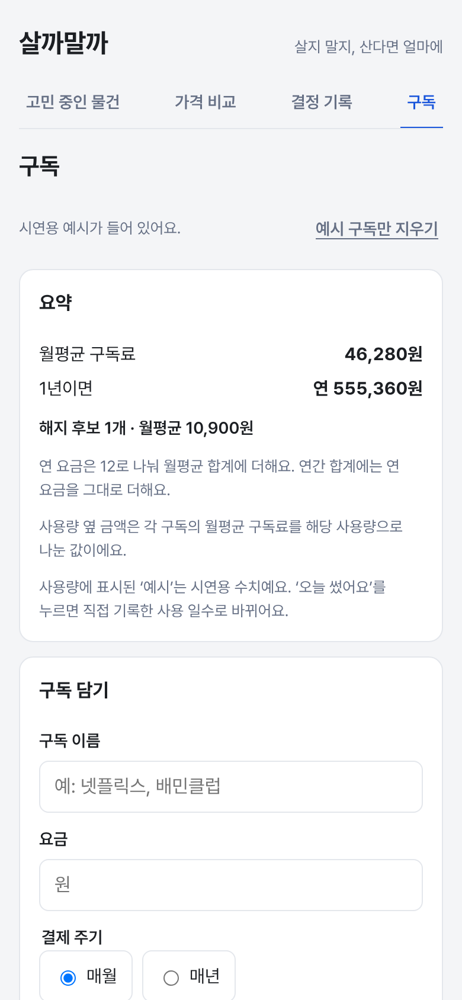
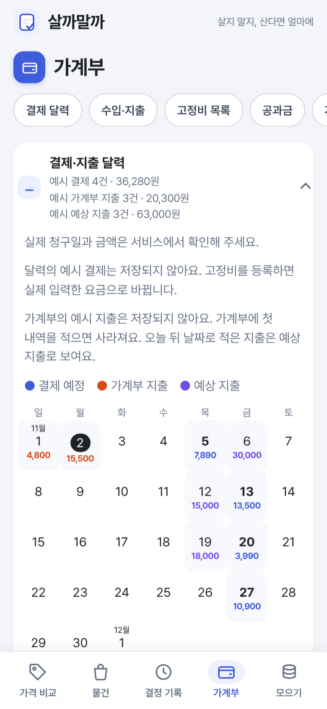

# 살까말까 개발 Todo

기준: [PRD v1.04](./PRD.md)
제작자: 강승준  
목표일: 2026-10-17  
상태: 1차 실습 제출본(v1)은 2026-10-13 완료. 중간 과제 작업본은 14\~35단계 구현·자동 검사 완료(`saving`·`main` 브랜치, GitHub Pages 배포 완료). 36단계는 제출용 README 사진·문서 대조, 37단계는 기능을 유지한 디자인·배치 개선, 38단계는 가계부 앱을 참고한 가계부 보기(F84). 13-4\~13-7 구독 분석과 제작자 판정·실기기 확인·AI 서버 배포는 남아 있음.
역할: 개발 Claude · 검토 GPT(2026-10-11 13단계부터 제작자 지시로 검토 중단. 2026-11-02 정정: 10/13 목적 점검부터 다시 상의했고, 중간 과제에서는 GPT 33\~53번으로 결정·명세·계획을 상의했다)

## 한눈에 보기

| 단계 | 내용 | 상태 |
| --- | --- | --- |
| 1\~6 | 필수(1차): 화면 틀·자동 배포, 묶음 비교, 할인 비교, 고민·결정 기록, 발표 문서, 최종 점검 | 완료 |
| 7\~12 | 확장(2차): 연장·메모·필터, 무료배송 비교(10/13 화면에서 뺌), 질문·링크·알림, 기록 요약·회고, 구독 정리함, 통합 검증 | 완료 |
| 3·4차 | 보강: 사기 전 점검·되돌리기·백업, 고민 노트, 담기 폼 줄이기, 보안 점검, 사용량 직접 적기 (아래 "3·4차 추가 작업") | 완료 |
| 13 · 13A | 보강: 구독 이용 분석(넷플릭스 기록 가져오기 완료, 13-4\~13-7 남음) · 카드·담기 폼 체크리스트 | 진행 중 · 완료 |
| 14 | 중간 과제 AI 1단계: 가격표 사진 → 온라인 가격 확인(F31), 사진으로 묶음 비교 채우기(F32), 말로 담기(F33), 고민 끝나는 날 캘린더(F35), AI 서버, 평가 | 구현 완료(배포·실제 자료 평가는 제작자) |
| 15 | 중간 과제 AI 1단계 이어서: AI 성적표(F43), 놓을 자리 확인(F44) | 구현 완료(배포·실제 자료 평가는 제작자) |
| 16 | 평가 1회차 개선: 담은 직후 새 카드(F24), 치수 읽기 문구·캡처 크게 보기(F44), 사진 초안 옛 링크(F31), 결과 화면 문구(F31·F32·F06), README 사실 정정·스킬 장 | 16-1\~16-5 완료(16-6·16-7은 제작자) |
| 17 | 평가 2회차 개선: Gemini 제한·키 없음 구분(AI 공통·F43), F32·F44 확인 상자 설명과 F32 'AI가 읽은 내용', 구매함 직후 회고 한 줄(F18), 첫 화면 설명 문장(F24), testing-ai-screens 규칙, 문서·배포 계획 보정, 전체 리뷰 뒤 최종 수정(F24) | 17-1\~17-6·17-8 완료(17-7은 제작자) |
| 18 | 절약·저축 1a: 고정비 정리함(F45)·무료 체험 끝나는 날(F46)·해지했어요(F47)·모으기(F48)·주요 메뉴 다섯 개(F49)·백업 v2(F20) | 구현 완료(제작자 판정 대기) |
| 19 | 절약·저축 1b: 정기배송 주마다·요금 바뀜·겹침·약정·공과금·체험 캘린더 | 구현 완료(제작자 판정·화면 확인 대기) |
| 20 | 절약·저축 2단계: 집에 있는 것·식재료·산 값·해 먹는 것·작은 지출·배달 비교 | 구현 완료(제작자 판정·화면 확인 대기) |
| 21 | 절약·저축 3단계: 할부·사용 빈도·중복·대용량·목표가·반품·되팔기 | 구현 완료(제작자 판정·화면 확인 대기) |
| 22 | 절약·저축 4단계: 지원 제도·카드 실적·포인트·쿠폰 만료·친구 정산 | 구현 완료(제작자 판정·화면 확인 대기) |
| 23 | 사용 흐름 개선: 오늘 확인할 것·빠른 물건 담기 | 구현 완료(제작자 판정·화면 확인 대기, `saving` 브랜치) |
| 24 | 추가 기능: 30일 결제 달력·장보기 초안 | 구현 완료(제작자 판정·화면 확인 대기, `saving` 브랜치) |
| 25 | 이번 주 집밥 계획·정기배송 중복 확인 | 구현 완료(제작자 화면 확인 대기) |
| 26 | 작은 지출 한 번 덜 쓰기·사기 전 근거 요약 | 구현 완료(제작자 화면 확인 대기) |
| 27 | 결제 전 사용 확인·상황별 시작 | 구현 완료(제작자 화면 확인 대기) |
| 28 | 작은 지출 한 주 시도 선택·유지 | 구현 완료(제작자 화면 확인 대기) |
| 29 | 가격 비교·사진을 첫 화면으로 | 구현 완료, 제작자 실기기 확인 대기 |
| 30 | 장보기 선택 한곳으로 | 구현 완료, 제작자 화면 확인 대기 |
| 31 | 물건 카드에서 사기 전 확인 | 구현 완료, 제작자 화면 확인 대기 |
| 32 | 고정비·모으기 화면 정리와 발표 비교 사진·문서 | 구현 완료, 제작자 실기기 확인 대기 |
| 33 | 가계부와 생활비 기록 통합 | 구현 완료, 제작자 화면 확인 대기 |
| 34 | 공개 AI 예시(저장된 사진 결과·예시 음성 문장)와 화면 순서 | 완료(배포 #41) |
| 35 | 가격표 사진 예시 첫 화면·다나와 조회값 | 완료(배포 #44) |
| 36 | 중간 과제 제출용 README 사진·문서와 공개 화면 대조 | 아래 36단계 참고 |
| 37 | 기능을 유지한 디자인·배치 개선(하단 메뉴·분할 탭·가계부 바로가기·블루 색감) | 완료·배포(#48), 실기기 확인 대기 |
| 38 | 가계부 보기: 달 이동·세 칸 요약·이달 현황판·분류별 지출·날짜별 내역·지난달 비교(F84) | 완료·배포(#48) |
| 39 | 가격표 사진 예시를 라면·차·젤리 진열대 서로 다른 사진 세 장으로(F83, 라면·젤리는 실제 Gemini 응답, 첫 화면 라면) | 완료·배포(#53) |
| 40 | 물건 분류 아이콘: 취미·식비 등을 골라 카드 표식을 아이콘으로(F85) | 완료 |
| 41 | 결제·지출 달력: 가계부 지출을 다른 색 금액으로, 날짜 숫자 위·금액 아래(F74 보강), 가계부 요약에 이번 달 모을 금액 칸(F84 보강) | 완료 |
| 42 | 가계부 예시(쓴 돈·예상 지출·모을 금액)와 달력의 예상 지출, 요약 네 칸 높이, README 버전 주소 표(F84·F74 보강) | 완료 |
| 43 | 문서 읽기 쉽게: PRD 맨 위에 바뀐 요구사항 표, 개정 이력은 맨 아래, `~` 취소선 고침, README 2·7장 | 완료 |
| 44 | 빈 화면 예시: 물건·결정 기록 예시 줄, 모으기 요약 예시 금액(F82 보강) | 완료 |
| 45 | 주요 메뉴 네 개(가계부·물건·장보기·모으기)와 첫 화면 가계부, 접어 둘 것 정리(F86) | 완료 |
| 46 | 공개 AI 서버 연결: Worker를 미국 GCP 지역에 고정해 다시 배포, 사진 읽기·다나와 자동 조회 켬(F31·F83) | 완료, 한국 휴대폰 확인 대기 |

남은 일: 13-4\~13-7, 29\~31단계 제작자 화면 판정, 스마트폰 실기기 확인, 발표 연습(중간 과제 발표 날짜는 마감에 따라). (제작자) Cloudflare 계정·서버 배포(14-17·15-8), 실제 자료 정확도 평가 자료 확인(14-16·15-7), 다나와 자동 조회를 켤지, 사진 대기 60초 확인(PRD v0.25), 중간 과제 마감 확인, PRD 제작자 확인 전 결정과 판정표 확인([판정표](./docs/평가/판정표.md)의 '꼭 볼 줄'부터, 16-6·17-7·18-8), README 학생 서술 칸(16-7).

## 1차 제출본 이후 Todo 변경 이력

기준은 2026-10-13 `v1` 커밋 `7d64fdc`의 Todo다. 그때는 1\~12단계와 보강 작업을 마쳤고, 13단계 구독 이용 분석 중 13-4\~13-7이 남아 있었다. 이 표의 완료는 **코드·자동 검사 완료**를 뜻하며, 제작자 판정·실제 스마트폰 시험·배포 완료와 구분한다.

**표 읽는 법:** 왼쪽은 1차에서 하던 작업, 오른쪽은 이후 실제로 계획을 어떻게 바꾸었는지다. 새 번호가 붙었다고 모두 새 화면은 아니다. 테스트 후 수정과 문서 작업도 포함한다.

| 1차 TODO의 작업 | 이후에 붙인 작업 | 지금 확인할 수 있는 결과 |
| --- | --- | --- |
| 물건 등록·고민·결정(1\~4·7\~10단계) | 빠른 담기·오늘 확인할 것·사기 전 근거(21·23·26·27·29\~31단계) | 두 칸 빠른 담기, 물건 카드에서 근거 요약으로 이동 |
| 할인·묶음 숫자 비교(2\~3단계) | 사진·음성 AI 입력과 평가 후 수정(14\~17단계), 배달 비교(20단계) | 직접 비교는 공개 사이트에서 사용 가능. AI는 로컬 서버에서만 시연했고 공개 배포는 남음 |
| 구독 요금·사용량 정리(11·13단계) | 고정비·공과금·정기배송·30일 결제 달력(18\~19·24\~25단계) | 결제 예정과 여러 종류의 반복 지출을 함께 표시 |
| 집 재고·모으기 작업 없음 | 재고·장보기·집밥·작은 지출·모으기·지원 제도(18\~22·25\~28단계) | 기존 기록과 새 지출 기록을 연결. 실제 옮긴 돈은 별도로 표시 |
| 백업 판 1과 통합 검사(12단계) | 백업 판 3과 늘어난 기록의 테스트(18\~31단계) | 옛 백업 복원 시험 완료. 스마트폰 실기기 확인은 남음 |

2026-11-02 추가 화면 피드백은 32단계에 반영했다. 고정비 요약을 줄이고 달력을 기본으로 펼치며, 모으기에서는 지원 제도를 위로 옮기고 입력 카드 두 개를 접는다. 발표 자료에서는 실제 화면 사진의 비율을 유지하고 1차와 개선본의 차이를 바로 옆에 쓴다.

| 시기·작업 | v1 계획에서 달라진 내용 | 지금 상태와 근거 |
| --- | --- | --- |
| 10/27\~10/31, 14\~17단계 | 중간 과제용 AI 입력·가격표 사진·묶음 사진·음성·치수 읽기·캘린더·평가 도구를 새로 추가. 평가에서 치수 읽기 실패·결과 설명·포커스 문제를 찾아 다시 고침 | `ai-stage1`에서 구현·평가. AI 서버 배포와 실제 자료 정확도 평가는 남음 |
| 11/01\~11/02, 18\~22단계 | 1차의 구독 정리에서 생활비 전체로 범위를 넓혀 고정비·집 재고·작은 지출·사기 전 입력·모으기·지원 제도를 추가. 백업도 판 1에서 판 3으로 확장 | `saving`에 구현, 옛 백업 호환 시험 완료. 제작자 판정 대기 |
| 11/02, 23\~28단계 | 오늘 확인할 것, 두 칸 빠른 담기, 30일 결제 달력, 임시 장보기, 이번 주 집밥, 한 주 작은 지출 시도를 새로 추가 | 기존 기록을 이용하고 새 필수 입력을 최소화. 자동 시험 완료 |
| 11/02, 29\~31단계 | 가격 비교·사진을 첫 화면으로 변경. 장보기의 겹친 요리 선택을 하나로 합침. 물건 카드에서 사기 전 요약으로 바로 이동하도록 변경 | AC195\~AC202 구현, 전체 1990개 자동 테스트 통과. 실기기·제작자 화면 확인 대기 |
| 11/02, 45단계 | 기능이 늘어 탭이 길어지자 다섯 탭을 실제 화면으로 재고 주요 메뉴를 네 개로 줄임. 첫 화면을 가격 비교에서 가계부로 되돌리고, 결정 기록은 물건 안으로, 집에 있는 것은 장보기로 옮기고, 상황별 시작 버튼을 뺌 | AC217\~AC223 구현, 가계부 6.1화면 → 3.9화면(390px, 빈 저장소) |
| 계속 보류 | 1차에 남았던 구독 분석 13-4\~13-7은 완료로 바꾸지 않음. AI 서버 공개 배포와 실제 자료 정확도 평가도 미완료 | 미완료 항목은 체크박스 `[ ]` 유지 |
| 11/02, 발표 문서 정리 | README를 1차 이후의 추가·개선과 최신 화면 중심으로 줄이고, 비AI 기능 상세 대조는 PRD v0.82에 기록. 조정용 사진 8장을 실제 Gemini로 재호출하고 결과·한계를 AI 평가 기록에 추가 | 공개 AI 서버 배포와 새 실제 자료 정확도 평가는 여전히 미완료. 최신 로컬 AI 응답 화면은 별도 캡처 |

초기 계획의 무료배송 비교 탭 제거는 **v1 제출 전인 10/13**에 일어난 변경이다. 중간 과제의 새 변경과 혼동하지 않도록 기준 시점을 표시했다. 요청·시험 결과·수정 이유의 상세 기록은 [DEVLOG](./DEVLOG.md)와 [PRD](./PRD.md)에 있다.

**1차 이후 추가·변경 표시:** 아래 14\~31단계는 v1 제출 후 새로 계획한 작업이다. 1\~12단계와 13-1\~13-3은 1차 기록이며 완료 상태를 소급해 바꾸지 않는다. v1 당시 체크박스는 195개 중 191개 완료였고, 2026-11-02 36단계 추가 전에는 325개 중 300개 완료였다. 늘어난 130개에는 새 기능뿐 아니라 평가·수정·배포 확인 작업도 들어 있으므로 130개를 모두 새 기능 수로 해석하지 않는다.

| 표시 | 1차 이후 Todo가 바뀐 방식 | 해당 단계 |
| --- | --- | --- |
| **[새로 추가]** | 사진·음성 입력과 AI 결과 확인, 놓을 자리 치수 읽기, 평가 도구 | 14\~15단계 |
| **[시험 후 수정]** | 평가에서 확인한 실패·문구·포커스·모의 응답 혼동을 바로잡음 | 16\~17단계 |
| **[새로 추가]** | 구독에서 고정비·장보기·작은 지출·모으기로 범위 확장 | 18\~22단계 |
| **[화면 흐름 수정]** | 빠른 담기·결제 달력·집밥·사기 전 요약을 추가하고 겹친 장보기 선택을 합침 | 23\~31단계 |
| **[그대로 보류]** | 1차 때 남은 구독 분석과 AI 서버 배포·실기기 검증은 완료 표시하지 않음 | 13-4\~13-7, 14-17, 15-8 등 |

**화면 전후:** 같은 예시 구독 기록에서 1차의 ‘구독’이 개선본의 ‘고정비’로 확장되고 30일 결제 달력이 붙었다. [화면 비교 전체](./docs/midterm_compare/README.md)에서 첫 화면·빠른 담기도 볼 수 있다.

| 1차: 구독 요약 | 중간 과제: 고정비 요약·결제 달력 |
| :---: | :---: |
|  |  |

일정: 각 단계의 "예정"은 계획 당시 날짜다. 실제로는 1\~13단계와 3·4차 작업을 모두 2026-10-11에 진행했다(커밋 날짜 기준).

단계를 나눈 기준:

- 한 단계 = 눈으로 확인할 수 있는 기능 하나. 단계마다 "사용자 확인 방법"을 숫자까지 정해 두고, 제작자가 확인한 뒤 다음 단계로 넘어간다.
- 틀과 자동 배포를 먼저(1단계). 이후 단계마다 배포 링크로 바로 확인한다.
- 필수 기능을 먼저 끝내고 확장. 1\~6단계로 1차 필수 기능만으로 제출할 수 있는 상태를 만든 뒤 7\~12단계에서 2차 기능을 더한다. 2차는 늦어지면 구독(11단계)부터 미루도록 중요한 순서로 놓는다.
- 단계 안의 순서: 계산 규칙(테스트 먼저) → 화면 → 검증 → 커밋.

## 계획의 기준과 열린 질문

확정 범위는 간단한 숙려 리스트, 묶음상품 비교, 할인 비교다. React·TypeScript·Vite로 화면을 만들고 Vitest로 계산과 시각 규칙을 검증한다. 숙려 기록은 localStorage에 저장한다. 날짜는 최신 PRD #9를 따른다.

디자인은 기능 검증용 프로토타입으로 시작한다. 기본 입력창·버튼·결과 카드와 모바일 한 열 배치만 마련하고 기능 구현을 우선한다. 색상·아이콘·장식의 완성도 작업은 핵심 기능이 작동한 뒤 검토하며, 계산·저장 구현을 기다리게 하지 않는다. 읽기 쉬운 글자, 입력 레이블, 포커스 표시와 모바일 사용성은 유지한다. 결과물은 웹사이트 링크로 제출한다. 1단계에서 GitHub Pages 자동 배포를 설정하고, 이후 단계마다 push 후 배포 링크(https://lumos0107.github.io/BuyorNot/)로 결과를 확인한다. 개발 중 모바일 화면은 PC 브라우저의 개발자 도구로 확인하고, 단계가 끝날 때 실제 스마트폰으로 배포 링크를 연다.

이전 문서에서 완료된 이름·제작자·대상·기능 범위·기술 확정과 원격 저장소 연결 확인은 유지한다. 아래 체크박스는 앞으로 수행할 작업과 확인만 나타낸다. Public 설정과 기획 문서 push는 2026-10-11에 확인했다(1-1\~1-3).

## 진행과 승인 규칙

- 이 문서는 계획 제안으로 시작했고, 2026-10-11 제작자 승인 뒤 진행했다. 승인 전에는 코드 작성이나 개발 환경 설치를 시작하지 않았다.
- 승인 후에는 한 단계씩 진행한다. 각 단계가 끝나면 완료한 작업 번호, 눈으로 볼 결과, 검증 결과, commit·push 상태를 보고한다.
- 사용자가 결과를 확인하고 다음 단계 진행을 허용한 뒤에 다음 단계로 넘어간다. 답이 없으면 승인으로 간주하지 않는다.
- 예시 보고: “2-1부터 2-11까지 완료했습니다. 묶음상품 비교 화면과 계산 결과를 확인해 주세요.”
- 단계별 검증 후 commit하고 push한다. 긴 단계는 실행 가능한 작은 작업 묶음으로 나눠 중간 push도 남긴다. 완성 후 한꺼번에 올리지 않는다. (PRD #8)
- 구현 작업은 구현과 관련 검증을 끝낸 뒤 체크한다. 검증·commit·push는 각각 실제 수행을 확인한 뒤 체크한다.
- 기존 번호는 실행 중 임의로 바꾸지 않는다. 추가 작업이 승인되면 해당 단계의 마지막 번호 다음에 붙인다.
- 작업마다 AI 요청, 결과, 발견한 오류, 수정 이유, 검증 결과와 커밋 식별자를 기록한다. (PRD #8)
- PRD가 바뀌면 영향을 받는 작업을 먼저 갱신하고 변경 계획을 확인받는다.
- 선택 기능과 범위 밖 기능을 자동으로 다음 작업에 추가하지 않는다.

## PRD 참조 읽는 법

각 작업 끝에 근거를 표시한다. #번호는 PRD의 장 번호, F01\~F06은 #5, F07\~F28은 #10의 기능 요구사항, AC01\~AC17은 #7, AC18\~AC47은 #11의 검증 사례다.

용어: 2026-10-11부터 '숙려'를 '고민'으로 바꿨다(숙려 리스트 → 고민 목록). 아래 지난 작업 문장은 당시 표현 그대로 둔다.

| 참조 | 내용 |
| --- | --- |
| PRD #1 | 서비스 대상과 모바일 우선 디자인 |
| PRD #3 | 필수·선택·제외 범위 |
| PRD #4 | 화면과 사용자 흐름 |
| PRD F01 / F02 / F03 | 상품 관리 / 고민·결정 / 결정 기록 |
| PRD F04 / F05 / F06 | 할인 비교 / 묶음상품 비교 / 저장·사용성 |
| PRD #6 | 상품 데이터와 저장 구조 |
| PRD AC01\~AC17 | 구체적인 기대 결과 |
| PRD #8 / #9 | 기술·GitHub·발표 산출물 / 완성 기준 |
| PRD #10 / #11 | 확장 기능(F07\~F28) / 확장 검증 사례(AC18\~AC47) |

## 1단계 기능 검증용 모바일 프로토타입

예정: 10/11\~10/12. 일정은 단계별 사용자 확인 시간에 따라 조정한다.

**단계 목표:** 기본 입력창·버튼·결과 카드로 구성한 모바일 프로토타입에서 세 메뉴와 두 비교 탭을 이동할 수 있다.

기본 스타일로 기능을 연결할 자리를 만든다. 시각적 장식이나 브랜드 디자인에 시간을 쓰지 않는다. 계산·저장이 연결되지 않은 화면은 예시임을 표시하고 실제 데이터가 저장됐다고 표시하지 않는다.

- [x] **1-1** GitHub 저장소의 Public 설정을 확인한다. (PRD #8)
- [x] **1-2** 기획 문서 변경을 commit한다. (PRD #8)
- [x] **1-3** 기획 문서 커밋을 원격 저장소에 push한다. (PRD #8) — `d7cafad`, 원격 main과 일치 확인
- [x] **1-4** React·TypeScript·Vite 개발 환경을 구성하고 `.gitignore`에 node_modules·dist를 제외한다. Vite 골격은 빈 임시 폴더에서 만든 뒤 필요한 파일만 옮겨, 기존 README·PRD·TODO·docs/를 덮어쓰지 않는다. (PRD #8)
- [x] **1-5** 개발 실행 명령을 설정한다. (PRD #8)
- [x] **1-6** 빌드 명령, Vite `base`(`/BuyorNot/`), GitHub Pages 배포 워크플로를 설정한다. (PRD #8)
- [x] **1-7** 고민 중인 물건·가격 비교·결정 기록 메뉴를 만든다. 새로고침 404를 피하도록 화면 전환은 React 상태로 처리한다. (PRD #4, #8)
- [x] **1-8** 할인 비교·묶음상품 비교 탭을 만든다. (PRD #4)
- [x] **1-9** 레이블과 포커스 표시가 있는 공통 입력 컴포넌트를 만든다. (PRD F06, #8)
- [x] **1-10** 키보드로 조작할 수 있는 공통 버튼을 만든다. (PRD F06)
- [x] **1-11** 상품 등록 폼의 화면을 배치한다. (PRD F01)
- [x] **1-12** 상품 카드와 상세 화면의 예시를 배치한다. (PRD #4)
- [x] **1-13** 결정 기록 화면의 예시를 배치한다. (PRD F03)
- [x] **1-14** 목록이 비어 있을 때의 안내를 만든다. (PRD #4)
- [x] **1-15** 묶음상품 A·B 입력 화면을 배치한다. (PRD F05)
- [x] **1-16** 할인 조건 A·B 입력 화면을 배치한다. (PRD F04)
- [x] **1-17** 비교 결과 카드의 예시를 배치한다. (PRD #4, #8)
- [x] **1-18** 모바일 한 열 배치를 적용한다. (PRD #1 디자인 방향)
- [x] **1-19** PC 화면에서 읽을 수 있는 배치를 적용한다. (PRD F06)
- [x] **1-20** 개발 서버 실행과 로컬 빌드(`npm run build`) 성공을 확인한다. (PRD #8)
- [x] **1-21** 360px 화면에서 메뉴와 탭 이동을 확인한다. (PRD F06)
- [x] **1-22** `DEVLOG.md`를 만들고(아래 개발 기록 양식 포함) 1단계의 AI 요청·수정·검증 기록을 남긴다. (PRD #8)
- [x] **1-23** 화면 뼈대 변경을 commit한다. (PRD #8) — `429ca36`
- [x] **1-24** 화면 뼈대 커밋을 push한다. (PRD #8) — `2caf5b5`까지 push, 원격 main 일치 확인
- [x] **1-25** 저장소 Settings → Pages의 Source를 GitHub Actions로 설정한다. 사용자가 직접 설정한다. (PRD #8) — 사용자가 2026-10-11 설정
- [x] **1-26** 배포 워크플로 성공과 배포 링크 접속을 PC와 스마트폰에서 확인한다. 첫 배포가 실패하면 원인을 고친 뒤 Actions 탭에서 워크플로를 다시 실행한다. (PRD #8, #9) — 워크플로 성공(45초), 배포 주소를 실제 Chrome 360px·1024px로 확인. 스마트폰 확인은 사용자

**작업 순서 주의:** 번호는 그대로 두되 1-20(로컬 빌드 확인) → 1-23 → 1-25 → 1-24 → 1-26 순서로 진행한다. 1-25(Pages Source를 GitHub Actions로 전환)는 Vite 파일이나 배포 워크플로가 들어간 첫 push보다 먼저 끝낸다. 중간 push도 마찬가지다. Source가 branch(Jekyll)인 상태에서 push하면 Vite의 index.html이 소개 페이지를 대신해 깨진 화면이 보이고, 배포 워크플로도 실패할 수 있기 때문이다.

**사용자 확인 방법:** 스마트폰으로 배포 링크를 열어 세 메뉴와 두 비교 탭을 눌러 본다. 상품 등록 폼과 비교 예시가 보이고, 입력·버튼이 화면 밖으로 잘리지 않아야 한다. 계산과 저장은 아직 연결 전이다.

**보고 후 대기:** 완료 번호와 화면을 보고하고 사용자 확인을 받은 뒤 2단계로 진행한다.

## 2단계 묶음상품 가성비 비교

예정: 10/13.

**단계 목표:** 두 상품을 입력하면 같은 단위당 가격과 총지출을 비교할 수 있다.

- [x] **2-1** Vitest 테스트 실행 환경을 구성한다. (PRD #8) — 1단계에서 함께 구성, `npm test` 통과 확인
- [x] **2-2** 묶음상품 입력의 데이터 타입을 정의한다. (PRD F05, #8)
- [x] **2-3** 무게·부피·개수별 입력 방식을 연결한다. (PRD F05)
- [x] **2-4** 입력값의 유효성 검사를 구현한다. (PRD F05, AC12)
- [x] **2-5** g/kg와 mL/L 단위 환산 함수를 구현한다. (PRD F05)
- [x] **2-6** 총용량 계산 함수를 구현한다. (PRD F05)
- [x] **2-7** 기준 단가 계산 함수를 구현한다. (PRD F05)
- [x] **2-8** 단가 비교와 동률 판정을 구현한다. (PRD F05)
- [x] **2-9** 반올림으로 가려지는 미세한 차이 안내를 구현한다. (PRD F05)
- [x] **2-10** 결과 카드에 단가와 총지출을 표시한다. (PRD F05)
- [x] **2-11** 묶음상품 예시 넣기를 구현한다. (PRD F06)
- [x] **2-12** 묶음상품 입력 초기화를 구현한다. (PRD F06)
- [x] **2-13** 단위·개수·동률·0원·오류 사례의 자동 테스트를 작성한다. (PRD F05, AC10\~AC12, AC17, #8)
- [x] **2-14** 묶음상품 자동 테스트의 통과를 확인한다. (PRD #7, #8)
- [x] **2-15** 모바일에서 입력부터 결과까지 확인한다. (PRD F06)
- [x] **2-16** 단계의 AI 요청·수정·검증 기록을 남긴다. (PRD #8)
- [x] **2-17** 묶음상품 비교 변경을 commit한다. (PRD #8) — `fdef9bc`
- [x] **2-18** 묶음상품 비교 커밋을 push한다. (PRD #8) — 1-24와 함께 push

**사용자 확인 방법:** 배포 링크에서 900mL 두 개 6,000원과 1.5L 한 개 5,400원을 입력한다. 100mL당 약 333.33원과 360원이 보이고, A의 총지출은 600원 더 커야 한다. 500g 두 개와 1kg 한 개를 같은 가격으로 넣으면 동률이어야 한다. 수량 0이나 서로 다른 단위 종류에는 오류 안내가 보여야 한다.

**보고 후 대기:** 완료 번호와 계산 화면을 보고하고 사용자 확인을 받은 뒤 3단계로 진행한다.

## 3단계 할인 조건 비교

예정: 10/14.

**단계 목표:** 쿠폰 제한과 배송비를 포함한 두 조건의 최종 결제액을 비교할 수 있다.

- [x] **3-1** 할인 비교 입력의 데이터 타입을 정의한다. (PRD F04, #8)
- [x] **3-2** 쿠폰 없음·정률·정액별 입력 방식을 연결한다. (PRD F04)
- [x] **3-3** 금액·할인율 입력 검증을 구현한다. (PRD F04, AC12)
- [x] **3-4** 최소 주문액에 따른 쿠폰 적용 판정을 구현한다. (PRD F04)
- [x] **3-5** 정수 기반 정률 할인 계산을 구현한다. (PRD F04, AC09, AC15)
- [x] **3-6** 최대 할인액 상한을 적용한다. (PRD F04)
- [x] **3-7** 정액 할인 계산을 구현한다. (PRD F04)
- [x] **3-8** 할인액이 상품 금액을 넘지 않도록 제한한다. (PRD F04, AC08)
- [x] **3-9** 배송비를 포함한 최종 결제액을 계산한다. (PRD F04)
- [x] **3-10** 결제액 차이와 동률을 표시한다. (PRD F04, AC16)
- [x] **3-11** 할인 계산 근거와 적용 불가 이유를 표시한다. (PRD F04)
- [x] **3-12** 잘못된 입력에서 이전 계산 결과를 숨긴다. (PRD F04)
- [x] **3-13** 할인 비교 예시 넣기를 구현한다. (PRD F06)
- [x] **3-14** 할인 비교 입력 초기화를 구현한다. (PRD F06)
- [x] **3-15** 할인 규칙의 자동 테스트를 작성한다. 상품 금액이 최소 주문액과 같으면 쿠폰이 적용되는 경계값도 포함한다. (PRD F04, AC05\~AC09, AC12, AC15, AC16, #8)
- [x] **3-16** 할인 비교 자동 테스트의 통과를 확인한다. (PRD #7, #8)
- [x] **3-17** 단계의 AI 요청·수정·검증 기록을 남긴다. (PRD #8)
- [x] **3-18** 할인 비교 변경을 commit한다. (PRD #8) — `9c6f6e4`
- [x] **3-19** 할인 비교 커밋을 push한다. (PRD #8) — 1-24와 함께 push

**사용자 확인 방법:** 배포 링크에서 80,000원에 15% 할인·상한 10,000원·배송비 3,000원을 넣으면 73,000원이어야 한다. 같은 금액에 정액 8,000원 할인·배송비 0원이면 72,000원이며 차액은 1,000원이다. 최소 주문액 미달이면 쿠폰 적용 불가 이유가 보여야 한다.

**보고 후 대기:** 완료 번호와 계산 화면을 보고하고 사용자 확인을 받은 뒤 4단계로 진행한다.

## 4단계 간단한 숙려와 결정 기록

예정: 10/15\~10/16 오전.

**단계 목표:** 상품을 등록하고 숙려한 뒤 구매·포기를 기록하며, 새로고침해도 기록이 유지된다.

- [x] **4-1** PRD의 상품 데이터 타입을 정의한다. (PRD #6)
- [x] **4-2** schemaVersion을 포함한 로컬 저장 구조를 정의한다. (PRD #6)
- [x] **4-3** 상품명·가격·이유·기간·링크 입력 검증을 구현한다. (PRD F01)
- [x] **4-4** 상품 등록을 구현한다. (PRD F01)
- [x] **4-5** 고민 중인 상품 목록을 실제 데이터에 연결한다. (PRD F01)
- [x] **4-6** 상품 상세를 실제 데이터에 연결한다. (PRD F01)
- [x] **4-7** 고민 중인 상품 정보 수정을 구현한다. (PRD F01)
- [x] **4-8** 확인 절차가 있는 상품 삭제를 구현한다. (PRD F01)
- [x] **4-9** 숙려 종료 시각을 등록 시각 + 선택 기간으로 계산해 저장한다. 등록 시각을 인자로 받는 순수 함수로 만들어 테스트할 수 있게 한다. (PRD F02, #6)
- [x] **4-10** 남은 시간과 재검토 가능 상태를 표시한다. 상태 판정은 `(reviewAt, now)`를 인자로 받는 순수 함수로 만들어 종료 직전·정각·직후를 테스트한다. (PRD F02, AC02)
- [x] **4-11** 페이지 진입·포커스 복귀·열린 화면에서 시각을 갱신한다. (PRD F02)
- [x] **4-12** 구매 완료 결정을 구현한다. (PRD F02)
- [x] **4-13** 구매 포기 결정을 구현한다. (PRD F02)
- [x] **4-14** 결정 기록을 최신 결정일 순으로 표시한다. (PRD F03)
- [x] **4-15** 결정 기록 상세 조회를 구현한다. (PRD F03)
- [x] **4-16** 결정 기록 삭제를 구현한다. (PRD F03)
- [x] **4-17** 변경된 기록을 localStorage에 저장한다. (PRD F06)
- [x] **4-18** 재방문 시 저장된 기록을 복원한다. (PRD F06)
- [x] **4-19** 저장 실패 안내를 구현한다. (PRD F06, AC13)
- [x] **4-20** 손상된 데이터의 확인 후 초기화 절차를 구현한다. (PRD F06, AC13)
- [x] **4-21** 기기·브라우저별 저장 제한을 안내한다. (PRD F06)
- [x] **4-22** 가격 비교에서 상품 등록 화면으로 이동하도록 연결한다. (PRD #4)
- [x] **4-23** 숙려 시각 경계의 자동 테스트를 작성한다. (PRD F02, AC02, AC03, #8)
- [x] **4-24** 숙려 자동 테스트의 통과를 확인한다. (PRD #7, #8)
- [x] **4-25** 등록·수정·삭제·결정·저장 복원을 검증한다. (PRD F01\~F03, F06, AC01, AC04)
- [x] **4-26** 저장 실패와 데이터 손상 안내를 검증한다. (PRD AC13)
- [x] **4-27** 단계의 AI 요청·수정·검증 기록을 남긴다. (PRD #8)
- [x] **4-28** 숙려·기록 기능 변경을 commit한다. (PRD #8) — `437e534`
- [x] **4-29** 숙려·기록 기능 커밋을 push한다. (PRD #8) — 1-24와 함께 push

**사용자 확인 방법:** 스마트폰으로 배포 링크를 열어 상품을 등록한 뒤 새로고침해 정보가 남는지 확인한다. 구매·포기를 선택하면 결정 기록에서 확인할 수 있어야 한다. 재검토 시연용 가상 데이터는 기간이 지나도 자동 구매 처리되지 않아야 한다. 가격 비교는 상품 등록 없이 이용할 수 있어야 한다.

**보고 후 대기:** 완료 번호와 저장·결정 흐름을 보고하고 사용자 확인을 받은 뒤 5단계로 진행한다.

## 5단계 발표·문서 준비

예정: 10/16 오후.

**단계 목표:** 마감일 전에 실행 안내 문서와 발표 자료를 만들어, 6단계에서는 점검과 제출만 남긴다.

- [x] **5-1** README에 서비스 소개, 기능, 배포 링크, 실행·테스트 명령, 저장 제한을 정리한다. (PRD #8, F06)
- [x] **5-2** 완성 화면을 캡처한다. (PRD #8)
- [x] **5-3** DEVLOG에서 실제 AI 요청 → 오류 발견 → 수정 사례를 최소 한 건 고른다. (PRD #8)
- [x] **5-4** 서비스 소개, 시연, PRD·Todo, 바이브 코딩 장단점, 개선점, 결론 순서로 발표 자료를 만든다. (PRD #8)
- [x] **5-5** 할인 상한·단위 환산·숙려 시각 중 검증 사례를 발표 자료에 넣는다. (PRD #7, #8)
- [x] **5-6** 가상 데이터로 시연 순서를 정하고 한 번 연습한다. (PRD #8) — 시연_순서.md 작성, 흐름은 캡처 스크립트로 확인(말하기 연습은 사용자)
- [x] **5-7** 단계의 AI 요청·수정·검증 기록을 남긴다. (PRD #8)
- [x] **5-8** 문서·발표 자료 변경을 commit한다. (PRD #8) — `e8bdafc`
- [x] **5-9** 문서·발표 자료 커밋을 push한다. (PRD #8) — 1-24와 함께 push

**사용자 확인 방법:** README의 안내대로 배포 링크와 실행 명령이 맞는지 보고, 발표 자료를 처음부터 끝까지 넘겨 본다.

**보고 후 대기:** 완료 번호와 문서·발표 자료를 보고하고 사용자 확인을 받은 뒤 6단계로 진행한다.

## 6단계 완성 기준 최종 점검

예정: 10/17.

**단계 목표:** PRD의 필수 기능·검증 사례·모바일 사용성·실행 안내·Public 저장소·개발 중 push 이력·발표 산출물을 모두 확인한다.

아래는 최종 점검표다. 문서와 발표 자료는 5단계에서 준비한다. 실패하면 원래 구현 작업 번호로 수정 내용을 기록하고 해당 사례를 재검증한다. 모두 통과하기 전에는 완성으로 표시하지 않는다.

- [x] **6-1** 상품 등록·수정·삭제가 요구사항대로 작동하는지 확인한다. (PRD F01, #9) — App.wishlist.test(등록·수정·삭제 확인)
- [x] **6-2** 새로고침 후 상품과 종료 시각이 유지되는지 확인한다. (PRD AC01, #9) — AC01 테스트
- [x] **6-3** 종료 정각에 재검토 가능으로 바뀌는지 확인한다. (PRD AC02, #9) — AC02 테스트(정각 재검토 가능)
- [x] **6-4** 종료 후 미결정 상품이 고민 중 상태로 유지되는지 확인한다. (PRD AC03, #9) — AC03 테스트
- [x] **6-5** 포기 기록 복원과 삭제 결과를 확인한다. (PRD AC04, #9) — AC04 테스트
- [x] **6-6** 할인 상한 예시의 결제액이 73,000원인지 확인한다. (PRD AC05, #9) — AC05 테스트
- [x] **6-7** 정액 할인 예시가 72,000원이고 비교 차이가 1,000원인지 확인한다. (PRD AC06, #9) — AC06 테스트
- [x] **6-8** 최소 주문액 미달 예시가 쿠폰 불가·52,000원인지 확인한다. (PRD AC07, #9) — AC07 테스트
- [x] **6-9** 상품 금액보다 큰 쿠폰의 예시가 3,000원인지 확인한다. (PRD AC08, #9) — AC08 테스트
- [x] **6-10** 원 단위 내림 예시가 9,005원인지 확인한다. (PRD AC09, #9) — AC09 테스트
- [x] **6-11** 부피 비교 예시의 단가와 총지출 차이가 맞는지 확인한다. (PRD AC10, #9) — AC10 테스트
- [x] **6-12** 무게 환산 예시가 100g당 800원으로 동률인지 확인한다. (PRD AC11, #9) — AC11 테스트
- [x] **6-13** 빈 값·음수·수량 0·다른 단위에 잘못된 결과가 나오지 않는지 확인한다. (PRD AC12, #9) — AC12 테스트(bundle·discount·wishlist 검증)
- [x] **6-14** 저장 실패·손상 데이터에서 안내가 보이는지 확인한다. (PRD AC13, #9) — AC13 테스트(손상·저장 실패·저장소 없음)
- [x] **6-15** 모바일과 키보드로 등록부터 결정까지 완료할 수 있는지 확인한다. (PRD AC14, #9) — 키보드 테스트(ARIA 탭)와 폼 조작 테스트
- [x] **6-16** 소수 할인율 예시에서 1원 계산 오차가 없는지 확인한다. (PRD AC15, #9) — AC15 테스트
- [x] **6-17** 할인 비교 예시가 양쪽 45,000원으로 동률인지 확인한다. (PRD AC16, #9) — AC16 테스트
- [x] **6-18** 개수 비교 예시가 1개당 400원과 약 416.67원인지 확인한다. (PRD AC17, #9) — AC17 테스트(로직·화면)
- [x] **6-19** 360px 화면에서 내용이 잘리지 않는지 확인한다. (PRD F06, #9) — 최종 빌드 20장면 캡처, scrollWidth = 360
- [x] **6-20** PC 화면에서 주요 기능을 사용할 수 있는지 확인한다. (PRD F06) — 1024px 캡처 6장면
- [x] **6-21** 저장 범위 안내가 실제 동작과 일치하는지 확인한다. (PRD F06) — 하단 안내·배너 문구 = useWishlist 동작(App.storage.test)
- [x] **6-22** 사용자 입력 없이 예시를 불러오고 초기화할 수 있는지 확인한다. (PRD F06) — 예시 넣기·초기화 테스트(할인·묶음·숙려)
- [x] **6-23** 상품 등록 없이 두 가격 비교 도구를 사용할 수 있는지 확인한다. (PRD #4) — CompareScreen 테스트는 등록 없이 동작
- [x] **6-24** npm test의 전체 결과가 통과인지 확인한다. (PRD #8, #9) — npm test 115/115
- [x] **6-25** npm run build가 성공하는지 확인한다. (PRD #8) — npm run build 성공(tsc -b 포함)
- [x] **6-26** 실행 안내 문서를 따라 npm run dev로 앱을 열 수 있는지 확인한다. (PRD #8, #9) — README 명령대로 npm run dev → 200, 제목 살까말까
- [x] **6-27** GitHub 저장소를 비로그인 상태로 열람할 수 있는지 확인한다. (PRD #8, #9) — GitHub API visibility=public (비로그인 curl)
- [x] **6-28** 개발 중 단계별 commit·push 증거가 남아 있는지 확인한다. (PRD #8, #9) — git log: 단계별 커밋 7개 (push는 1-25 뒤)
- [x] **6-29** 발표 자료에 서비스 소개와 시연이 포함돼 있는지 확인한다. (PRD #8) — 슬라이드 2·3 소개, 4\~6 시연 + 시연_순서.md
- [x] **6-30** 발표 자료의 PRD·Todo가 최종 범위와 일치하는지 확인한다. (PRD #8) — 슬라이드 7(P0·P1·범위 밖, 6단계) = PRD v0.7·TODO
- [x] **6-31** 실제 개발 사례로 바이브 코딩의 장단점을 설명하는지 확인한다. (PRD #8) — 슬라이드 10·11 실제 사례(총지출 버그, Infinity 크래시, 반올림 검증), 12 장단점
- [x] **6-32** 발표 자료에 개선점이 포함돼 있는지 확인한다. (PRD #8) — 슬라이드 13 개선점(P1·P2, 효과 미검증, 계산 범위)
- [x] **6-33** 발표 결론이 검증한 결과에 근거하는지 확인한다. (PRD #8) — 슬라이드 14 결론: 검증 사례 17개 테스트 확인, 효과는 사용 기록 뒤 판단
- [x] **6-34** 최종 점검·수정 기록이 개발 기록에 남아 있는지 확인한다. (PRD #8) — DEVLOG에 단계별·검토별 기록
- [x] **6-35** 최종 변경이 commit돼 있는지 확인한다. (PRD #8) — e8bdafc까지 commit
- [x] **6-36** 최종 커밋이 원격 저장소에 반영됐는지 확인한다. (PRD #8) — 원격 main = `2caf5b5`
- [x] **6-37** PRD P0 전체가 완료됐는지 점검한다. (PRD #3, #9) — P0 전체 구현, 테스트·캡처로 확인
- [x] **6-38** 최종 배포 링크에서 세 기능이 PC와 스마트폰 모두에서 작동하는지 확인한다. (PRD #8, #9) — PC(Chrome) 확인: 숙려 예시·할인·묶음 예시 동작, 콘솔 오류 없음. 스마트폰은 사용자 확인

**사용자 확인 방법:** 스마트폰으로 배포 링크를 열어 상품 등록 → 새로고침 → 구매·포기 기록을 직접 확인한다. 두 비교 도구에 위 예시를 넣어 결과를 확인한다. 실행 안내와 발표 자료를 열어 보고, 비로그인 브라우저에서 GitHub 코드와 단계별 개발 이력을 확인한다. 자동 테스트와 빌드는 실행 결과를 함께 제시한다.

**최종 보고:** 완료한 6단계 작업 번호와 검증 결과를 보고하고 사용자의 최종 확인을 기다린다. 미완료 항목은 번호와 이유를 명시한다.

## 7단계 숙려 연장·결정 메모·기록 필터

예정: 10/12. 대상: F07, F08, F12(필터) / 검증: AC18, AC19, AC23, AC28

일정 규칙(GPT 2차 PRD 검토 반영): 10/14까지 7\~10단계가 검증되지 않으면 11단계(구독)를 이월한다. 더 줄여야 하면 내 기록 알림 → 시급 환산 순으로 뺀다. P1 네 기능과 10/16 통합 시간을 먼저 지킨다.

- [x] **7-1** 숙려 데이터에 선택 필드(extensions, decisionNote, answers, satisfaction, reviewNote)를 추가하고 복원 검증을 갱신한다. 1차 형식 기록이 그대로 읽히는 테스트를 쓴다. (PRD #10, AC28)
- [x] **7-2** 연장 함수(max(지금, 종료) + 일수, 횟수 +1)를 테스트 먼저 쓰고 구현한다. (PRD F07, AC18)
- [x] **7-3** 카드에 '더 고민하기'(1·3·7일)와 "n번 연장" 표시를 붙인다. (PRD F07)
- [x] **7-4** 구매함·구매 포기에 메모 입력과 확인·취소를 붙이고 201자 오류를 처리한다. (PRD F08, AC19)
- [x] **7-5** 결정 기록 카드에 메모를 표시한다. (PRD F08)
- [x] **7-6** 결정 기록 필터(전체·구매함·구매 포기, 건수)를 만든다. (PRD F12, AC23)
- [x] **7-7** 360px 캡처로 카드·메모·필터 화면을 확인한다. (PRD F06)
- [x] **7-8** 키보드로 더 고민하기·메모 확인·취소를 조작해 포커스가 끊기지 않는지, 한글 입력 중 Enter로 잘못 확정되지 않는지 확인한다. (PRD F06)
- [x] **7-9** DEVLOG 기록, commit, push, 배포 확인. (PRD #8) — `50da3de`, 워크플로 성공, 배포 주소 캡처 확인

**사용자 확인 방법:** 배포 링크에서 예시 물건을 넣고 '더 고민하기 3일'을 눌러 남은 시간이 늘어나는지, 구매 포기 때 메모를 적고 결정 기록에서 보이는지, 필터가 건수대로 걸러지는지 본다.

## 8단계 무료배송 채우기 비교 (2026-10-13 제작자 결정으로 화면에서 뺌, 계산 로직은 남김)

예정: 10/12. 대상: F13 / 검증: AC26

- [x] **8-1** 계산 함수(현재 총지출·추가 후 총지출·판정)를 테스트 먼저 쓰고 구현한다. (PRD F13, AC26)
- [x] **8-2** 입력 검증(범위·빈 값)을 구현한다. (PRD F13, AC12)
- [x] **8-3** 가격 비교에 세 번째 탭 '무료배송 채우기'를 만들고 결과·안내를 표시한다. (PRD F13)
- [x] **8-4** 예시 넣기·초기화를 붙인다. (PRD F06)
- [x] **8-5** 캡처 확인, DEVLOG, commit, push, 배포 확인. (PRD #8) — `0270b46`

**사용자 확인 방법:** 예시 넣기 → 30,000원과 35,000원, "배송비 3,000원 줄고 총지출 5,000원 늘어요"가 보이는지 본다.

## 9단계 질문 3개·비교 링크·내 기록 알림·안내문

예정: 10/13. 대상: F09, F10, F11 / 검증: AC20, AC21, AC22

- [x] **9-1** 등록 폼에 접이식 질문 3개를 붙이고 답을 저장한다. (PRD F09, AC20)
- [x] **9-2** 재검토 가능 카드에 답을 표시한다. (PRD F09)
- [x] **9-3** 비슷한 이름 찾기 함수를 테스트 먼저 쓰고 구현한다. (PRD F10, AC21)
- [x] **9-4** 상품명 입력 중 알림을 폼 아래에 표시한다. (PRD F10)
- [x] **9-5** 카드에 비교해 볼 곳 링크(네이버쇼핑·다나와·쿠팡)를 붙인다. (PRD F10, AC22)
- [x] **9-6** 화면 아래 접이식 안내문을 쓴다. (PRD F11)
- [x] **9-7** 캡처 확인, DEVLOG, commit, push, 배포 확인. (PRD #8) — `67d5cb2`

**사용자 확인 방법:** 상품명에 '게이밍 키보드'를 치면 예시 포기 기록 알림이 뜨는지, 질문에 답하고 담은 뒤 재검토 카드에 답이 보이는지, 링크가 새 창으로 열리는지 본다.

## 10단계 결정 기록 요약·구매 후 회고

예정: 10/14. 대상: F12(요약·회고) / 검증: AC24, AC25

- [x] **10-1** 요약 계산(구매 포기 건수·합계, 시급 환산, 회고 집계)을 테스트 먼저 쓰고 구현한다. (PRD F12, AC24)
- [x] **10-2** 시급 설정 저장(`buyornot.settings.v1`)을 구현한다. (PRD F12)
- [x] **10-3** 결정 기록 상단 요약 카드를 만든다. (PRD F12)
- [x] **10-4** 회고 시점 판정(결정 + 7일)을 테스트 먼저 쓰고 카드에 "잘 샀나요?"를 붙인다. (PRD F12, AC25)
- [x] **10-5** 예시 데이터에 회고 가능한 구매 1건을 추가한다. (PRD F12)
- [x] **10-6** 캡처 확인, DEVLOG, commit, push, 배포 확인. (PRD #8) — `283b395`

**사용자 확인 방법:** 예시 물건을 넣고 결정 기록에서 요약 숫자와 "잘 샀나요?"가 보이는지, 시급을 넣으면 시간으로 바뀌는지 본다.

## 11단계 구독 정리함

예정: 10/15. 대상: F14 / 검증: AC27

- [x] **11-1** 구독 데이터 타입·저장(별도 키)·복원 검증을 테스트 먼저 쓰고 구현한다. (PRD F14)
- [x] **11-2** 월 환산·다음 결제일(월 구독은 말일 처리, 연 구독은 갱신일)·해지 후보(31일 기준)·합계(연 합계는 원액) 함수를 테스트 먼저 쓰고 구현한다. (PRD F14, AC27)
- [x] **11-3** 네 번째 메뉴 '구독'과 등록 폼·목록·요약·수정·삭제를 만든다. (PRD F14)
- [x] **11-4** 저장 상태 배너를 구독에도 적용한다. (PRD F06)
- [x] **11-5** 캡처 확인(4개 탭 360px에서 메뉴 줄바꿈·터치 영역), 키보드·접힘 상태 확인, DEVLOG, commit, push, 배포 확인. (PRD #8, F06) — `f9eee6b`, 320\~390px 메뉴 한 줄·44px

**사용자 확인 방법:** 구독 두 개(월·연)를 넣고 월 합계·D-n·해지 후보가 맞는지 본다.

## 12단계 2차 통합 검증과 문서 갱신

예정: 10/16. 검증: AC18\~AC28

- [x] **12-1** 2차 검증 사례 전체를 자동 테스트와 캡처로 점검한다. (PRD #11) — 빠진 사례 2개 추가(AC23 빈 필터, AC28 화면)
- [x] **12-2** 1차 기록이 있는 브라우저에서 2차 앱을 열어 그대로 복원되는지 확인한다. (AC28) — 1차 빌드로 만든 기록, 저장값 변화 없음
- [x] **12-3** README·발표 자료·시연 순서에 2차 기능을 반영한다. (PRD #8) — 발표 자료 16장
- [x] **12-4** GPT 검토(7\~11단계)를 받고 반영한다. (PRD #8) — `7a27176`, 10\~11단계 14건 + 후속 확인 2회 10건, 1건은 제작자 결정으로 넣지 않음
- [x] **12-5** DEVLOG, commit, push, 배포 확인. (PRD #8) — `7a27176`·`66b293f`, 배포 사이트 확인

**사용자 확인 방법:** 배포 링크를 스마트폰으로 열어 새 기능 5가지를 한 번씩 써 본다. 10/17은 발표 연습.

## 3·4차 추가 작업 (2026-10-11, 완료 후 기록)

12단계 이후 제작자 요청으로 더한 기능이다. 단계 번호 없이 진행해 이 목록은 끝난 뒤 커밋과 [DEVLOG](./DEVLOG.md)를 보고 적었다. 확인은 기능마다 PRD 검증 사례 자동 테스트와 360px 화면 캡처로 했다(DEVLOG 각 기록의 "검증 결과").

- [x] **추-1** 용어 '숙려'를 '고민'으로 바꾼다. — `d2c7fcb`
- [x] **추-2** 3차 기능: 사기 전에 한 번 더·질문 6개·예시 구독 사용량(F15·F16), 예시만 지우기(F17), 되돌리기·오늘 썼어요(F18·F19), 백업·복원·비교 결과 담기(F20·F21). (AC29\~AC35) — `1d81e20`·`bcea9e3`·`62486a6`, 검토 반영 `0cb2257`, 문서 `f29bc97`
- [x] **추-3** 4차 고민 노트: 갖고 싶은 정도, 카드에서 질문 답하기, 고민 효과(F22). (AC36\~AC40) — 계획 `46d3e24`, 구현 `1b58dd7`·`21b40e8`, 검토 반영 `5a85435`·`95c805b`
- [x] **추-4** 비교 문구의 할인 근거 제외, 구독 '확인 필요'(F23). (AC41·AC42) — `80c1152`
- [x] **추-5** 4차 문서(README·발표 자료·시연 순서). — `ca65630`
- [x] **추-6** 보안 점검: 콘텐츠 보안 정책, 글꼴 직접 배포, 배포 권한 나누기, 백업 5MB. — `15d7c94`
- [x] **추-7** 담기 폼 줄이기(F24). (AC43) — `9779ece`
- [x] **추-8** 구독 사용량 직접 적기(F25), 예시 이름 '배달의민족 배민클럽'. (AC44) — `bd076cb`·`16cef8f`
- [x] **추-9** 가격 비교 예시 카드와 처음부터 채워진 계산기. — `8dc2a2f`

## 13단계 구독 이용 분석 (PRD F26, 2026-10-11 제작자 승인)

웹에서는 공식 API나 사용자가 내려받은 이용 기록 파일만 쓴다. 1단계는 넷플릭스 시청 기록 CSV. 단계마다 확인 방법을 보고하고 제작자 확인 뒤 다음 단계로 간다. 진행 중에는 커밋만 하고 push하지 않았고(제작자 지시), 이후 제작자 지시로 push해 배포까지 확인했다(`f3e012f`, GitHub Actions 성공).

- [x] **13-1** 출처 기록 구조(`usageRecords`: 출처·수집 기간·가져온 시각·날짜별 기록 수/시간)와 분석 함수(이용 일수·기록 수·실제 이용 시간을 따로, 수집 기간 밖은 일부로)를 테스트 먼저 쓰고 구현한다. 복원 검증 포함. (PRD F26, AC45) — `d47951f`
- [x] **13-2** 넷플릭스 시청 기록 CSV 해석기(머리글 유무, 따옴표, 날짜 형식 3가지, 월/일·일/월, 같은 날 같은 제목 합치기, 읽지 못한 줄 세기)를 가짜 예시 CSV로 테스트 먼저 쓰고 구현한다. (PRD F26, AC45) — `b473d36`
- [x] **13-3** 구독 카드의 "이용 기록 가져오기": 파일 선택 → 미리보기 → 확인 → 저장(같은 출처는 바꿈), 오류 안내, 카드에 "최근 30일 n일 · 기록 n개 (파일 기간 · 가져온 날)". 360px 확인. (PRD F26, AC45) — `4d90b75`
- [ ] **13-4** 분석 기간과 그 기간 실제 낸 금액 입력, 기록 수·이용 일수 기준 비용("본 날 하루에 약 n원"), 실제 시간이 있을 때만 시간당 비용. (PRD F26)
- [ ] **13-5** 카드의 출처·수집 기간·마지막 업데이트 정리, 기록 없음·일부 수집 문구, 예시와 실제 기록 구분. (PRD F26)
- [ ] **13-6** 배달 구독 순혜택: 기간 안에 확인된 할인액 입력 → 순혜택 = 할인액 − 실제 낸 금액. (PRD F26)
- [ ] **13-7** 발표 자료·README에 현재 구현 / 검증 중 / 앱 확장을 구분해 적는다. (PRD F26)

**사용자 확인 방법:** 13-3까지 끝나면 로컬 빌드(`npm run build` → `npx vite preview`)에서 구독 카드의 "이용 기록 가져오기"로 `docs/samples/netflix-sample.csv`(가짜 예시)나 본인 넷플릭스 CSV를 가져와 미리보기 숫자와 카드 문장을 본다. 본인 파일은 저장소에 넣지 않는다.

## 13A 카드 체크리스트·예시 규격 (PRD F27, 2026-10-11 제작자 요청)

- [x] **13A-1** 카드의 오늘의 고민에 질문 6개 체크리스트(답한 수/6, 답한 줄은 답과 다시 답하기, 펼친 질문 하나, 다른 줄은 답하기)를 테스트 먼저 쓰고 구현한다. "답한 것" 목록과 "생각해 볼 질문 · n개 남음"을 대신한다. (PRD F27, AC46) — `812db50`
- [x] **13A-2** 고민 중인 예시 둘(헤드폰·건조대)을 같은 단계(고민 중·3/6·정도 기록)로 맞추고 360px에서 두 카드 구성을 비교한다. 시연 순서 문서 갱신. (PRD F27, AC46) — `812db50`
- [x] **13A-3** 예시 카드 둘의 체크리스트를 6개 모두 임의로 채우고, 담기 폼에 접힌 "체크리스트 (선택)"을 넣어 "예시 물건 넣기"가 폼을 체크리스트까지 채우게 한다. (PRD F28, AC47) — `1f20b0c`

**여기부터 14\~31단계는 1차 제출 이후 추가·수정한 중간 과제 작업이다.**

## 14단계 중간 과제 AI 1단계 (PRD F31·F32·F33·F35, 2026-10-28 제작자 요청·선택, 계획 [2026-10-28-ai-stage1.md](./docs/superpowers/plans/2026-10-28-ai-stage1.md))

**사용자 확인 방법:** 서버 주소를 넣은 로컬 빌드에서 (1) 가격 비교의 "가격표 사진" 탭에 가격표 사진 1장 → 읽은 상품명·가격이 칸에 보이고 "온라인 가격 확인" 뒤 다나와 줄과 "매장 가격이 920원 높아요" 같은 두 줄 비교(AC51\~AC54) (2) 묶음 비교 카드 A의 "사진으로 채우기" → 가격·용량·개수가 채워지고 카드 B는 그대로(AC55\~AC56) (3) 고민 목록 담기 폼의 "말로 담기"로 "무선 청소기 삼만 오천 원, 이유는 바닥 청소" → 상품명·가격·이유가 채워지고 "상품명·가격·이유를 채웠어요."(AC57\~AC58) (4) 서버 주소 없는 빌드에서도 고민 중 카드에 "구글 캘린더"·"캘린더 파일(.ics)"(AC59) (5) 배포판 CSP의 `connect-src`에 서버 출처만, `img-src`에 `blob:`(AC61). 자동 테스트는 모두 모의 응답으로 돈다. (2026-10-30 정정: (1)의 비교 문장은 "매장 가격이 920원 높아요"가 아니라 "조회 시점 다나와 표시 상품가가 매장 가격보다 920원 높아요."이다(다나와 4,900원·매장 3,980원, PRD AC52).)

- [x] **14-1** AI 서버 뼈대: 출처 검사·CORS·긴급 차단·IP당 1분 10번·본문 크기 검사 (PRD 10장 AI 공통) (계획 ai-stage1 T1) — `4c1193b`
- [x] **14-2** Gemini 호출: 40초 상한·503일 때만 1번 더·요청 전체 55초 (PRD 10장 AI 공통) (계획 ai-stage1 T2) — `949220d`
- [x] **14-3** `/api/read-tag` 가격표 읽기와 파일 머리 검사 (PRD F31 · AC51) (계획 ai-stage1 T3) — `9110cb6`
- [x] **14-4** 다나와 검색 페이지 가져오기·줄 뽑기 (PRD F31) (계획 ai-stage1 T4) — `b84b009`
- [x] **14-5** `/api/lowest-price` 같은 상품 줄 고르기 (PRD F31 · AC52·AC53) (계획 ai-stage1 T5) — `bc13b3b`
- [x] **14-6** `/api/voice-fill` 녹음으로 칸 채우기 (PRD F33 · AC57) (계획 ai-stage1 T6) — `920aa92`
- [x] **14-7** 앱 AI 기반: 서버 주소·CSP·요청 함수·사진 줄이기·문구·테스트 모의 (PRD 10장 AI 공통 · AC61) (계획 ai-stage1 T7) — `859d225`
- [x] **14-8** 담기 폼 채우기 계약: 사진 결과를 빈 칸에만 (PRD F31 · AC54) (계획 ai-stage1 T8) — `822fa58`
- [x] **14-9** F31 규격 확인·비교 문장 로직 (PRD F31 · AC52) (계획 ai-stage1 T9) — `ac2081c`
- [x] **14-10** F31 "가격표 사진" 탭 화면 (PRD F31 · AC51\~AC54) (계획 ai-stage1 T10) — `740830a`
- [x] **14-11** F32 사진으로 묶음 비교 채우기 (PRD F32 · AC55·AC56) (계획 ai-stage1 T11) — `d74af0f`
- [x] **14-12** 녹음기: 권한·20초 자동 멈춤·끊김·정리 (PRD F33 · AC58) (계획 ai-stage1 T12) — `57551e2`
- [x] **14-13** 말로 담기 로직: 빈 칸 채우기와 안내 문장 (PRD F33 · AC57) (계획 ai-stage1 T13) — `9edbd53`
- [x] **14-14** 말로 담기 화면 연결 (PRD F33 · AC57·AC58) (계획 ai-stage1 T14) — `b0d96f6`
- [x] **14-15** 고민 끝나는 날 캘린더(.ics·구글 캘린더) (PRD F35 · AC59) (계획 ai-stage1 T15) — `fe578f9`
- [x] **14-16** 평가 채점 코드·스크립트·합성 사례. 실제 자료 정확도는 (제작자) 자료 확인 뒤 (PRD F43 · AC62) (계획 ai-stage1 T16) — `25307fc`
- [ ] **14-17** (제작자) Cloudflare 계정으로 서버 배포·배포판 확인 (PRD 10장 AI 공통 · AC61) (계획 ai-stage1 T17)
- [x] **14-18** README·PRD 정리, TODO·DEVLOG와 구현 정합성 확인 (계획 ai-stage1 T18) — `7c649c8`

## 15단계 AI 성적표·놓을 자리 확인 (PRD F43·F44, 2026-10-29 제작자 선택, 계획 [2026-10-29-ai-stage1-plus.md](./docs/superpowers/plans/2026-10-29-ai-stage1-plus.md))

**사용자 확인 방법:** (1) 서버 주소가 있는 빌드에서 기록 백업·복원 아래 "AI 성적표"를 펼치면 기능마다 채점 결과 줄(PRD F43 문장)과 실패 예 5개까지(AC62\~AC63) (2) 고민 중 카드의 "놓을 자리 확인"에 자리 60×40×30cm·물건 58×39×20cm → 들어간다는 판정과 "(한 축 이상에서 남는 곳이 2cm보다 적어요)"(문장은 PRD F44 그대로), 저장 뒤 F15 질문에 이어짐(AC64\~AC66) (3) 상품 상세 캡처에서 치수 읽기 → 확인 상자에 읽은 치수와 기준(AC67\~AC68).

- [x] **15-1** F43 요약 스크립트와 AI 성적표 카드 (PRD F43 · AC62·AC63) (계획 ai-stage1-plus T1) — `99922d8`
- [x] **15-2** F44 계산 로직: cm 검사·두 방향·문장 (PRD F44 · AC64) (계획 ai-stage1-plus T2) — `a074e25`
- [x] **15-3** F44 저장과 카드의 "놓을 자리 확인" (PRD F44 · AC65) (계획 ai-stage1-plus T3) — `353f798`
- [x] **15-4** F15에 놓을 자리 결과 잇기 (PRD F44 · AC66) (계획 ai-stage1-plus T4) — `76d17cb`
- [x] **15-5** `/api/read-size` 치수 읽기 서버 (PRD F44 · AC68) (계획 ai-stage1-plus T5) — `017a932`
- [x] **15-6** 캡처에서 치수 읽어 넣기 (PRD F44 · AC67) (계획 ai-stage1-plus T6) — `0208e4e`
- [x] **15-7** 치수 읽기 평가와 성적표 갱신. 실제 자료는 (제작자) 확인 뒤 (PRD F43·F44) (계획 ai-stage1-plus T7) — `90e8c7f`
- [ ] **15-8** (제작자) 로컬 확인 → 서버 다시 배포 → 문서 (계획 ai-stage1-plus T8) — 로컬 확인·문서는 `f9be82f`(2026-10-31), 실제 치수 읽기 40초 실패는 15-8a에서 고침, 서버 배포는 제작자
- [x] **15-8a** 치수 읽기 실제 호출 40초 실패 원인 찾아 고치기 (PRD F44) (판정 R24·R25·R26·R27, GPT 49) — `4773fb5`

## 16단계 평가 1회차 개선 (PRD F06·F24·F31·F32·F44, 2026-10-31 다각도 평가 1회차 판정 R29·GPT 50번, 계획 [2026-10-31-improve-round1.md](./docs/superpowers/plans/2026-10-31-improve-round1.md))

평가 기록: [docs/평가/2026-10-31-1회차.md](./docs/평가/2026-10-31-1회차.md). 새 문장은 모두 'Claude 결정, 제작자 확인 전'이라 작업 전에 [판정표](./docs/평가/판정표.md)의 해당 줄을 본다(계획 Global Constraints). 이미 끝낸 것: `check_prd_refs.py` 대조 검사 `534e8df`, PRD v0.35(9장 남은 결정 목록·AC69\~AC74) `f152a93`.

**사용자 확인 방법:** (1) 고민 중인 물건 둘(1일·2일 남음)이 있을 때 '나이키 에어포스'를 3일로 담으면 화면이 셋째 카드로 내려가 그 이름 바로 아래에 "방금 담았어요."가 보이고, 상품명에 한 글자 넣으면 사라진다(AC70) (2) 서버 주소가 있는 로컬 빌드에서 놓을 자리 확인 → "상품 페이지 캡처에서 치수 읽기" → 확인 상자 첫 줄이 "AI가 읽은 내용: ‘…’ · 사진과 같은지 확인해 주세요"이고, "캡처 크게 보기"를 누르면 같은 캡처가 화면 폭으로 보인다(AC71) (3) 가격표 사진 → "고민 목록에 담기" → 상품명을 '3단 오픈 책장'으로 고치면 링크 칸이 비고 "상품명을 바꿔서 가격표 사진에서 가져온 다나와 검색 링크를 지웠어요. …"가 보인다(AC69) (4) 다나와 조회가 꺼진 서버에서 "온라인 가격 확인" → 제목 아래 "지금은 다나와 가격을 자동으로 가져오지 않아요. 가격은 다나와에서 직접 확인해 주세요.", 묶음 비교 "사진으로 채우기"에 '100mL당' 단가가 함께 인쇄된 묶음 가격표 → "AI가 이 가격을 100mL당 가격으로 읽었어요. …"와 '취소'만, 가격 비교를 처음 열면 "처음에는 예시 값이 들어 있어요. …"(AC72\~AC74) (5) README에 "스킬로 과제를 한 방법" 장과 비어 있는 학생 서술 칸 셋이 있고, README의 자동 테스트 수가 `npm test` 출력과 같다. (2)\~(4)의 사진 흐름은 실제 Gemini를 부르므로 제작자가 정한 때에만 한다(자동 테스트는 모의 응답).

- [x] **16-1** 담은 직후 새 카드로 포커스와 "방금 담았어요." (PRD F24 · AC70) (계획 improve-round1 T1) — `d97e622`
- [x] **16-2** 치수 읽기 "AI가 읽은 내용"과 캡처 크게 보기 (PRD F44 · AC67·AC71) (계획 improve-round1 T2) — `2a47245`
- [x] **16-3** 상품명을 바꾸면 사진 초안의 다나와 링크 지우기 (PRD F31 · AC69) (계획 improve-round1 T3) — `cf3ff01`
- [x] **16-4** 결과 화면 문구: F31 맨 위 줄·F32 단가 거절·가격 비교 예시 안내 (PRD F31·F32·F06 · AC56·AC72\~AC74) (계획 improve-round1 T4) — `827f376`
- [x] **16-5** README 사실 정정과 "스킬로 과제를 한 방법" 장 뼈대(학생 서술 칸은 비움) (계획 improve-round1 T5) — `ae9b072`
- [ ] **16-6** (제작자) PRD '제작자 확인 전' 30줄 판정 → Claude가 PRD 9장·기능 절 표시를 출처로 바꿈 (PRD 9장 · [판정표](./docs/평가/판정표.md))
- [ ] **16-7** (제작자) README 스킬 장·장단점·개선점·결론의 학생 서술 (16-5 뒤, 계획 T5 Step 4의 어긋남 다섯 곳)

## 17단계 평가 2회차 개선 (PRD 10장 AI 공통·F18·F24·F32·F43·F44, 2026-10-31 다각도 평가 2회차(평가 B) 판정 R38·GPT 51번, 계획 [2026-10-31-improve-round2.md](./docs/superpowers/plans/2026-10-31-improve-round2.md))

평가 기록: [docs/평가/2026-10-31-2회차.md](./docs/평가/2026-10-31-2회차.md). 새 문장과 동작은 모두 'Claude 결정, 제작자 확인 전'이라 작업 전에 [판정표](./docs/평가/판정표.md)의 해당 줄(#28 넓힌 부분, #31\~#33)을 본다(계획 Global Constraints). 이미 끝낸 것: 평가 B 기록 `0b1057b`, PRD v0.38(AC75\~AC79) `4a4832d`. 실제 자료 평가용을 처음 돌리기 전에 17-1(서버 실패 구분)을 먼저 끝낸다(평가용은 한 번만 돈다).

**사용자 확인 방법:** (1) 로컬 AI 서버를 `GEMINI_API_KEY` 없이 켜고(서버 주소가 있는 로컬 빌드) 가격표 사진을 고르면 "AI 기능을 잠시 멈췄어요. 직접 입력해 주세요."가 보이고 서버 로그에 Gemini로 나간 요청이 없다(AC75). Gemini의 429는 일부러 만들 수 없어 자동 테스트로 본다: 사진 읽기에 429 `upstream_limited`가 오면 "AI 사용이 제한됐어요. 나중에 다시 시도하거나 직접 입력해 주세요."(AC76) (2) 묶음 비교 "사진으로 채우기"의 확인 상자 첫 줄이 "AI가 읽은 내용: ‘…’ · ‘…’ · 사진과 같은지 확인해 주세요"이고, 폰 스크린리더(TalkBack·VoiceOver)로 확인 상자에 포커스가 가면 그 줄도 읽힌다(AC77, 사진 흐름은 실제 Gemini를 부르므로 제작자가 정한 때에만) (3) 고민 중인 물건을 구매함으로 옮기면 "‘…’를 구매함으로 옮겼어요." 바로 아래에 "7일 뒤부터 결정 기록에서 잘 샀는지 적을 수 있어요."가 보이고, 구매 포기로 옮기면 그 줄이 없다(AC78) (4) 기록 없이 처음 열면 "처음이라면 예시로 둘러보세요." 위에 "사고 싶은 물건을 담아 두면 날마다 다시 생각해 보고, 처음 적은 이유와 지금 마음을 비교할 수 있어요."가 있고, 예시 물건 넣기를 누르면 사라진다(AC79) (5) `docs/ai-eval.md`에 '평가 도구를 점검한 기록' 단락이, README 4장에 그 링크가 달린 한 문장이 있고, README의 자동 테스트 수가 `npm test` 출력과 같다.

- [x] **17-1** Gemini 제한과 키 없음을 다른 실패와 나누기, 앱 문구, 다나와 고르기 평가의 제한 세기 (PRD 10장 AI 공통·F43 · AC60·AC75·AC76) (계획 improve-round2 T1) — `0f13a68`
- [x] **17-2** F32·F44 확인 상자 첫 줄을 상자 설명으로, F32 "AI가 읽은 내용" (PRD F32·F44 · AC77) (계획 improve-round2 T2) — `4dba136`
- [x] **17-3** 구매함으로 옮긴 직후 회고 안내 한 줄 (PRD F18 · AC78) (계획 improve-round2 T3) — `a87eca0`
- [x] **17-4** 고민 중인 물건이 없을 때 서비스 설명 문장을 담기 폼 위로 (PRD F24 · AC79) (계획 improve-round2 T4) — `fe80681`
- [x] **17-5** 총괄이 직접: `testing-ai-screens`에 브라우저 확인 규칙, 규칙 없이·함께 비교 시험 먼저, 평가기준에서 링크 (계획 improve-round2 T5) — `79b00a0`
- [x] **17-6** 문서: P1 정정 단락(ai-eval.md)·README 한 문장, 낡은 사실, 배포 계획 Task 17 보정(치수 읽기 경로·무료 한도 빈칸), README 테스트 수 (계획 improve-round2 T6) — `7c203bb`
- [ ] **17-7** (제작자) 판정표 새 줄 #31\~#34와 #28의 넓힌 부분 판정('꼭 볼 줄'부터), 스킬 규칙 변경 승인 → Claude가 PRD 9장·기능 절 표시를 출처로 바꿈 (PRD 9장 · [판정표](./docs/평가/판정표.md))
- [x] **17-8** 전체 리뷰 뒤 최종 수정: 담은 물건을 바로 결정하거나 지우면 담은 직후 안내와 "방금 담았어요."도 지우기 (PRD F24 · AC80) (판정 R43) — `26d33e0` (이 줄은 평가 C 뒤 2026-10-31에 더함)

## 18단계 절약·저축 1a (PRD F45·F46·F47·F48·F49·F20 보강, 2026-11-01 제작자 요청 "전부 구현하면 좋겠는데"·설계 문서, GPT 53번 상담과 빌더 점검 뒤 총괄 판정 R45·R46, 계획 [2026-11-01-saving-p1a.md](./docs/superpowers/plans/2026-11-01-saving-p1a.md))

설계: [docs/superpowers/specs/2026-11-01-saving-features-design.md](./docs/superpowers/specs/2026-11-01-saving-features-design.md)(2026-11-01 GPT 53·빌더 점검 반영 판). 브랜치 `saving`(`ai-stage1` 908be29에서 갈라짐)에서 만들고, 병합 순서 `ai-stage1` → main → `saving`은 제작자 몫이다. 새 문장과 동작은 모두 'Claude 결정, 제작자 확인 전'이라 작업 전에 [판정표](./docs/평가/판정표.md)의 해당 줄(#35\~#40)을 본다(계획 Global Constraints). 이미 끝낸 것: 설계 고침 `581282f`, PRD v0.44(F45\~F49·F20 보강, AC81\~AC99) `0dc2f06`.

**사용자 확인 방법:** (1) 앱을 열면 주요 메뉴가 "물건 · 가격 비교 · 결정 기록 · 고정비 · 모으기" 다섯 개이고 360px 폭에서 가로 스크롤 없이 한 줄이며, 첫 화면 제목은 "고민 중인 물건" 그대로다(AC97·AC98) (2) 고정비 탭에서 월세 450,000(월세·관리비, 매월 25일)·휴대폰 55,000(통신, 매월 10일)·넷플릭스 13,500(구독, 매월 15일)·클라우드 연 120,000(구독)을 담으면 요약이 "월평균 고정비" 528,500원, "1년이면" 연 6,342,000원, "구독·멤버십 23,500원 · 통신 55,000원 · 월세·관리비 450,000원"이고, 휴대폰 카드에는 "통신"만 있고 "오늘 썼어요"가 없다(AC81) (3) 넷플릭스를 고쳐 무료 체험 끝나는 날을 오늘부터 13일 뒤로 저장하면 카드에 "무료 체험 중 · {그 날짜}에 끝나요 (D-13). 그 뒤 월 13,500원"이 보이고 월평균 고정비가 515,000원으로 줄며 요약에 "무료 체험 중 1개 · 끝나면 월 13,500원이 더 나가요"가 생긴다(AC85) (4) 휴대폰의 "해지했어요"를 누르면 확인에 "다른 곳으로 갈아탄 거라면 해지 대신 ‘수정’에서 요금을 바꿔 주세요. 해지로 옮기면 이 요금 전체를 줄어든 고정비로 세요."가 있고, "옮기기"를 누르면 화면 제목 아래 "‘휴대폰’을 해지한 것으로 옮겼어요."와 접힌 "해지한 것 1개"가 생기며, 모으기 탭에 "줄어든 고정비 · 해지 1개" "월 55,000원"이 보인다(AC88·AC89·AC91) (5) 모으기 탭에서 넣었어요 100,000원을 적으면 "100,000원을 넣었다고 적었어요."가 보이고, 목표 '비상금' 500,000원을 정하면 "비상금 · 500,000원 중 100,000원 (20%)"이 보인다(AC92·AC94) (6) 기록 백업·복원에서 백업 파일을 받으면 파일 안에 `"backupVersion": 2`와 `"savings"`가 있다(AC99).

- [x] **18-1** 저장 모양: 고정비 새 필드 셋(종류·체험 끝나는 날·해지한 날)과 모으기 키·저장 훅 (PRD F45·F46·F47·F48 · AC84·AC96) (계획 saving-p1a T1) — `6a4117c`
- [x] **18-2** 백업 v2: 모으기를 넣고 v1 파일도 받기 (PRD F20 · AC99) (계획 saving-p1a T2) — `b4bac34`
- [x] **18-3** 주요 메뉴 다섯 개와 모으기 세 숫자, 구매 포기 알림 한 줄 (PRD F48·F49 · AC91·AC96·AC97·AC98) (계획 saving-p1a T3) — `44ee74f`
- [x] **18-4** 고정비 이름 바꿈과 종류 (PRD F45 · AC81\~AC84) (계획 saving-p1a T4) — `eb42c97`
- [x] **18-5** 무료 체험 끝나는 날 (PRD F46 · AC85\~AC87) (계획 saving-p1a T5) — `95ecc01`
- [x] **18-6** 해지했어요 (PRD F47 · AC88\~AC90) (계획 saving-p1a T6) — `3b05eda`
- [x] **18-7** 옮긴 돈 적기·기록과 저축 목표 (PRD F48 · AC92\~AC96) (계획 saving-p1a T7) — `6b85aca`
- [ ] **18-8** (제작자) 판정표 #35\~#40 판정 → Claude가 PRD 9장·기능 절 표시를 출처로 바꿈, 360px 실기기 확인(AC98), README 2장 화면 목록·발표 자료의 탭 이름을 언제 바꿀지, `ai-stage1` → main → `saving` 병합 (PRD 9장 · [판정표](./docs/평가/판정표.md))

## 19단계 절약·저축 1b (PRD F45\~F48·F50\~F53·F20 보강, 2026-11-01 제작자 요청 "전부 구현하면 좋겠는데", 계획 [2026-11-01-saving-p1b.md](./docs/superpowers/plans/2026-11-01-saving-p1b.md))

새 문장과 동작은 PRD v0.46의 'Claude 결정, 제작자 확인 전'이며 [판정표](./docs/평가/판정표.md) #41\~#46은 제작자 판정 대기다. 계획 작업을 차례로 구현하고, 화면에서 확인할 항목은 단계 완료 시 별도 목록으로 남긴다.

**사용자 확인 방법:** 고정비 탭에서 4주마다 18,900원 정기배송을 적으면 월평균 약 20,475원, 13,500원 구독과 합쳐 월평균 33,975원이다(AC100). 통신 55,000원을 15,000원으로 낮추면 모으기의 줄어든 고정비는 월 40,000원이다(AC107). 수도·가스·전기 기록은 고정비 합계와 별도이며 같은 달을 다시 적으면 바꾸기 확인이 나온다(AC113\~AC115). 체험 끝 11월 14일은 11월 13일 일정으로 내려받는다(AC103).

- [x] **19-1** 저장 검사 도우미 통합 (기존 AC84·AC96, M8) (계획 saving-p1b T1) — `67ad0b1`
- [x] **19-2** 고정비 저장 안내 이름 (PRD F45 · AC102·AC84) (계획 saving-p1b T2) — `8be9237`
- [x] **19-3** 공과금 저장·백업 v2 (PRD F53·F20 · AC115·AC116) (계획 saving-p1b T3) — `a3f5b86`
- [x] **19-4** 수도·가스·전기 요금 카드 (PRD F53 · AC113\~AC115) (계획 saving-p1b T4) — `0787cbc`
- [x] **19-5** 정기배송 주마다 (PRD F45 · AC100·AC101) (계획 saving-p1b T5) — `b3a7e16`
- [x] **19-6** 약정·계약 끝나는 날과 통신 비교 링크 (PRD F52 · AC111·AC112) (계획 saving-p1b T6) — `6d1c752`
- [x] **19-7** 같은 곳에 쓰는 구독·멤버십 (PRD F51 · AC109·AC110) (계획 saving-p1b T7) — `952b577`
- [x] **19-8** 요금 바뀜 기록과 해지한 날 (PRD F50·F47 · AC104\~AC106·AC108) (계획 saving-p1b T8) — `4ab399a`
- [x] **19-9** 모으기의 요금 낮춤 (PRD F48 · AC107) (계획 saving-p1b T9) — `dff0adb`
- [x] **19-10** 무료 체험 끝나기 전날 캘린더 (PRD F46 · AC103) (계획 saving-p1b T10) — `93a52d5`
- [ ] **19-11** (제작자) 판정표 #41\~#46 판정, 360px 실기기 확인, 병합·push·배포

## 20단계 절약·저축 2단계 (PRD F54\~F60·F20 보강, 2026-11-01 제작자 요청 "일곱 묶음 전부 구현", 계획 [2026-11-01-saving-p2.md](./docs/superpowers/plans/2026-11-01-saving-p2.md))

새 칸·문장·저장 모양은 PRD v0.49의 'Claude 결정, 제작자 확인 전'이며 [판정표](./docs/평가/판정표.md) #47\~#54는 제작자 판정 대기다. 1b와 같이 작업마다 테스트 먼저 → 구현 → 전체 검증 → 코드 커밋 → 기록 커밋 순서다.

**사용자 확인 방법:** 물건 탭의 '집에 있는 것'에서 세제를 '조금'으로 바꾸면 '살 때가 된 것'에 뜬다(AC117). 두부 유통기한 3일 뒤는 '먼저 쓸 것'에 뜬다(AC119). 산 값 두 건은 같은 단위 종류끼리 100g당 값을 비교한다(AC121). 모으기에서 커피 4,500원을 '썼어요'와 '참았어요'로 적으면 실제 지출과 참았다고 적은 금액이 분리된다(AC127\~AC128). 배달 비교는 포장·쿠폰을 반영한 실제 총액을 보인다(AC129).

- [x] **20-1** 집에 있는 것·자잘한 지출 저장 모양, 훅, 백업 v3 (PRD F54·F59·F20 · AC118·AC128·AC131·AC132) (계획 saving-p2 T1) — `0b570b4`
- [x] **20-2** 집에 있는 것과 살 때가 된 것 (PRD F54 · AC117·AC118) (계획 saving-p2 T2) — `c4db428`
- [x] **20-3** 유통기한과 버린 식재료 기록 (PRD F55 · AC119·AC120) (계획 saving-p2 T3) — `d8a86e7`
- [x] **20-4** 산 값과 단가 비교 (PRD F56 · AC121·AC122) (계획 saving-p2 T4) — `500ed5d`
- [x] **20-5** 자주 해 먹는 것 (PRD F57 · AC123·AC124) (계획 saving-p2 T5) — `e0351e3`
- [x] **20-6** 있어서 안 산 기록 (PRD F58 · AC125·AC126) (계획 saving-p2 T6) — `88deb28`
- [x] **20-7** 편의점·카페 등 자잘한 지출 (PRD F59 · AC127·AC128) (계획 saving-p2 T7) — `77345b7`
- [x] **20-8** 배달 앱 총액과 주문 기준 비교 (PRD F60 · AC129·AC130) (계획 saving-p2 T8) — `6f62128`
- [ ] **20-9** (제작자) 판정표 #47\~#54 판정, 화면·실기기 확인, 병합·push·배포

## 21단계 절약·저축 3단계 (PRD F61\~F67·F20 보강, 2026-11-01 제작자 요청 "일곱 묶음 전부 구현", 계획 [2026-11-01-saving-p3.md](./docs/superpowers/plans/2026-11-01-saving-p3.md))

새 칸·문장은 PRD v0.56의 'Claude 결정, 제작자 확인 전'이며 [판정표](./docs/평가/판정표.md) #55\~#62는 제작자 판정 대기다. 선택 필드를 기존 물건 기록에 더해 옛 기록·백업을 유지한다.

**사용자 확인 방법:** 300,000원 물건에 12개월·월 30,000원을 적으면 총 360,000원·일시불보다 60,000원 더로 보인다(AC133). 집에 세탁 세제가 있으면 같은 이름을 담을 때 안내가 보인다(AC137). 총량 10·월 사용량 1·기한 6개월이면 다 쓰는 데 약 10개월 문장이 보인다(AC139). 목표가·직접 본 값, 반품 기한·되팔기 금액도 각 카드와 모으기에서 구분해 확인한다(AC141\~AC147).

2026-11-02 제작자 화면 요청으로 물건·고정비 담기 전체를 접었다 펼칠 수 있고, 쓰는 곳은 후보를 눌러 여러 개 고른 뒤 닫으면 선택 개수가 보인다(PRD F24·F45·F51, AC149·AC150). 화면 확인은 로컬 `.superpowers/sdd/saving/화면확인_3단계.md`에 적었다.

- [x] **21-1** 물건 선택 필드·복원·백업 호환 (PRD F61\~F67·F20 · AC134·AC148) (계획 saving-p3 T1) — `68f9a70`
- [x] **21-2** 할부 총액 (PRD F61 · AC133·AC134) (계획 saving-p3 T2) — `bd865b3`
- [x] **21-3** 사용 빈도와 빌리기·중고 (PRD F62 · AC135·AC136) (계획 saving-p3 T3) — `6e58690`
- [x] **21-4** 집에 있는 것과 중복 구매 (PRD F63 · AC137·AC138) (계획 saving-p3 T4) — `61ba7f0`
- [x] **21-5** 대용량을 다 쓸 때 (PRD F64 · AC139·AC140) (계획 saving-p3 T5) — `38d3af7`
- [x] **21-6** 목표가와 본 값 (PRD F65 · AC141·AC142) (계획 saving-p3 T6) — `369b118`
- [x] **21-7** 반품 기한과 반품 기록 (PRD F66 · AC143\~AC145) (계획 saving-p3 T7) — `b499ce5`
- [x] **21-8** 되팔기 기록과 생긴 돈 (PRD F67 · AC146·AC147) (계획 saving-p3 T8) — `e3e89ae`
- [ ] **21-9** (제작자) 판정표 #55\~#62 판정, 화면·실기기 확인, 병합·push·배포

## 22단계 절약·저축 4단계 (PRD F68\~F71·F20 보강, 2026-11-02 제작자 요청 "일곱 묶음 전부 구현", 계획 [2026-11-02-saving-p4.md](./docs/superpowers/plans/2026-11-02-saving-p4.md))

새 칸·문장은 PRD v0.61의 'Claude 결정, 제작자 확인 전'이며 [판정표](./docs/평가/판정표.md) #63\~#67은 제작자 판정 대기다. 공식 제도는 자격을 판단하지 않고 링크·직접 확인 상태만 둔다. 화면은 모으기 맨 아래에 접어 둔다.

**사용자 확인 방법:** 에너지바우처의 공식 페이지를 열고 확인한 날·상태를 적는다(AC151·AC152). 30만 원 기준 카드에 28만 원을 쓰면 실적까지 2만 원이 보인다(AC154). 포인트 만료 D-n과 캘린더(AC156\~AC158), 받을 돈·줄 돈의 미정산 합계(AC159·AC160), 백업 복원(AC162)을 확인한다.

- [x] **22-1** 받을 수 있는 돈 저장·백업 호환 (PRD F68\~F71·F20 · AC162) (계획 saving-p4 T1) — `8ba4a4f`
- [x] **22-2** 공식 링크·직접 확인·받은 금액 (PRD F68 · AC151\~AC153) (계획 saving-p4 T2) — `a816ec8`
- [x] **22-3** 카드 실적 차이 (PRD F69 · AC154·AC155) (계획 saving-p4 T3) — `89aba7d`
- [x] **22-4** 포인트·쿠폰 만료와 캘린더 (PRD F70 · AC156\~AC158) (계획 saving-p4 T4) — `0c91f44`
- [x] **22-5** 친구 정산·빌려준 돈 (PRD F71 · AC159\~AC161) (계획 saving-p4 T5) — `462f271`
- [ ] **22-6** (제작자) 판정표 #63\~#67 판정, 화면·실기기 확인, 병합·push·배포

## 23단계 사용 흐름 개선 (PRD F72\~F73·F01·F24·F30 보강, 2026-11-02 제작자 추가 기능 방향 동의, 계획 [2026-11-02-saving-p5.md](./docs/superpowers/plans/2026-11-02-saving-p5.md))

새 입력·문장은 PRD v0.68의 'Claude 결정, 제작자 확인 전'이며 [판정표](./docs/평가/판정표.md) #68\~#69는 제작자 판정 대기다. `.claude/skills/simplifying-entry-flows/SKILL.md`로 필드의 필요 시점·빈 값·날짜 경계를 점검한다.

**사용자 확인 방법:** 물건 탭의 '오늘 확인할 것'에서 오늘 정도·고민 기간 끝·7일 안의 결제·반품·쿠폰 만료를 보고 각 보기로 첫 카드에 이동한다(AC163\~AC166). 물건 담기를 열어 상품명·가격만 적으면 보이는 기본 3일로 담기고, 이유는 카드에서 나중에 채운다(AC167·AC168). '더 적기'에서는 기존 입력을 그대로 쓴다(AC169\~AC171).

- [x] **23-1** 오늘 확인할 기록 집계 (PRD F72 · AC163\~AC165) (계획 saving-p5 T1) — `8ac5109`
- [x] **23-2** 첫 화면 요약과 대상 이동 (PRD F72 · AC163·AC166) (계획 saving-p5 T2) — `d748045`
- [x] **23-3** 이유를 나중에 적는 기록 호환 (PRD F73 · AC167·AC168·AC171) (계획 saving-p5 T3) — `c1e70d5`
- [x] **23-4** 두 칸 담기와 상세 입력 (PRD F73 · AC169\~AC171) (계획 saving-p5 T4) — `ef63617`
- [ ] **23-5** (제작자) 판정표 #68\~#69 판정, 화면·실기기 확인, 병합·push·배포

## 24단계 30일 결제 달력·장보기 초안 (PRD F74\~F75, 2026-11-02 제작자 요청 "두개다 ㅅ", 계획 [2026-11-02-saving-p6.md](./docs/superpowers/plans/2026-11-02-saving-p6.md))

날짜·초안 동작은 PRD v0.72의 'Claude 결정, 제작자 확인 전'이며 [판정표](./docs/평가/판정표.md) #70\~#71은 제작자 판정 대기다. 두 기능 모두 기존 기록만 읽고 새 저장 키는 없다.

**사용자 확인 방법:** 고정비에서 오늘부터 30일 달력을 열어 월·연·주마다 결제 예정과 건수별 합계를 본다(AC172\~AC175). 집에 있는 것의 장보기 초안에서 부족한 항목과 고른 요리의 없는 재료를 체크한다(AC176\~AC179). 체크는 실제 재고에 영향을 주지 않는다.

- [x] **24-1** 반복 결제 건 계산 (PRD F74 · AC172\~AC174) (계획 saving-p6 T1) — `6f46252`
- [x] **24-2** 고정비 30일 결제 달력 (PRD F74 · AC175) (계획 saving-p6 T2) — `8701f6f`
- [x] **24-3** 장보기 후보 계산 (PRD F75 · AC176·AC177) (계획 saving-p6 T3) — `a3816f4`
- [x] **24-4** 임시 장보기 체크 화면 (PRD F75 · AC178·AC179) (계획 saving-p6 T4) — `c2c7bbe`
- [ ] **24-5** (제작자) 판정표 #70\~#71 판정, 화면·실기기 확인, 병합·push·배포

## 25단계 식재료·정기배송 (PRD F76\~F77, 2026-11-02 제작자 “전부다 수행해보자”, 계획 [2026-11-02-saving-p7.md](./docs/superpowers/plans/2026-11-02-saving-p7.md))

**사용자 확인 방법:** 자주 해 먹는 것에서 요리 세 개를 골랐을 때 공통으로 부족한 재료는 장보기 초안에 한 번만 나타난다. 넉넉한 휴지와 7일 안에 결제할 같은 이름 정기배송을 적으면 휴지 카드에 확인 문장이 보인다. 360px 화면에서 가로 넘침과 접힘을 확인한다.

- [x] **25-1** 이번 주 요리 최대 3개·부족한 재료 합치기 (PRD F76 · AC180\~AC181) (계획 saving-p7 T1) — `b8fd3e0`
- [x] **25-2** 넉넉한 재고와 정기배송 결제일 연결 (PRD F77 · AC182\~AC183) (계획 saving-p7 T2) — `b8fd3e0`
- [ ] **25-3** (제작자) 화면·실기기 확인과 판정

## 26단계 지출·구매 결정 (PRD F78\~F79, 2026-11-02 제작자 “전부다 수행해보자”, 계획 [2026-11-02-saving-p7.md](./docs/superpowers/plans/2026-11-02-saving-p7.md))

**사용자 확인 방법:** 커피를 지난 7일 두 번, 이번 7일 한 번 썼다면 한 번 덜 쓰기 시도가 보인다. 사기 전 카드에는 이미 적은 값의 요약이 먼저 보이고, 자세히 적던 값은 접었다 열어도 남는다.

- [x] **26-1** 지출 버튼별 7일 횟수·한 번 덜 쓰기 (PRD F78 · AC184\~AC185) (계획 saving-p7 T3) — `b93ee55`
- [x] **26-2** 사기 전 근거 한눈에 보기·입력 접기 (PRD F79 · AC186\~AC187) (계획 saving-p7 T4) — `b93ee55`
- [ ] **26-3** (제작자) 화면·실기기 확인과 판정

## 27단계 고정비·시작 동선 (PRD F80\~F81, 2026-11-02 제작자 “전부다 수행해보자”, 계획 [2026-11-02-saving-p7.md](./docs/superpowers/plans/2026-11-02-saving-p7.md))

**사용자 확인 방법:** 7일 안에 결제할 구독에서 최근 사용 확인 문장을 보고 기존 사용·해지 동작으로 이어진다. 첫 화면의 세 시작 버튼은 각 화면으로 옮기고 키보드 포커스가 해당 제목으로 간다.

- [x] **27-1** 결제 전 사용 확인 (PRD F80 · AC188\~AC189) (계획 saving-p7 T5) — `4f33c8f`
- [x] **27-2** 상황별 시작 버튼과 목적지 포커스 (PRD F81 · AC190\~AC191) (계획 saving-p7 T6) — `4f33c8f`
- [ ] **27-3** (제작자) 화면·실기기 확인과 판정

## 28단계 작은 지출 시도 선택 보강 (PRD F78, 2026-11-02 최종 점검, 계획 [2026-11-02-saving-p7.md](./docs/superpowers/plans/2026-11-02-saving-p7.md))

**사용자 확인 방법:** 커피를 이전 7일 두 번 쓴 뒤 한 주 시도를 시작하면 목표 1번 이하가 보이고 새로고침 뒤에도 남는다. 일곱째 날 뒤 완료 기록을 보고, 다른 버튼으로 바꾸거나 버튼을 지우면 이전 선택이 남지 않는다.

- [x] **28-1** 한 주 시도 선택·진행·완료 저장 (PRD F78 · AC192\~AC194) (계획 saving-p7 T7) — `82f2873`
- [ ] **28-2** (제작자) 화면·실기기 확인과 판정

## 29단계 사진 중심 첫 화면 (PRD F31·F49·F81, 2026-11-02 제작자 요청, 계획 [2026-11-02-ux-p8.md](./docs/superpowers/plans/2026-11-02-ux-p8.md))

**사용자 확인 방법:** AI 서버가 연결된 로컬 화면을 열면 가격 비교의 실시간 가격표 사진이 첫 화면이다. 현재 공개 빌드는 35단계 변경으로 저장된 가격표 사진 예시가 먼저 보인다. 사진 선택 전 그림·짧은 설명·개인정보 안내를 보고 360px에서 가로 넘침을 확인한다.

- [x] **29-1** 가격 비교→가격표 사진 기본 선택과 서버 없는 대체 (PRD F31·F49 · AC97·AC195\~AC196) (계획 ux-p8 T1) — `4ac7b0d`
- [x] **29-2** 사진 시작 화면 그림·안내·모바일 확인 (PRD F31 · AC197) (계획 ux-p8 T2) — `4ac7b0d`
- [ ] **29-3** (제작자) 화면·실기기 확인과 판정

## 30단계 장보기 선택 합치기 (PRD F75\~F76, 2026-11-02 제작자 UX 요청, 계획 [2026-11-02-ux-p8.md](./docs/superpowers/plans/2026-11-02-ux-p8.md))

**사용자 확인 방법:** 장보기 초안에서 요리 선택은 한곳뿐이고 최대 세 개다. 여러 요리의 공통 부족 재료는 한 줄이며 출처 이름이 정확하다. 아무 기록도 없으면 집에 있는 것 입력으로 이동할 수 있다.

- [x] **30-1** 요리 선택 통합·재료 출처·빈 상태 (PRD F75\~F76 · AC198\~AC200) (계획 ux-p8 T3) — `4ac7b0d`
- [ ] **30-2** (제작자) 화면·실기기 확인과 판정

## 31단계 물건 카드에서 사기 전 확인 (PRD F79, 2026-11-02 제작자 UX 요청, 계획 [2026-11-02-ux-p8.md](./docs/superpowers/plans/2026-11-02-ux-p8.md))

**사용자 확인 방법:** 고민 카드의 사기 전 확인을 누르면 해당 물건 요약으로 이동한다. 상세 입력은 한 종류만 보이고, 다른 종류로 바꿨다가 돌아와도 입력 값이 남는다.

- [x] **31-1** 고민 카드→해당 사기 전 요약 이동 (PRD F79 · AC201) (계획 ux-p8 T4) — `4ac7b0d`
- [x] **31-2** 사기 전 상세 선택·입력 보존 (PRD F79 · AC202) (계획 ux-p8 T5) — `4ac7b0d`
- [ ] **31-3** (제작자) 화면·실기기 확인과 판정

## 32단계 고정비·모으기 화면과 발표 비교 정리 (2026-11-02 제작자 화면·문서 피드백)

**사용자 확인 방법:** 고정비 요약은 월·연·해지 후보만 보이고 달력은 처음부터 열린다. 예시를 넣으면 통신·보험도 달력에 보인다. 모으기에서는 받을 수 있는 돈이 위쪽에 있고 청년 월세 지원 안내가 펼쳐진다. 옮긴 돈·자잘한 지출은 아래에서 접혀 있다. README의 전후 사진과 PRD·TODO 표를 나란히 읽을 수 있다.

- [x] **32-1** 고정비 요약·달력·예시와 모으기 순서·접힘 수정
- [x] **32-2** 공식 제도 안내 확인 후 대상·혜택·확인 경로 보강
- [x] **32-3** 최신 화면 캡처와 README 전후 비교·스킬 회고·방법론 장단점, PRD·TODO 대조표 정리
- [ ] **32-4** 전체 자동 검사·배포·제작자 실기기 확인

## 33단계 가계부와 생활비 기록 통합 (2026-11-02 제작자 요청)

1차에는 구독 요금만 관리했고 수입·지출 장부는 없었다. 이번에는 수동 가계부를 만들고 기존 고정비·자잘한 지출·공과금 화면을 가계부 탭에 모았다. 모으기에는 저축과 받을 수 있는 돈을 남겼다. Gemini 공개 AI 문제는 호출 한도를 고려해 별도 미완료 항목으로 보류한다.

- [x] **33-1** 수입·지출 입력, 월별 합계·내역·삭제와 브라우저 저장 (PRD F82)
- [x] **33-2** 가계부 탭에 기존 생활비 기능을 모으고 중복 합산 방지 안내 (PRD F82)
- [x] **33-3** 백업 판 4에 가계부를 포함하고 옛 백업 복원 유지 (PRD F20·F82)
- [ ] **33-4** 전체 테스트·공개 배포·제작자 화면 확인

## 34단계 공개 AI 예시와 화면 순서·사진 보강 (2026-11-02 제작자 요청)

- [x] **34-1** 로컬 Gemini의 기존 가격표 사진 3장 결과를 새 요청 없이 공개 시연으로 표시. 실제 AI와 구분 (PRD F83)
- [x] **34-2** 녹음 대신 준비된 음성 문장으로 물건 담기 입력 흐름 시연 (PRD F83)
- [x] **34-3** 가계부 달력 첫 배치와 저장되지 않는 예시 내역, 모으기 계산 설명 하단 배치 (PRD F82)
- [x] **34-4** 같은 화면 크기로 전후 사진을 다시 캡처하고 README 설명·전체 테스트·공개 배포 확인. GitHub Pages 실행 #41(`a3ce14b`) 성공, 새 브라우저에서 달력·가계부 예시와 공개 사진 결과 확인

## 35단계 가격표 사진 예시 첫 화면·다나와 조회값 비교 (2026-11-02 사용자 요청)

- [x] **35-1** 공개 가격 비교 첫 화면을 가격표 사진 예시로 바꾸고 다른 비교 탭은 유지
- [x] **35-2** 첫 사진의 저장된 OCR 가격 아래에 다나와 표시 최저가 4건, 조회일, 상품 페이지 링크를 추가
- [x] **35-3** 배송비·쿠폰 제외, 포장 확인 필요, 실시간 조회 아님을 화면과 README에 명시
- [x] **35-5** (2026-11-02 제작자 "들어가자마자 켜져 있도록") 첫 사진의 저장된 결과를 처음부터 펼치고 '이 사진의 저장된 결과 보기' 버튼을 없앰. 사진 버튼을 고르면 그 사진의 결과로 바로 바뀜
- [x] **35-4** 첫 화면을 다시 캡처하고 공개 배포 화면에서 확인. GitHub Pages 배포 #44(`8484167`)에서 사진 예시와 다나와 가격 4건 확인

## 36단계 중간 과제 제출용 README 사진·문서 대조 (2026-11-02 사용자 요청)

**사용자 확인 방법:** README의 전후 사진이 같은 폭·같은 비율로 나란히 보이고, 각 사진 아래에 1차 대비 바뀐 점이 한 줄로 있다. 사진·음성 예시는 저장된 결과이며 AI를 호출하지 않는다고 README·PRD·화면이 같은 말을 한다.

- [x] **36-1** `main`·`v1` 빌드를 Pages와 같은 방식으로 묶어 390×844(2배) 새 브라우저에서 다시 캡처, 촬영 스크립트 [capture.cjs](./docs/midterm_compare/capture.cjs) 추가. 예전 탭 순서가 찍힌 13번 사진은 삭제하고 원본 사진(`public/demo/rt01.jpg`)으로 대체
- [x] **36-2** README 1장 전후 표에 바뀐 점 설명 줄 추가, 3장 AI 사진을 로컬 실제 응답과 공개 저장 결과로 나누고 다나와 표를 따로 배치. 커밋 수·TODO 단계 수 갱신
- [x] **36-3** PRD 4장의 "공개 사이트에서 숨긴다" 문장을 F83의 저장된 예시와 맞추고 화면 비교 기록 갱신
- [ ] **36-4** 공개 주소 직접 확인(이 클라우드 환경에서는 github.io 접속이 막혀 Pages와 같은 로컬 빌드로 대조함)·제작자 실기기 확인

## 37단계 디자인·배치 개선 (2026-11-02 제작자 요청 "기능은 유지하고 디자인과 배치를 바꿔 보기 좋고 쓰기 편하게", PRD 1장 디자인 방향)

**사용자 확인 방법:** 휴대폰 폭(390px)에서 주요 메뉴 다섯 개가 화면 아래에 아이콘과 함께 붙어 있다. 가격 비교 하위 탭 네 개가 2×2로 잘리지 않는다. 가계부 제목 아래 `공과금`을 누르면 공과금 카드로 이동한다. PC 폭(1024px)에서는 메뉴가 위에 있다. 기존 버튼 이름·문구·순서는 그대로다.

- [x] **37-1** 주요 메뉴 하단 고정·아이콘(`src/ui/NavIcons.tsx`, `Tabs`의 `main`·`icon`), 탭을 바꾸면 맨 위로 이동
- [x] **37-2** 하위 탭 분할 버튼, 머리글 고정, 카드·입력·버튼·라디오·접기 줄 모양 통일, '오늘 확인할 것' 빈 상태의 제목·설명 겹침 수정
- [x] **37-3** 가계부 안 바로가기 버튼 줄(`src/ui/JumpNav.tsx`)과 공과금 카드 `id`
- [x] **37-4** 전체 자동 테스트·린트·타입 검사, 390px·1024px 브라우저 화면 확인, README 비교 사진 다시 찍기
- [x] **37-6** 2차(제작자 "좀 더 개선"): 가격 비교 A·B 입력칸을 휴대폰에서도 두 줄로 나란히(할인 비교 화면 약 500px 짧아짐), A·B 표식 색 구분, 비교 결과 카드 강조 테두리와 결론 강조 바탕, 요약 숫자 줄 구분, 물건 카드 가격 크게·결정 영역 구분선·비교 링크 칩·보조 버튼 한 단계 작게
- [x] **37-7** 3차(제작자 "보이는 디자인도"): 색감 시안 3개를 같은 화면으로 찍어 비교, 제작자가 '세련된 블루' 선택. 강조색·바탕·파비콘·theme-color 교체, 하단 메뉴 비선택 글자 대비 3.81:1 → 4.8:1, 화면 제목 아이콘 배지·화면 위쪽 옅은 빛·주 버튼과 결론 상자 그라데이션·탭 전환 움직임(움직임 줄이기 존중)
- [x] **37-8** 제작자 "그라데이션은 없는 게 더 낫다": 화면 위쪽 빛·사이트 제목 글자·아이콘 배지·주 버튼·결론 상자·말풍선·메뉴 알약·+ 배지·상태 표시의 그라데이션을 모두 단색으로 바꿈
- [x] **37-5** 제작자 승인("반영하고 리드미도 고쳐")으로 `main` 반영. 배포 #48(`0dfc380`)·#49(`617b64b`) 성공
- [x] **37-10** 제작자 "다른 탭들도 가계부처럼": 물건·결정 기록·고정비 카드의 첫 글자 표식, 모으기·결정 기록 요약 큰 숫자 칸, 할인 결과 A·B 두 칸과 더 싼 쪽 강조, 저축 목표 막대·오늘 확인할 것 줄 정리. README 첫머리 '한눈에 보기'와 4장 '스킬이 실제로 잡아낸 것' 표 추가
- [ ] **37-9** 제작자 스마트폰 실기기 확인

## 38단계 가계부 보기 (PRD F84, AC203\~AC208, 2026-11-02 제작자 요청 "가계부 앱(뱅크샐러드)을 참고해 디자인과 좋아 보이는 기능도", "월마다 들어오는 돈·모으고 싶은 금액·지출을 하나의 가로 막대 현황판으로")

**사용자 확인 방법:** 가계부 요약의 ‹ › 로 달이 바뀐다. 수입 50만 원·지출 15,500원 달에 '이번 달 모을 금액' 100,000을 저장하면 막대가 지출·모을 금액·남는 돈으로 나뉘고 아래에 '수입 500,000원 중 지출 15,500원(3%) · 모을 금액 100,000원(20%) · 남는 돈 384,500원(77%)'이 보인다. 지출이 있는 달은 분류별 금액·비율이 큰 순서로, 내역은 날짜별로 묶여 보인다. 은행·카드 연동은 하지 않는다.

- [x] **38-1** 로직: 달 옮기기, 분류별 지출, 날짜별 묶음과 요일 이름, 현황판 계산, 모을 금액 입력 검사, 지난달 비교, 가계부 기록의 달별 모을 금액(옛 기록 호환) — `src/logic/ledgerView.test.ts`
- [x] **38-2** 화면: 달 넘기기 버튼, 세 칸 요약, 지난달 비교 줄, 이달 현황판(막대·색 안내·문장·모을 금액 저장), 분류별 지출 카드, 날짜별 내역과 동그란 분류 표식·수입 색 — `src/App.ledgerView.test.tsx`
- [x] **38-3** 전체 테스트·린트·타입·390px 브라우저 확인, README 사진 다시 찍기
- [x] **38-4** `main` 반영. 배포 #48(`0dfc380`) 성공

## 39단계 가격표 사진 예시 세 장을 서로 다른 사진으로 (PRD F83, 2026-11-02 제작자 요청)

**사용자 확인 방법:** `가격 비교 → 가격표 사진 예시`에 '라면 진열대'·'차 진열대'·'젤리 진열대' 버튼이 있고, 처음 열면 라면 진열대가 골라져 라면 사진과 '농심)신라면블랙 1,900원' 등 5개, 젤리를 누르면 젤리 사진과 17개 품목이 보이고 그중 3개는 '가격표를 읽지 못함'이다. 다나와 비교는 차 진열대에만 있다. 버튼을 눌러도 AI 요청은 가지 않는다.

- [x] **39-1** 제작자가 직접 찍은 라면·젤리 진열대 사진을 긴 변 1600px 이하 JPEG(품질 0.85)로 바꿔 `public/demo/ramen.jpg`·`jelly.jpg`에 둠. 얼굴·영수증·위치 정보 없음 확인. 같은 차 사진을 자른 `rt02`·`rt03` 시연 사진은 뺌
- [x] **39-2** 로컬 `wrangler dev`(`gemini-3.5-flash-lite`)의 `POST /api/read-tag`로 사진마다 한 번 실제 호출, 두 장 모두 200. 응답 원본은 Git 밖 `_개인기록/`에 보관
- [x] **39-3** `DemoPhotoCompare.tsx`의 예시를 차·라면·젤리 세 장으로 바꾸고 응답의 상품명·가격·개수를 고치지 않고 옮김. 가격을 못 읽은 상품은 '가격표를 읽지 못함'. `App.demo.test.tsx`를 새 버튼 이름과 라면·젤리 결과에 맞춤. 제작자 "처음 차 말고 라면으로"에 따라 버튼 순서를 라면·차·젤리로 하고 처음에 라면 진열대를 보여 줌
- [x] **39-4** 전체 테스트·린트·타입 검사·빌드, README 3장·[AI 평가 기록](./docs/ai-eval.md)·화면 사진 갱신 (`1c151c2`)
- [x] **39-6** (2026-11-02 제작자 "다나와 기준 최저가가 없는데?", "하이퍼링크 버튼으로, 글자에 링크 걸지 말고") 라면·젤리 진열대에도 다나와 낱개(1개) 상품 페이지에서 직접 확인한 표시 최저가 3건씩 추가(라면: 신라면 120g·더 레드 125g·블랙 134g, 젤리: 리찌 알맹이 67g·마이구미 포도 66g·왕꿈틀이 67g). 용량이 다르거나 찾지 못한 상품은 뺌. 다나와 링크를 `다나와 상품 보기` 버튼으로(화면 읽기 프로그램에는 상품 이름 포함) (`a7e93bb`)
- [x] **39-5** `main` 반영 후 GitHub Pages 배포 확인. 배포 #53(`3434104`) 성공. 이 환경은 github.io 접속이 막혀 공개 화면은 Pages와 같은 로컬 빌드로 확인

## 40단계 물건 분류 아이콘 (PRD F85, AC209\~AC211, 2026-11-02 제작자 요청 "아이콘 여러 개 선택할 수 있게 해서 취미·식비 이런 거 하나 선택해서 아이콘으로")

**사용자 확인 방법:** `물건 → 물건 담기 → 더 적기 (선택)`의 '분류 (선택)'에서 '취미'를 고르고 담으면 카드 이름 앞 동그라미가 첫 글자 대신 게임 패드 아이콘이다. 카드의 `수정`에서 '고르지 않음'으로 저장하면 첫 글자로 돌아간다. 결정한 뒤 결정 기록 카드에도 같은 아이콘이 보인다.

- [x] **40-1** 로직: 분류 일곱 가지와 이름(`src/logic/itemCategory.ts`), 물건 기록의 선택 칸 `category`, 담기·수정(null이면 지움)·저장 기록 검사 — `src/logic/itemCategory.test.ts`
- [x] **40-2** 화면: 아이콘(`src/ui/CategoryIcons.tsx`), 아이콘과 이름을 함께 보여 주는 분류 고르기(`src/ui/CategoryPicker.tsx`)를 담기 폼 '더 적기'와 수정 폼에, 물건·결정 기록 카드 표식 — `src/App.itemCategory.test.tsx`
- [x] **40-3** 전체 검사(vitest 2021/2021·lint·tsc)·커밋 `c7a6b6e`·`main` 반영

## 41단계 결제·지출 달력 (PRD F74 보강, AC212\~AC213, 2026-11-02 제작자 요청 "나갈 돈은 놔두고 지출 내역을 달력에 추가", "지출·나갈 것 금액으로 표시", "날을 의미하는 숫자를 좀 위로 올리고 아래에")

**사용자 확인 방법:** 가계부에 이번 달 지난 날짜의 지출을 적으면 맨 위 '결제·지출 달력'의 그 날짜 숫자 아래에 주황 금액이, 고정비 결제일에는 파랑 금액이 보인다. 날짜를 누르면 아래 목록의 그날로 이동한다.

- [x] **41-1** `PaymentCalendarSection`: 이번 달 1일부터 그리기, 가계부 지출을 날짜별로 모아 결제 예정과 함께 칸·목록에 표시, 칸 안 금액(`shortWon`, 10만 원부터 만 단위), 색 안내, 지난 날짜·오늘 표시 — `src/App.paymentCalendar.test.tsx`
- [x] **41-3** (제작자 "저축/모으고 싶은 금액 하나 추가") 가계부 요약을 수입·지출·차이·**이번 달 모을 금액** 2×2 네 칸으로. '정하기'·'바꾸기' 버튼은 이달 현황판 입력칸으로 포커스 (AC214) — `src/App.ledgerView.test.tsx`
- [x] **41-2** 전체 검사(vitest 2024/2024·lint·tsc)·커밋 `927d73f`·`main` 반영

## 42단계 가계부 예시와 예상 지출 (PRD F84·F74 보강, AC215, 2026-11-02 제작자 요청 "예상 지출 몇 가지 추가해 주고 쓴 금액도", "모을 금액 정해서 반영", "비율이 이상함", "1·2차 하고 URL로 적는 거")

**사용자 확인 방법:** 기록이 없는 새 브라우저에서 가계부를 열면 요약 네 칸(모을 금액 (예시) 100,000원)의 높이가 같고, 현황판 막대에 파란 모을 금액 구간이 있다. 달력에는 지난 날짜에 주황, 오늘 뒤 날짜에 보라 금액이 있다. 가계부에 첫 내역을 적으면 예시가 모두 사라진다.

- [x] **42-1** 공용 예시(`src/logic/ledgerDemo.ts`)를 요약·현황판·달력이 함께 씀, 예시 모을 금액 100,000원(저장 안 함), 달력의 예상 지출(오늘 뒤 날짜, 보라) — `src/App.ledgerView.test.tsx`(AC215)
- [x] **42-2** 모을 금액 칸의 버튼을 이름 줄 오른쪽으로 옮겨 네 칸 높이를 맞추고 640px 이상에서 한 줄
- [x] **42-3** README 맨 위 '직접 실행해 보기'를 1차·2차·코드 비교 주소 표로
- [x] **42-4** 전체 검사(vitest 2025/2025·lint·tsc)·커밋 `f2124a5`·`main` 반영

## 43단계 문서 읽기 쉽게 (2026-11-02 제작자 요청 "이런 문서 표부터 보이게", "조금만 더 자세히", "이 문장 좀 다른 느낀 점으로")

**사용자 확인 방법:** GitHub에서 PRD를 열면 짧은 판 줄 바로 아래에 '1차 실습 제출본(v1)에서 바뀐 요구사항' 표가 보이고, 판마다 바뀐 내용은 맨 아래 '개정 이력'에 있다. PRD·TODO·README·DEVLOG에서 'AC212\~AC213'처럼 범위를 적은 곳이 취소선으로 보이지 않는다.

- [x] **43-1** PRD 맨 위의 긴 '현재 개정'·'버전' 줄을 짧은 판 줄로 바꾸고 전체 이력을 '## 개정 이력'으로 옮김(검사 스크립트는 그 줄의 판 번호를 그대로 읽음)
- [x] **43-2** GitHub가 한 문단 안의 `~` 두 개를 취소선으로 그려 범위 표시가 지워져 보이던 문제: PRD·README·TODO·DEVLOG·AI 평가 기록·화면 비교 문서의 `~`를 `\~`로(코드 안은 그대로), `check_prd_refs.py`가 `\~` 범위도 읽게 함
- [x] **43-3** README 2장 PRD·TODO 변화를 영역별 기능 표·단계별 표로 자세히, 7장의 'AI가 했다' 문단을 다른 느낀 점(요청 방식의 변화)으로 바꿈
- [x] **43-4** 검사(vitest 2025/2025·lint·tsc·PRD·TODO 검사)·커밋 `1a982ec`·`main` 반영. 같은 커밋에 README 3장 'AI 한계' 표(제작자 "사진을 올리면 실시간으로 비교해 최저가를 알려 주고자 했다. 로컬에서는 잘 되었으나 서버에서는 안 되어 로컬 결과를 예시처럼 적어 놨다")

## 44단계 빈 화면 예시 (PRD F82 보강, AC216, 2026-11-02 제작자 요청 "전체적으로 비어 있는 데에 기본으로 예시 좀 채워 넣어 줘")

**사용자 확인 방법:** 새 브라우저에서 물건·결정 기록을 열면 빈 안내 아래에 점선 테두리의 흐린 예시 줄 세 개가 보인다. 모으기에는 '지금까지 (예시)' 요약이 보이고, 물건을 하나 구매 포기하면 실제 요약에서 참은 구매만 실제 금액이 되고 나머지 칸은 '(예시)'로 흐리게 남는다.

- [x] **44-1** 예시 줄 미리보기(`src/ui/ExamplePreview.tsx`)를 물건·결정 기록의 빈 안내에, 모으기 요약 예시와 빈 칸 예시 금액(`SavingsScreen`) — `src/App.emptyExamples.test.tsx`(AC216)
- [x] **44-2** 전체 검사(vitest 2027/2027·lint·tsc)·커밋 `fe7f92c`·`main` 반영. 처음 넣은 위치는 빈 목록 상자 안이라 AC79(빈 상자에는 문장만) 시험이 실패해 별도 카드로 옮김

## 45단계 주요 메뉴 네 개와 첫 화면 가계부 (PRD F86, AC217\~AC223, 2026-11-02 제작자 요청 "탭은 4개로 가자", "3번은 가계부로 하자")

**사용자 확인 방법:** 새 브라우저로 열면 아래 메뉴가 가계부·물건·장보기·모으기 네 개이고 가계부가 열려 있다. 가계부는 요약 → 접힌 수입·지출 적기 → 달력 → 내역 → 현황판 → 분류별 지출 → 접힌 고정비·공과금 → 접힌 자잘한 지출 순서다(390px에서 6.1화면 → 3.9화면). 물건 위의 '결정 기록' 하위 탭을 누르면 결정 기록이 보인다. 장보기는 할인 비교부터이고, 주소 끝에 `?tab=photo`를 붙이면 가격표 사진 예시가 바로 열린다. 모으기의 받을 수 있는 돈은 맨 아래에 접혀 있다(2.4화면 → 1.3화면).

- [x] **45-1** 다섯 탭을 390px 새 브라우저로 찍어 길이·접힌 묶음을 세고 '매일 / 가끔 / 시연용'으로 나눈 정리안을 제작자에게 제시, 제작자가 탭 네 개·적는 곳은 저장 형식을 바꾸지 않는 방법·첫 화면 가계부를 고름 `01597a1`
- [x] **45-2** PRD v1.01 F86·AC217\~AC223, F49·F81·F74·F48·F68·F31·F83 변경 줄, AC97·AC195·AC196 기대값 고침, AC190\~AC191 뺌 `01597a1`
- [x] **45-3** 화면: 주요 메뉴 네 개, 물건 하위 탭, 장보기(할인 비교부터·사진 예시는 마지막·`?tab=photo`·집에 있는 것), 가계부 순서와 접힘, 모으기 순서 — `src/App.tabs4.test.tsx`(AC217\~AC223) 먼저 실패 확인 뒤 구현, 기존 시험은 새 메뉴 이름·위치에 맞춤(상황별 시작 시험 삭제) `01597a1`
- [x] **45-4** 전체 검사(vitest 2036/2036·lint·tsc)·360px 가로 넘침 없음 확인 `01597a1`
- [x] **45-5** README 사진 다시 찍기(`capture.cjs` 새 메뉴 이름, `SKIP_V1=1`)·README 표·문장·DEVLOG 반영(이 기록 커밋)
- [x] **45-6** (제작자) 바뀐 메뉴를 화면으로 확인하고 `main`에 반영(2026-11-02 "메인 반영", 공개 사이트에서 "가계부 4개로 잘나온다")

## 46단계 공개 AI 서버 연결 (PRD F31·F83, 2026-11-03 제작자 요청 "진짜로 ai 작동하게 해보자", "사진에서 물품가격 인식해서 인터넷 최저가를 비교하는 거")

**사용자 확인 방법:** 휴대폰으로 https://lumos0107.github.io/BuyorNot/?tab=photo 를 열면 장보기의 '가격표 사진'이 보인다. 라면 진열대 사진을 올리면 몇 초 뒤 '읽은 상품'에 농심신라면 1,000원 등이 채워지고, 농심신라면을 고른 채 '온라인 가격 확인'을 누르면 '농심 신라면 120g · 1개 묶음 · 630원'처럼 다나와 결과가 보인다.

- [x] **46-1** 로컬 `wrangler dev`(AI·다나와 켬)로 사진 읽기 200(3.7초)·다나와 조회 found 확인 — 코드 변경 없이 배포만 남음을 확인
- [x] **46-2** `.github/workflows/worker.yml`(저장소 비밀 값으로 배포·Gemini 키를 Cloudflare 비밀 변수로), `wrangler.jsonc` 배치 `gcp:us-central1`·`AI_ENABLED`·`DANAWA_ENABLED` 켬 `aea40a2`
- [x] **46-3** (제작자) Cloudflare 토큰·계정 ID·Gemini 키를 저장소 비밀 값으로 등록 → 배포 작업 #1 성공, `https://buyornot-ai.buyornot.workers.dev`에 사진 3번 200·다나와 found·다른 Origin 403
- [x] **46-4** `.env.production`에 서버 주소, 로컬 공개 빌드로 사진 올리기 → 실제 서버 읽기 → 다나와 결과까지 브라우저로 확인. README·PRD v1.04 반영
- [ ] **46-5** (제작자) 한국 휴대폰에서 공개 링크로 사진 올려 보기(지역 문제 해결 확인), 말로 담기·치수 읽기 확인

## 추가 제안

현재 PRD 밖의 기능이나 작업을 추가로 제안하지 않는다.

## P1 선택 기능

2026-10-11 사용자가 2차 범위로 확정해 7\~12단계로 옮겼다(PRD #10).

## 하지 않기로 한 것

1차 계획 때 정한 제외 범위다. 이 중 5개(제외-7·8·10·12·13)는 이후 제작자가 범위를 바꿔 2·3차에서 구현했고, 그 항목에 표시했다. 나머지는 지금도 범위 밖이다.

- **제외-1** 회원가입·로그인. (PRD #3)
- **제외-2** 서버 데이터베이스. (PRD #3)
- **제외-3** 쇼핑몰 가격 자동 수집. (PRD #3)
- **제외-4** 실제 결제. (PRD #3)
- **제외-5** AI 구매 추천. (PRD #3)
- **제외-6** 복합 쿠폰·카드 혜택 계산. (PRD #3)
- **제외-7** 구매 후 만족도·회고. (PRD #3) → 범위를 바꿔 구현: F12 구매 후 회고
- **제외-8** 합계·소비 통계. (PRD #3, F03) → 범위를 바꿔 구현: F12 결정 기록 요약
- **제외-9** 자동 알림. (PRD #3, F02)
- **제외-10** 데이터 내보내기. (PRD #3) → 범위를 바꿔 구현: F20 백업·복원
- **제외-11** 기기 간 동기화. (PRD #3)
- **제외-12** 완료한 상품의 상태 되돌리기. (PRD F01) → 범위를 바꿔 구현: F18 되돌리기
- **제외-13** 비교 데이터의 숙려 리스트 자동 이전. (PRD #4, 필수 범위 밖) → 범위를 바꿔 구현: F21 비교 결과 담기

## 개발 기록 양식

`DEVLOG.md`에 작업마다 아래 양식을 복사해 채운다.

| 항목 | 기록 내용 |
| --- | --- |
| 날짜와 작업 번호 | |
| 연결된 기능과 검증 ID | |
| AI에 요청한 내용 | |
| 생성 결과와 발견한 문제 | |
| 수정한 내용과 이유 | |
| 검증 결과 | |
| commit 식별자와 push 확인 | |
| 남은 작업 | |
