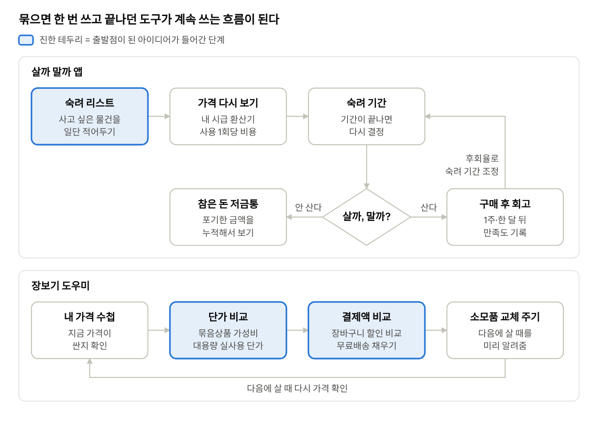

# 생활 소비 결정 도구 아이디어

작성일 2026-10-11 · 온라인 문서: https://claude.ai/code/artifact/e4077f8f-98b6-4304-967c-744a27a94089

## 공통 기준

이 결의 아이디어들은 돈을 쓰기 직전이나 쓰고 난 뒤의 작은 고민을, 입력 몇 개만으로 바로 풀어준다는 점이 같다.

- **즉답**: 값 몇 개를 넣으면 숫자나 결정이 바로 나온다.
- **외부 데이터 불필요**: 사용자가 넣은 값만으로 돌아가서 API나 크롤링이 필요 없다.
- **누구나 겪는 고민**: 학생이든 직장인이든 한 번쯤 해본 계산이다.
- **작은 규모**: 한 화면이면 충분해서 빠르게 만들고 바로 시연할 수 있다.

아이디어는 두 갈래로 나뉜다. **계산·비교형**은 사기 직전에 판단을 돕고, **기록·결정형**은 쌓인 기록으로 다음 결정을 돕는다.

## 출발점이 된 아이디어

아래 세 개가 기준점이고, 나머지 아이디어는 모두 이 세 개에서 파생했다.

| 아이디어 | 갈래 | 이런 고민 | 기능 | 쌓이는 기록 |
| --- | --- | --- | --- | --- |
| 구매 전 숙려 리스트 | 기록·결정형 | 충동구매하고 나중에 후회한다 | 사고 싶은 물건 등록, 숙려 기간 설정, 구매·포기 기록 | 구매 욕구가 실제 결정으로 이어진 기록 |
| 장바구니 할인 비교 | 계산·비교형 | “15% 할인”과 “1만 원 할인” 중 뭐가 이득이지? | 최소 주문액·최대 할인·배송비까지 반영해 실제 결제액 비교 | |
| 묶음상품 가성비 비교 | 계산·비교형 | 900mL 2개와 1.5L 1개 중 뭐가 저렴하지? | 용량·개수·가격 입력 → 같은 단위당 가격 비교 | |

## 계산·비교형 아이디어

사기 직전에 “이게 이득인가?”에 숫자로 답하는 아이디어 10개다. 입력은 사용자가 직접 넣고 결과는 한 화면에 나온다.

| 아이디어 | 이런 고민 | 입력 | 결과 |
| --- | --- | --- | --- |
| 멤버십 본전 계산기 | 쿠팡 와우·배민클럽, 내가 쓰는 만큼이면 본전 뽑나? | 월 주문 횟수, 건당 배송비, 할인액, 월 회비 | 월 회비와 아낀 돈 비교, 본전이 되는 주문 횟수 |
| 무료배송 채우기 | 2만 원 무료배송 맞추려고 더 담는 게 나을까? | 장바구니 금액, 무료배송 기준, 배송비, ‘어차피 살 것’ 목록 | 모자란 금액과 배송비 비교, 모자란 금액에 맞는 품목 조합 추천 |
| 대용량 실사용 단가 | 대용량이 싸긴 한데 유통기한 안에 다 먹나? | 용량, 가격, 하루 소비량, 유통기한 | 버리는 양까지 반영한 실제 단가 (묶음 비교 확장판) |
| 사용 1회당 비용 | 30만 원 코트와 8만 원 코트, 뭐가 더 경제적이지? | 가격, 예상 사용 횟수, 되팔 가격 | 한 번 쓸 때마다 드는 실제 비용 |
| 내 시급 환산기 | 이 신발, 알바 몇 시간 일한 값이지? | 시급 또는 월급, 물건 가격 | 가격을 일한 시간으로 환산 |
| 렌탈 vs 구매 | 정수기·안마의자, 렌탈이 나아 사는 게 나아? | 월 렌탈료, 약정 기간, 구매가, 관리비 | 기간별 총비용, 손익이 뒤집히는 시점 |
| 가전 전기요금 | 에어컨 하루 8시간 틀면 얼마 나오지? | 소비전력, 하루 사용 시간, 평소 월 사용량 | 누진 구간을 반영한 월 요금 증가분 |
| 먼 주유소 손익 | 3km 더 가서 리터당 50원 싼 데 가는 게 이득? | 왕복 거리, 연비, 주유량, 리터당 가격 차 | 실제로 아끼는 돈 |
| N빵 정산기 | 술 안 마신 사람, 늦게 온 사람은 어떻게 나누지? | 항목별 금액, 항목마다 참여한 사람 | 1인당 송금액 |
| 직구 실결제액 | 관세·배송비까지 붙이면 직구가 국내보다 싸나? | 상품가, 환율, 배송비, 국내 판매가 | 면세 기준을 반영한 실결제액과 국내가 비교 |

## 기록·결정형 아이디어

기록을 쌓아서 다음에 돈 쓸 때 판단 근거로 쓰는 아이디어 9개다. 쓸수록 가치가 커지는 것이 계산·비교형과 다른 점이다.

| 아이디어 | 이런 고민 | 기능 | 쌓이는 기록 |
| --- | --- | --- | --- |
| 구독 정리함 | 내가 뭘 구독 중이더라? 안 쓰는데 돈이 나간다 | 구독 등록, 결제일 알림, 마지막 사용일 체크 → 해지 후보 표시 | 구독별 월 비용과 실제 사용 빈도 |
| 내 가격 수첩 | 지난번엔 얼마에 샀지? 지금 싼 건가? | 자주 사는 품목의 구매가·구매처 기록 → 지금 가격이 내 최저가보다 몇 % 비싼지 표시 | 품목별 구매가 이력 |
| 구매 후 회고 | 산 것 중에 뭘 후회하더라? | 사고 1주·한 달 뒤 만족도 질문 | 카테고리별 후회율 (숙려 기간을 정하는 근거) |
| 반품 기한 트래커 | 반품하려 했는데 기간이 지났다 | 구매일·반품 기한 등록, 마감 전 알림 | 반품한 금액, 놓친 금액 |
| 기프티콘·포인트 만료 관리 | 기프티콘 유효기간이 지나서 날렸다 | 만료일 등록, 임박한 순으로 정렬·알림 | 쓴 금액, 날린 금액 |
| 냉장고 재고판 | 집에 뭐 있는지 몰라서 또 사고, 상해서 버린다 | 재고·유통기한 등록, 장보기 전에 확인 | 버린 음식 금액 |
| 소모품 교체 주기 | 정수기 필터 언제 바꿨지? 샴푸는 언제 떨어지지? | 교체일·주기 기록 → 다음 구매 시점 안내 | 품목별 실제 사용 기간 |
| 경조사비 장부 | 얼마 내야 하지? 그 사람은 나한테 얼마 했더라? | 주고받은 내역 기록, 관계별 평균 금액 | 주고받은 금액 이력 |
| 참은 돈 저금통 | 참아도 티가 안 나서 동기부여가 안 된다 | 포기한 물건 금액을 누적해서 보여줌 | 아낀 금액 추이 |

## 묶으면 좋아지는 조합

따로 쓰면 한 번 계산하고 끝나는 도구도, 두 흐름으로 묶으면 계속 쓰는 앱이 된다.

**살까 말까 앱**

1. 숙려 리스트: 사고 싶은 물건을 일단 적어두기
2. 가격 다시 보기: 내 시급 환산기, 사용 1회당 비용
3. 숙려 기간: 기간이 끝나면 다시 결정
4. 살까, 말까?
    - 안 산다 → 참은 돈 저금통 (포기한 금액 누적)
    - 산다 → 구매 후 회고 (1주·한 달 뒤 만족도 기록) → 후회율로 숙려 기간 조정 (3번으로 돌아감)

**장보기 도우미**

1. 내 가격 수첩: 지금 가격이 싼지 확인
2. 단가 비교: 묶음상품 가성비, 대용량 실사용 단가
3. 결제액 비교: 장바구니 할인 비교, 무료배송 채우기
4. 소모품 교체 주기: 다음에 살 때를 미리 알려줌 → 다음에 살 때 다시 가격 확인 (1번으로 돌아감)

살까 말까 앱은 구매 후 회고에서 나온 후회율로 숙려 기간을 다시 정한다. 장보기 도우미는 소모품 교체 시점이 다음 가격 확인으로 이어진다.

## 추천과 고르는 기준

먼저 하나를 만든다면 **구독 정리함, 내 가격 수첩, 사용 1회당 비용**을 추천한다. 공감하는 사람이 많고, 한 화면이면 충분하고, 외부 데이터가 필요 없다.

**고를 때 볼 기준**

- **공감**: 듣자마자 “나도 그런데”가 나오는 고민인가
- **입력 부담**: 처음 쓸 때 넣을 값이 5개 이하인가
- **외부 의존**: 제도·환율·가격 API 없이 돌아가는가
- **시연**: 입력부터 결과까지 1분 안에 보여줄 수 있는가

**만들기 전 확인할 것**

- [ ] 가전 전기요금: 주택용 누진 구간과 단가를 지금 기준으로 확인 (여름철 구간이 따로 있음)
- [ ] 직구 실결제액: 면세 기준 금액(국가별로 다름)과 관세·부가세 계산 방식 확인
- [ ] 알림이 필요한 아이디어(구독·반품·기프티콘·소모품): 푸시 알림을 보낼지, 화면에 ‘임박’ 표시만 할지 정하기
