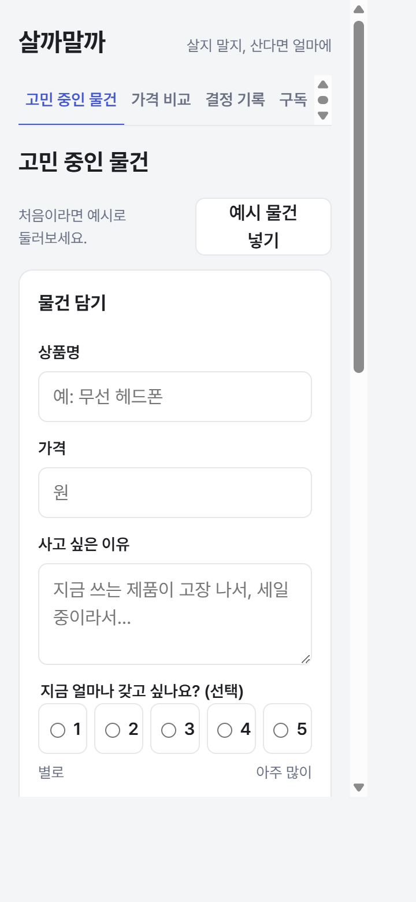
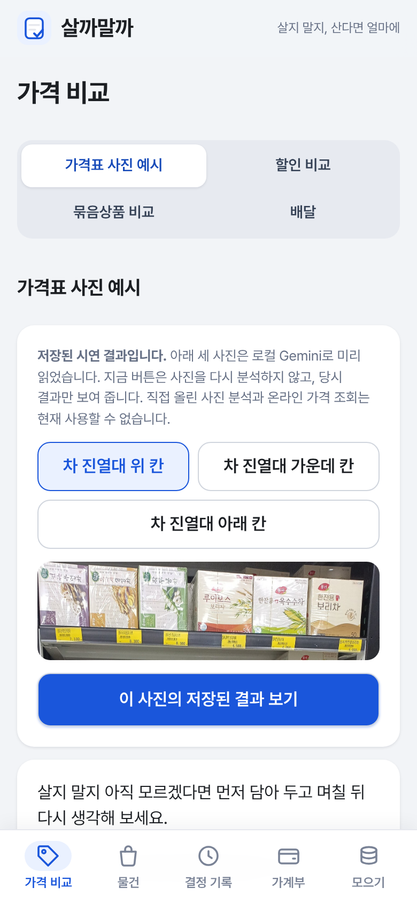
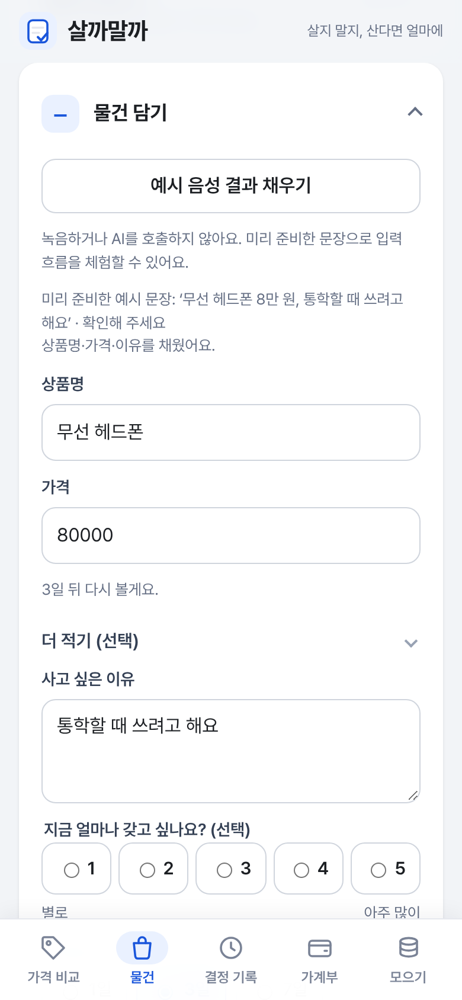
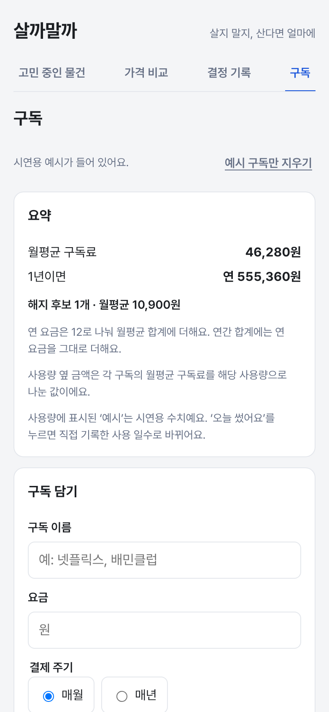
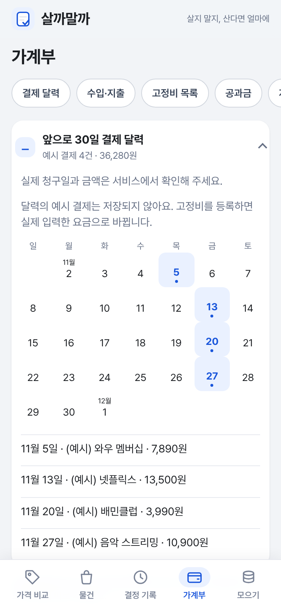
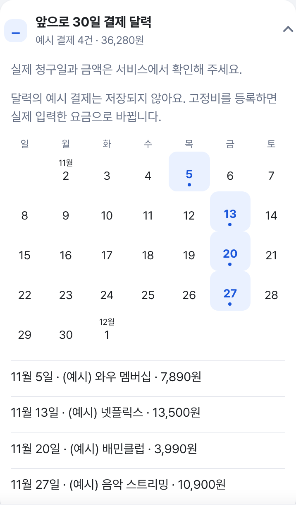
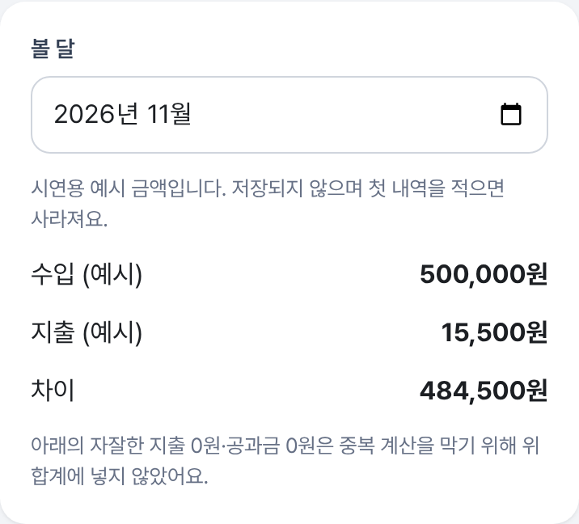
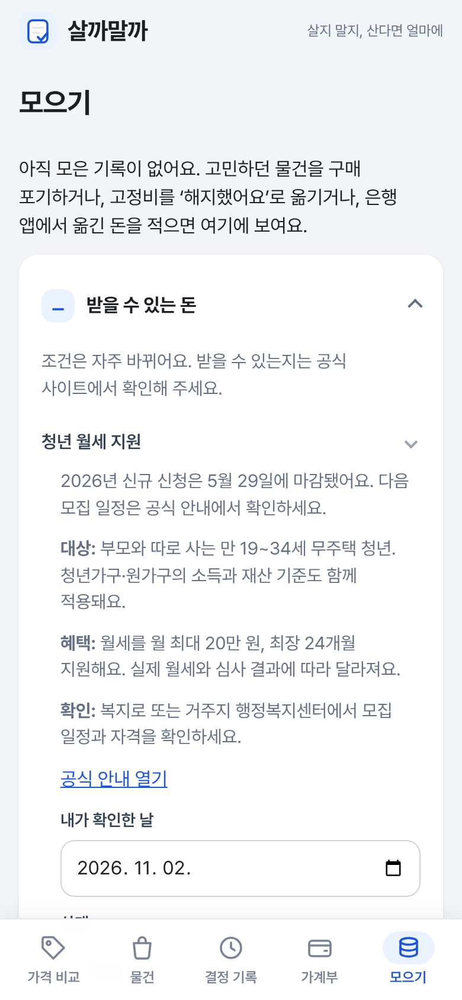
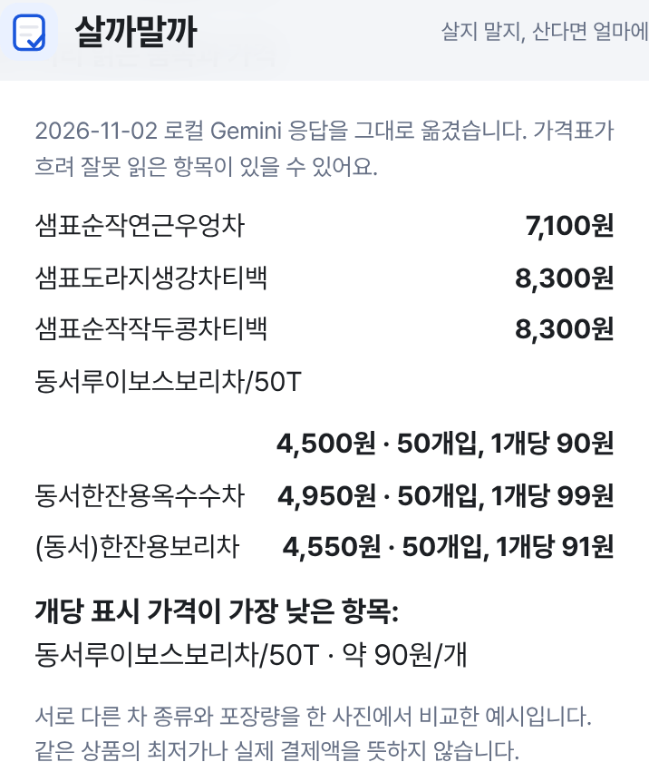
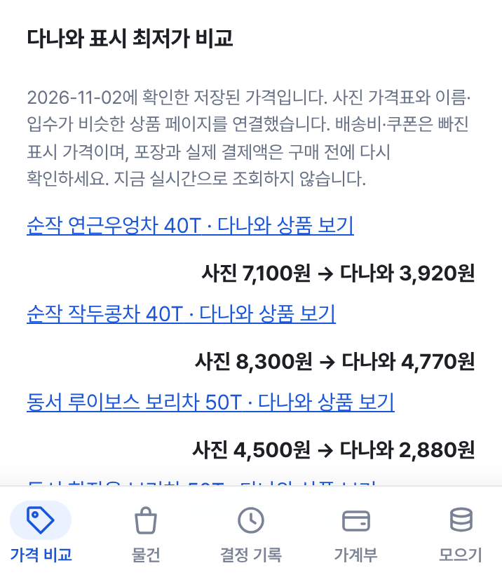

# 1차 과제와 중간 과제 화면 비교

비교 기준은 2026-10-13 제출 커밋 `7d64fdc`(태그 `v1`)와 2026-11-02 개선본이다. 왼쪽은 [1차 제출본](https://lumos0107.github.io/BuyorNot/v1/), 오른쪽은 [중간 과제 개선본](https://lumos0107.github.io/BuyorNot/)이다.

## 촬영 조건

2026-11-02에 [capture.cjs](capture.cjs)로 다시 찍었다. GitHub Pages 배포 작업과 같은 방법으로 `main` 빌드와 `v1` 태그 빌드를 한 묶음으로 만들고, 새 브라우저(빈 저장소)에서 휴대폰 화면 390×844, 2배 해상도로 찍었다.

- 한 화면 사진(01~06, 10)은 모두 780×1688, 같은 비율이다. 전후 사진은 같은 폭으로 나란히 놓는다.
- 부분 사진(09, 11, 12, 14)은 카드 하나만 잘라 폭 716이고 높이는 내용만큼이다.
- 07·08은 AI 서버를 켠 **로컬 앱**에서 실제 Gemini 응답을 받아 찍은 화면이라 공개 사이트에서는 다시 찍을 수 없다. 07은 그 당시 메뉴 이름(고정비)이 남아 있는 예전 화면이다.

## 처음 열었을 때

| 1차: 물건부터 담기 | 개선본: 가격표 사진 예시부터 시작 |
| :---: | :---: |
|  |  |

1차의 네 메뉴는 고민 중인 물건·가격 비교·결정 기록·구독이었다. 개선본은 가격 비교·물건·결정 기록·가계부·모으기 다섯 메뉴다. 공개 빌드는 가격 비교의 첫 탭으로 **가격표 사진 예시**를 보여 준다. 사진 버튼은 2026-11-02 로컬 Gemini가 읽은 응답을 저장해 둔 것을 다시 보여 줄 뿐, 사진을 새로 분석하지 않는다. 2026-11-02 디자인 개선(TODO 37단계) 뒤로는 휴대폰 폭에서 주요 메뉴가 화면 아래에 아이콘과 함께 붙고, 비교 탭 네 개는 2×2 분할 버튼으로 보인다.

## 물건을 담을 때

| 1차: 상품명·가격·이유를 함께 적음 | 개선본: 상품명·가격부터 담음 |
| :---: | :---: |
|  |  |

1차는 사고 싶은 이유를 적지 않으면 담을 수 없었다. 개선본은 이유와 갖고 싶은 정도를 `더 적기 (선택)`에 두었다. 오른쪽 사진은 `예시 음성 결과 채우기`로 미리 준비한 문장(‘무선 헤드폰 8만 원, 통학할 때 쓰려고 해요’)을 넣은 모습이며 녹음이나 AI 호출은 없다. [물건 탭 첫 화면](05-wishlist.png)에는 오늘 확인할 것과 상황별 시작 버튼이 추가됐다.

## 매달 나가는 돈과 가계부

| 1차: 구독 요금·사용 기록 | 개선본: 결제 달력부터 시작하는 가계부 |
| :---: | :---: |
|  |  |

구독에 통신·보험 등 고정비를 더하고, 공과금·자잘한 지출과 직접 적는 수입·지출을 가계부로 모았다. 달력은 처음부터 펼쳐져 있다. 고정비가 없으면 저장되지 않는 예시 결제 4건이 보이고, 실제로 고정비를 등록하면 사라진다. 금액은 실제 청구액이 아니다.

| 30일 결제 달력 | 가계부 이달 요약 |
| :---: | :---: |
|  |  |

가계부 요약도 첫 입력 전에는 저장되지 않는 시연 금액을 보여 준다.

## 새 모으기 기능

1차에는 모으기 탭이 없었다. 개선본은 참은 구매·줄어든 고정비·실제 옮긴 돈을 구분한다. 받을 수 있는 돈을 위에 두고 청년 월세 지원 안내를 펼쳐 보여 준다. 숫자별 계산 설명은 화면 아래에 모았다.

## 가격표 사진: 로컬 실제 AI와 공개 예시의 차이

로컬 AI 서버에서는 2026-11-02 [CC0 차 진열 사진](https://commons.wikimedia.org/wiki/File:Various_Teas_from_South_Korea.jpg)의 조정용 사례 `rt01`([사진](../../public/demo/rt01.jpg))을 실제 Gemini로 읽었다. [사진을 고른 로컬 화면](07-ai-read-current.png)과 [실제 응답으로 채운 수정 칸](08-ai-result-current.png)에 상품명 `샘표순작연근우엉차`와 가격 `7100`이 보인다. 사진의 흐린 가격표 등은 잘못 읽을 수 있어 이 화면만으로 정확도를 주장하지 않는다.

공개 사이트에서는 실시간 Gemini 연결이 작동하지 않아 세 사진의 **저장된 결과**만 보여 준다. 사진 버튼을 누를 때 AI 호출이나 온라인 가격 조회는 일어나지 않는다.

| 저장된 읽기 결과 | 2026-11-02 다나와 표시 최저가 |
| :---: | :---: |
|  |  |

다나와 가격은 그날 상품 페이지에서 확인한 표시 최저가이며 배송비·쿠폰이 빠져 있고 실시간 조회가 아니다. 요청·채점 기록은 [AI 평가 기록](../ai-eval.md)에 있다.

기능별 변경은 [PRD](../../PRD.md), 구현 순서와 보류 항목은 [TODO](../../TODO.md)를 참고한다.
