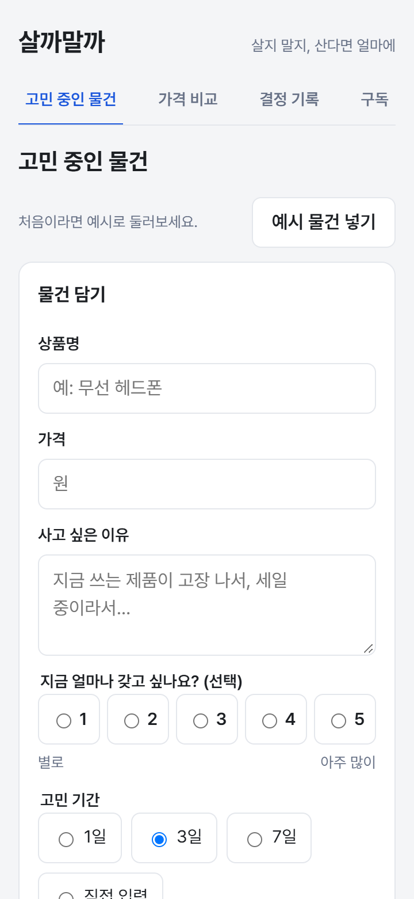
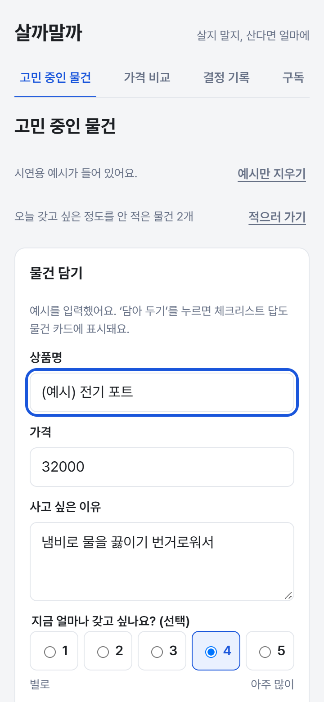
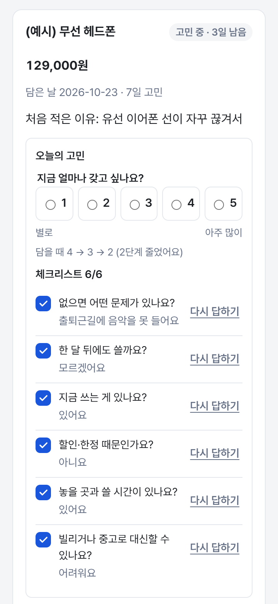
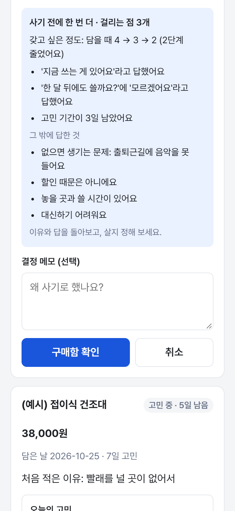
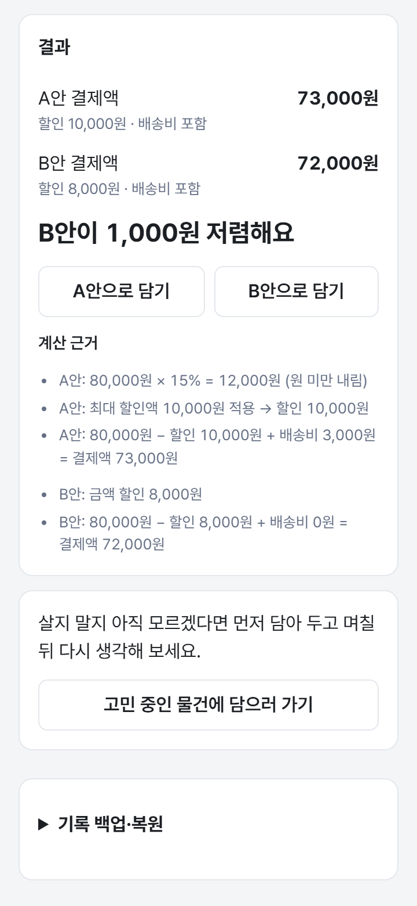
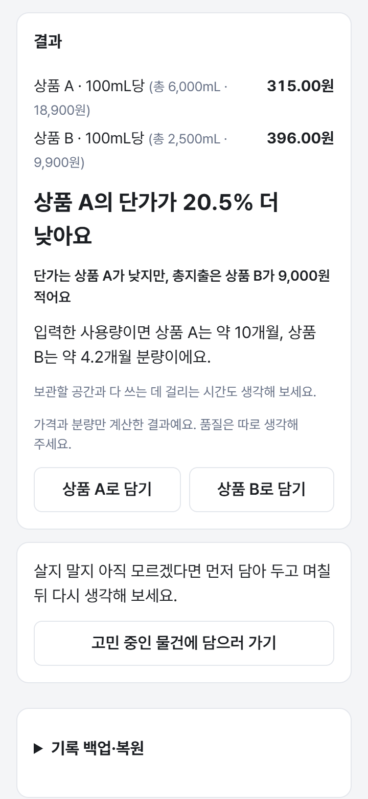
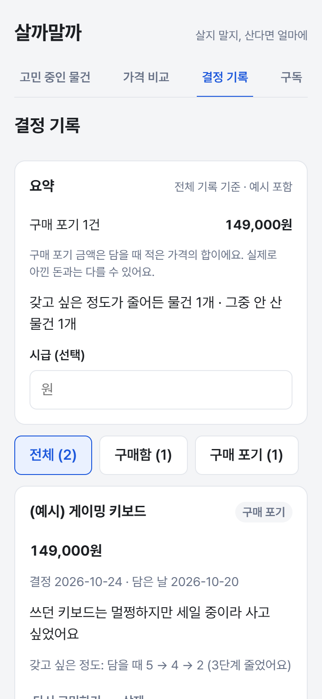
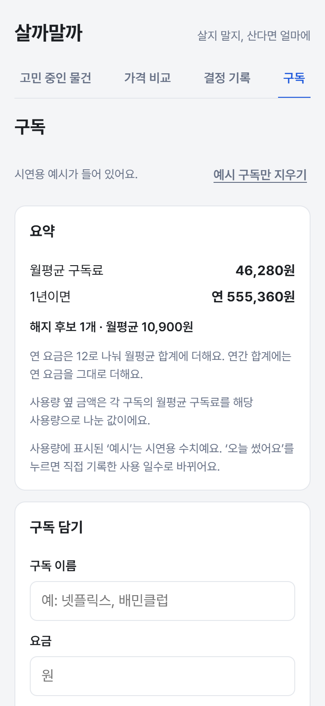
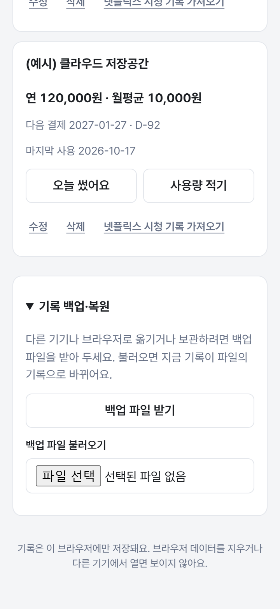

# 살까말까 v1 기준점

중간과제로 살까말까를 업그레이드하기 전 상태를 **v1**으로 정해 기록한다(2026-10-27 기록). 1주 과제로 2026-10-11~10-13에 만든 마지막 상태이고, 10/13 이후 바뀐 것은 없다. 업그레이드한 뒤에는 이 문서와 비교해 무엇이 바뀌었는지 본다.

| 항목 | v1 |
| --- | --- |
| 기준 커밋 | `7d64fdc` (2026-10-13 16:23) · Git 태그 `v1` |
| GitHub | main이 같은 커밋이다(10/27 확인) |
| 배포 사이트 | https://lumos0107.github.io/BuyorNot/ 의 파일이 이 커밋을 빌드한 결과와 같다(`index-BpxObitS.js` · `index-BWd0Oos2.css`, 10/27 확인). 마지막 자동 배포는 10/13 16:24 성공 |
| 만든 기간 | 2026-10-11 ~ 10-13, 커밋 86개(10/11 75개 · 10/12 1개 · 10/13 10개) |

새 버전을 push하면 배포 사이트도 새 버전으로 바뀐다. 그 뒤에 v1을 보려면 7절처럼 v1을 꺼내 실행한다.

## 1. 화면

휴대폰 화면(360×780)에서 예시 데이터로 찍었다. 새 브라우저(빈 기록)에서 [capture.py](v1_screens/capture.py)로 찍었고, 남은 날·결제일처럼 날짜가 들어간 글자는 찍은 날(10/27) 기준이다. 탭별 전체 화면(세로로 긴 그림)은 [v1_screens/full/](v1_screens/full/)에 있다.

| 1. 처음 연 화면 | 2. 예시 물건 넣기 뒤 | 3. 고민 카드 |
| :---: | :---: | :---: |
|  |  |  |
| 담기 폼이 맨 위에 있다 | 폼도 예시로 채워진다(F28). 폼 위에 오늘의 고민으로 가는 줄(F30) | 갖고 싶은 정도 변화와 체크리스트 6/6(F22·F27) |

| 4. 구매함을 누르면 | 5. 할인 비교 결과 | 6. 묶음상품 비교 결과 |
| :---: | :---: | :---: |
|  |  |  |
| 사기 전에 한 번 더: 내 기록에서 찾은 걸리는 점(F15) | 실제 결제액과 계산 근거, A안·B안으로 담기(F04·F21) | 단가·총지출, 한 달 사용량이면 몇 개월 분량(F05) |

| 7. 결정 기록 | 8. 구독 | 9. 맨 아래 백업·복원 |
| :---: | :---: | :---: |
|  |  |  |
| 요약·시급 환산·필터, 갖고 싶은 정도 변화(F12·F22) | 월평균·연 합계, 해지 후보(F14) | 기록 전체를 파일 하나로 받고 불러오기(F20) |

## 2. 숫자

업그레이드 뒤에 같은 방법으로 다시 재서 비교한다.

| 항목 | v1 | 잰 방법 |
| --- | --- | --- |
| 자동 테스트 | 532개 모두 통과(테스트 파일 61개, 약 32초) | `npx vitest run` |
| 타입 검사 | 통과 | `npx tsc -b` |
| 린트 | 경고·오류 0 | `npx oxlint` |
| 빌드 JS | 330.67 kB (gzip 100.76 kB) | `npm run build` |
| 빌드 CSS | 56.43 kB (gzip 17.15 kB) | `npm run build` |
| 앱 코드 | 37개 파일 6,805줄 | `src`에서 테스트를 뺀 것 |
| 테스트 코드 | 62개 파일 7,299줄 | `*.test.ts(x)`와 `src/test/` |
| PRD | v0.22, 기능 F01~F30, 검증 사례 AC01~AC50 | `PRD.md` |
| TODO | 작업 195개 중 191개 완료 | 남은 4개는 5절 |
| 문서 크기 | PRD 97KB · DEVLOG 101KB · TODO 38KB · README 11KB · 상세 설명 20KB | |

## 3. 기능

PRD v0.22 기준이다. 화면 순서(구매 전 → 구매할 때 → 구매 후 → 매달)로 묶었다.

**고민 중인 물건 (구매 전)**

- F01 물건 담기: 상품명·가격·사고 싶은 이유·고민 기간(1·3·7일·직접 입력), 링크는 선택
- F02 고민 기간과 결정: 고민 중 → 고민 기간 끝 → 구매함·구매 포기
- F07 고민 기간 연장(1·3·7일) · F08 결정 메모(200자까지)
- F09 담을 때 질문: 지금은 질문 6개 체크리스트(F27·F28)로 바뀌었다
- F10 비교해 볼 곳 링크(네이버쇼핑·다나와·쿠팡 검색), 담을 때 비슷한 기록 알림
- F11 안내문 "며칠 고민하면 뭐가 좋을까요?"(화면 맨 아래 접이식)
- F15 사기 전에 한 번 더: 구매함을 누르면 내 기록에서 찾은 걸리는 점을 보여 준다. 충동구매라고 단정하지 않는다
- F17 예시만 지우기 · F18 결정 직후 되돌리기, 결정 기록에서 다시 고민하기
- F22 고민 노트: 갖고 싶은 정도(1~5)를 담을 때와 날마다 적고, 줄어든 만큼 보여 준다
- F24 담기 폼 줄이기(링크 접기, 폼은 맨 위)
- F27 카드 체크리스트(질문 6개 늘 표시, 답한 수/6) · F28 담기 폼의 접힌 체크리스트, 예시 물건 넣기가 폼까지 채움
- F29 비슷한 기록 알림에 구매 후 회고를 함께 표시
- F30 담기 폼 위 "오늘 갖고 싶은 정도를 안 적은 물건 n개 [적으러 가기]"

**가격 비교 (구매할 때)**

- F04 할인 비교: 쿠폰(비율 할인·금액 할인)·최소 주문액·최대 할인액·배송비로 실제 결제액 비교, 계산 근거 표시
- F05 묶음상품 비교: 단가와 총지출, 한 달 사용량을 적으면 몇 개월 분량인지(예시는 세탁 세제)
- F21 비교 결과를 고민 목록의 담기 폼으로 보내기
- F13 무료배송 채우기 비교: 10/13 화면에서 뺐다. 계산 코드 `src/logic/shipping.ts`만 남아 있다

**결정 기록 (구매 후)**

- F03 결정 기록: 구매함·구매 포기를 최근 결정 순으로
- F12 필터(전체·구매함·구매 포기), 요약(구매 포기 금액, 시급으로 환산), 구매 후 회고

**구독 (매달)**

- F14 구독 정리함: 다음 결제일, 월평균·연 합계, 31일 넘게 안 쓴 구독은 해지 후보
- F16 구독 사용량(예시 구독에만 예시 숫자) · F19 "오늘 썼어요"(하루 한 번)
- F25 사용량 직접 적기(최근 30일 시간·횟수, 한 달에 한 번)
- F26 넷플릭스 시청 기록 CSV 가져오기(미리보기 → 확인, 제목은 저장하지 않음)
- F23 다듬기: 사용 기록이 없는 구독은 해지 후보가 아니라 "확인 필요". 가격 비교에서 담은 문장은 사기 전 점검의 할인 근거로 세지 않음

**공통**

- F06 이 브라우저에만 저장, 저장 실패·손상 안내, 다른 탭에서 저장한 기록 맞추기
- F20 백업·복원: 기록 전체를 JSON 파일 하나로 받고, 불러오면 확인 뒤 전체 교체(5MB까지)
- 보안 점검: 배포본에만 콘텐츠 보안 정책(CSP), 글꼴을 함께 배포(CDN 안 씀), 배포 권한은 배포 작업에만

## 4. 기술과 저장

- 기술(package-lock 기준): React 19.3.0 · TypeScript 6.0.3 · Vite 8.3.4 · Vitest 5.0.3 + Testing Library · jsdom 30.1.2 · oxlint 1.87.0 · Pretendard 1.3.9. `package.json` 버전은 0.1.0
- 저장: localStorage 키 3개 `buyornot.wishlist.v1`(물건 기록) · `buyornot.settings.v1`(시급) · `buyornot.subscriptions.v1`(구독). 서버·로그인 없음
- 백업 파일: `buyornot-backup-YYYY-MM-DD.json` = `{ app: "buyornot", backupVersion: 1, exportedAt, wishlist, settings, subscriptions }`
- 배포: main에 push하면 GitHub Actions가 테스트 → 빌드 → GitHub Pages
- 화면 전환: 주소가 아니라 상태로 바꾼다(Pages에서 새로고침해도 404가 나지 않게)
- 디자인: 배경 #f4f5f7 · 글자 #1c1f23 · 보조 #667085 · 강조 #1a56db · 경고 #d92d20, 글꼴은 Pretendard 하나, 입력 글자 16px · 높이 44px

| 폴더 | 파일 | 줄 수 | 내용 |
| --- | ---: | ---: | --- |
| `src/screens/` | 5 | 2,905 | 고민 중인 물건 1,117 · 구독 662 · 가격 비교 580 · 결정 기록 399 · 백업 147 |
| `src/logic/` | 20 | 2,309 | 계산 규칙(할인·묶음·고민·구독·백업·CSV 등) |
| `src/store/` | 3 | 383 | 저장 훅(물건·설정·구독) |
| `src/ui/` | 6 | 340 | 공통 부품(버튼·입력·탭·예시 막대·초기화 확인) |
| `src/index.css` | 1 | 672 | 스타일 전체 |
| `src/App.tsx` · `main.tsx` | 2 | 196 | 메뉴 4개와 백업 칸 |

## 5. v1에서 남긴 것

업그레이드할 것을 고를 때 참고한다.

**하지 않은 작업 (TODO 13단계)**

- 13-4 분석 기간과 그 기간 실제 낸 금액, 이용 일수 기준 비용
- 13-5 카드의 출처·수집 기간 정리, 예시와 실제 기록 구분
- 13-6 배달 구독 순혜택(할인액 − 낸 금액)
- 13-7 발표 자료·README에 현재 구현 / 검증 중 / 앱 확장 구분

**README 5절에 적은 개선 방향**

- 자취생 몇 명에게 1~2주 써 보게 해서 효과 확인(포기한 비율, 갖고 싶은 정도 변화)
- 고민 기간 종료·구독 결제일 알림
- 로그인과 서버 저장
- 구독 분석 마무리, 앱으로 만들면 기기 사용 시간 연동
- 스마트폰 실기기 확인(아직 안 함)

**미뤄 둔 아이디어 (10/13 기준)**

- 캘린더 알림(.ics 파일), 홈 화면에 추가(manifest)
- 가격 비교의 한 번 쓸 때 비용(P1)·"안 사면" 한 줄(P5): 10/13에 P3(한 달 사용량)만 골랐다
- 10/13 아이디어 회의에서 결정을 미룬 것: 배달 대신 기본 저녁, '참은 돈' 목표 저금통, 받을 돈 찾기(청년 월세 지원 등, 정보 확인 필요)

**알려진 한계 (PRD)**

- 두 탭에서 거의 동시에 저장하면 나중 저장이 남을 수 있다(탭 사이 잠금 없음)
- 다른 탭에서 결정·삭제하면 이 탭에서 쓰던 입력이 안내 없이 닫힌다
- localStorage는 출처 단위라 lumos0107.github.io 아래 다른 Pages도 기록을 읽을 수 있다. 기록과 백업 파일은 암호화하지 않는다. 클릭재킹 방지(frame-ancestors)는 meta로 넣을 수 없어 빠져 있다
- 비슷한 기록 알림은 색상·모델이 뒤에 붙은 이름('헤드폰 블랙')을 놓칠 수 있다

**저장소에 남은 정리거리**

- `docs/screenshots/`는 10/11 화면이다(F27~F30 전, 지금은 없는 무료배송 탭 포함). v1 화면은 이 문서의 `v1_screens/`를 본다
- `docs/presentation/index.html`은 4차(10/11) 기준 발표 자료다
- 저장소 맨 위의 `g-after.png` · `g-top.png`는 F30 커밋(`eaa6439`)에 함께 들어간 확인용 그림이다

## 6. 나중에 비교하는 방법

```bash
git log --oneline v1..HEAD        # v1 뒤에 한 커밋
git diff --stat v1..HEAD          # 바뀐 파일과 줄 수
git diff v1..HEAD -- PRD.md       # 기능·검증 사례가 어떻게 바뀌었는지
npx vitest run                    # 테스트 수 (v1: 532)
npm run build                     # 빌드 크기 (v1: JS 330.67 kB)
```

같은 조건의 화면은 빌드를 띄운 뒤(`npm run build && npx vite preview --port 4173`) `python docs/v1_screens/capture.py http://localhost:4173/BuyorNot/ docs/v2_screens`로 찍는다(Python Playwright와 크롬 필요). 버튼 이름이 바뀌었으면 스크립트의 단계를 고친다. `v1` 태그가 없는 곳에서는 `v1` 대신 `7d64fdc`를 쓴다.

## 7. v1 다시 열기

지금 작업은 그대로 두고 v1만 옆 폴더에 꺼내 실행한다.

```bash
git worktree add ../살까말까_v1 v1
cd ../살까말까_v1 && npm ci && npm run dev    # http://localhost:5173/BuyorNot/
```
