# 살까말까 v1과 지금 비교

[v1 기준점](v1_기준점.md)에 적은 방법 그대로 지금 상태를 다시 재서 v1과 나란히 놓았다(2026-11-01).

| 항목 | v1 | 지금 |
| --- | --- | --- |
| 커밋 | `7d64fdc` (태그 `v1`, 2026-10-13 16:23) | `4d4ee82` (브랜치 `ai-stage1`, 2026-10-31 07:34) |
| 화면을 찍은 날 | 2026-10-27 | 2026-11-01 |
| 배포 | 공개 사이트가 이 판 | 배포 전. 공개 사이트는 여전히 v1(11/01 확인) |

잰 방법은 v1 기준점 2절·6절과 같다. 다른 점은 셋이다.

- 화면 9장은 AI 기능이 켜진 빌드로 찍었다. 지시받은 `VITE_AI_SERVER_URL=http://localhost:8787 npm run build`는 운영 빌드가 http 주소를 막아(`src/csp.ts`의 `productionAiUrlProblem`) 실패했고, 화면에 AI 버튼만 보이게 `https://localhost:8787`로 빌드했다. 9장 안에서는 AI 서버를 부르지 않는다.
- 4173 포트를 10/27의 v1 미리보기가 쓰고 있어 4174 포트로 띄웠다. 찍는 스크립트는 v1의 [capture.py](v1_screens/capture.py)를 고치지 않고 그대로 썼다(버튼 이름이 바뀐 단계 없음).
- 예시 데이터의 날짜는 찍은 날 기준이라 두 그림의 날짜 글자가 다르다(예: 담은 날 10-23 → 10-28).

## 1. 화면 나란히

360×780 화면을 2배로 찍었다. 왼쪽이 v1(`v1_screens/`), 오른쪽이 지금(`v2_screens/`)이다. 탭별 전체 화면은 [v2_screens/full/](v2_screens/full/)에 있다.

**1. 처음 연 화면.** 설명 문장이 담기 폼 위로 올라왔고(F24, 17-4), 담기 폼 맨 위에 '말로 담기'와 Gemini 전송 안내가 생겼다(F33, 14-14).

| v1 | 지금 |
| :---: | :---: |
| 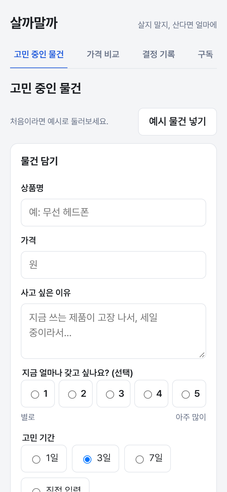 |  |

**2. 예시 물건 넣기 뒤.** 위쪽 두 줄(예시만 지우기, 적으러 가기)은 같고, '말로 담기'와 안내만큼 폼이 아래로 내려갔다.

| v1 | 지금 |
| :---: | :---: |
| 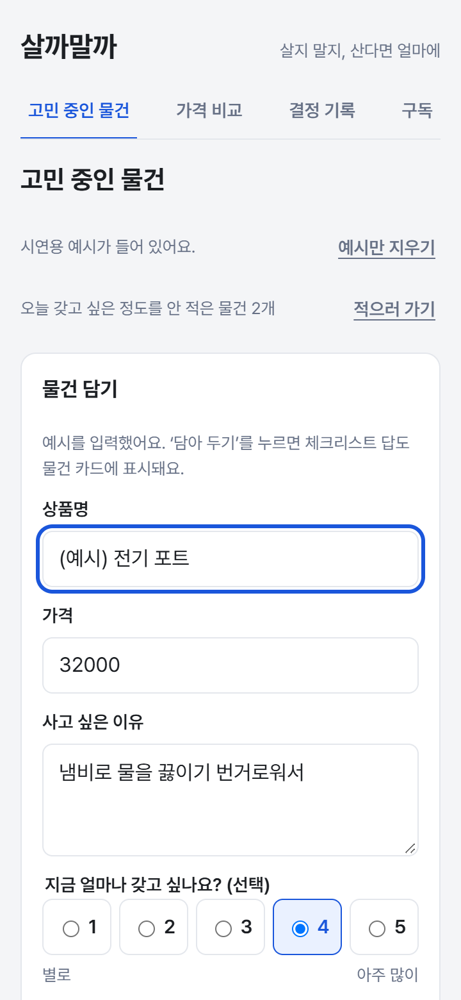 | 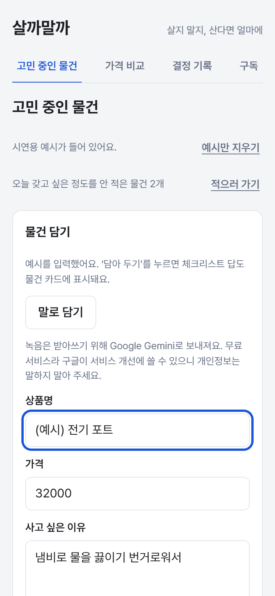 |

**3. 고민 카드.** 이 화면 안은 날짜 말고 같다. 새로 생긴 놓을 자리 확인과 캘린더 줄은 카드 아래쪽이라 이 그림 밖에 있다(2절 2a·2b).

| v1 | 지금 |
| :---: | :---: |
| 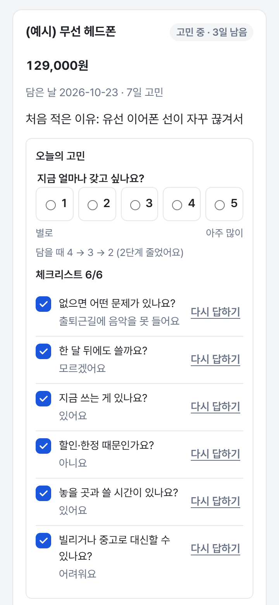 |  |

**4. 구매함을 누르면.** 같다. 저장한 놓을 자리 결과가 '안 들어가요'나 '빠듯해요'이면 여기 걸리는 점으로 나오지만(F44, 15-4), 예시 물건에는 치수가 없어 보이지 않는다.

| v1 | 지금 |
| :---: | :---: |
| 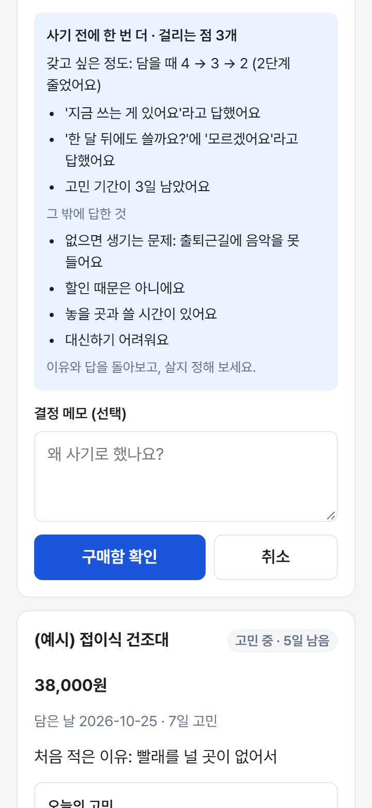 |  |

**5. 할인 비교 결과.** 결과 카드는 같다. 이 그림 위쪽의 탭 줄에 '가격표 사진'이 세 번째로 생겼고(F31, 2절 1), 예시 안내 문장이 바뀌었다(F06, 16-4).

| v1 | 지금 |
| :---: | :---: |
| 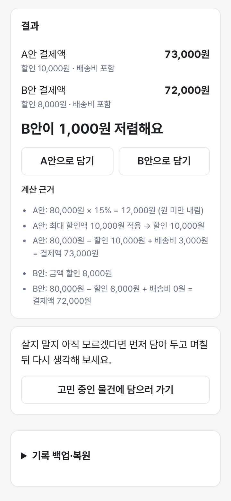 | 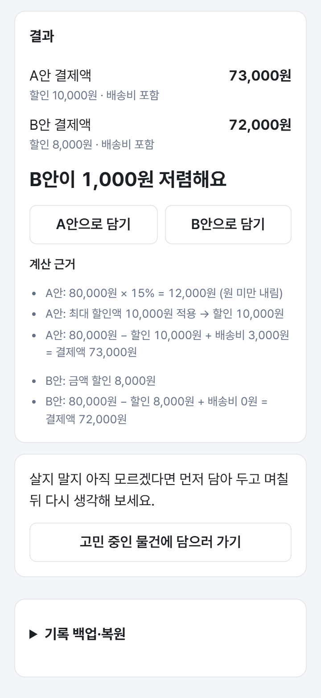 |

**6. 묶음상품 비교 결과.** 결과 카드는 같다. 이 그림 위쪽의 상품 A·B 카드마다 '사진으로 채우기'가 생겨 전체 화면이 272px 길어졌다(F32, 14-11).

| v1 | 지금 |
| :---: | :---: |
| 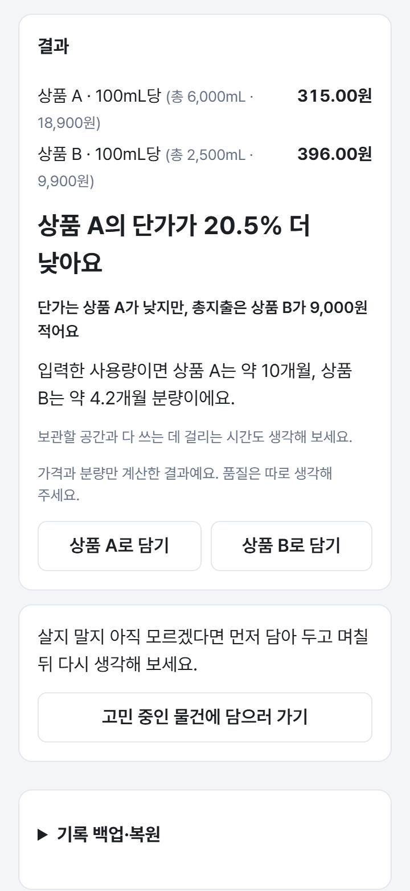 | 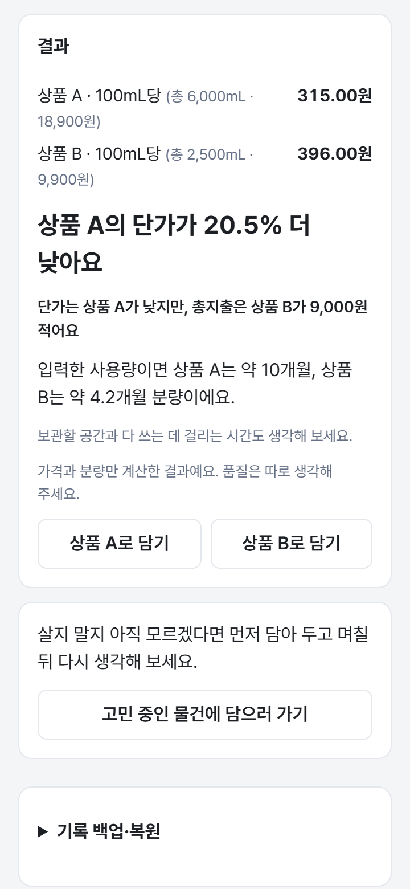 |

**7. 결정 기록.** 같다(날짜만 다르다). 구매함 직후의 회고 한 줄은 고민 목록 쪽 알림이라 여기에는 없다(2절 4).

| v1 | 지금 |
| :---: | :---: |
|  | 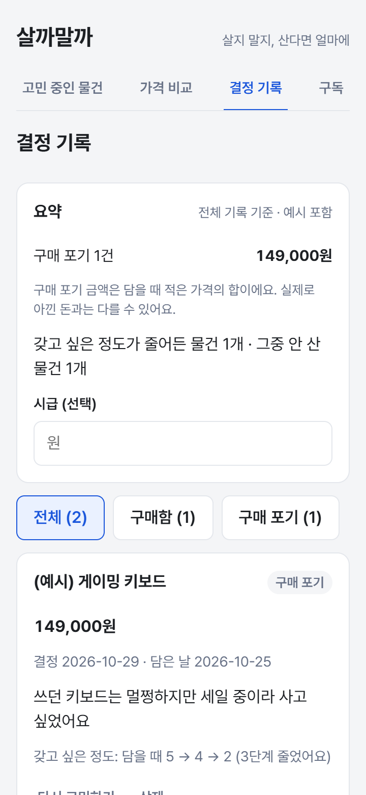 |

**8. 구독.** 픽셀까지 같다.

| v1 | 지금 |
| :---: | :---: |
| 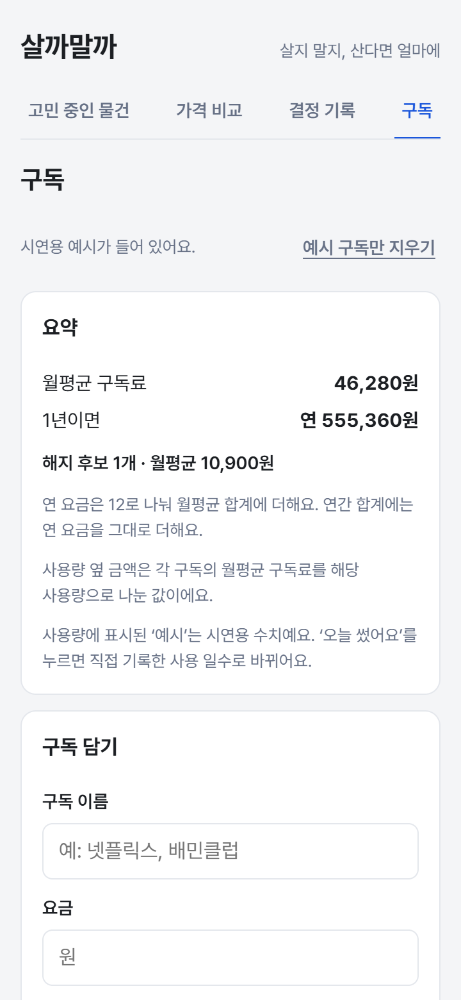 |  |

**9. 맨 아래 백업·복원.** 같다(남은 날과 마지막 사용 날짜만 다르다). AI 성적표 카드는 요약 파일이 비어 있어 이 아래에 생기지 않는다(F43, 2절 6).

| v1 | 지금 |
| :---: | :---: |
| 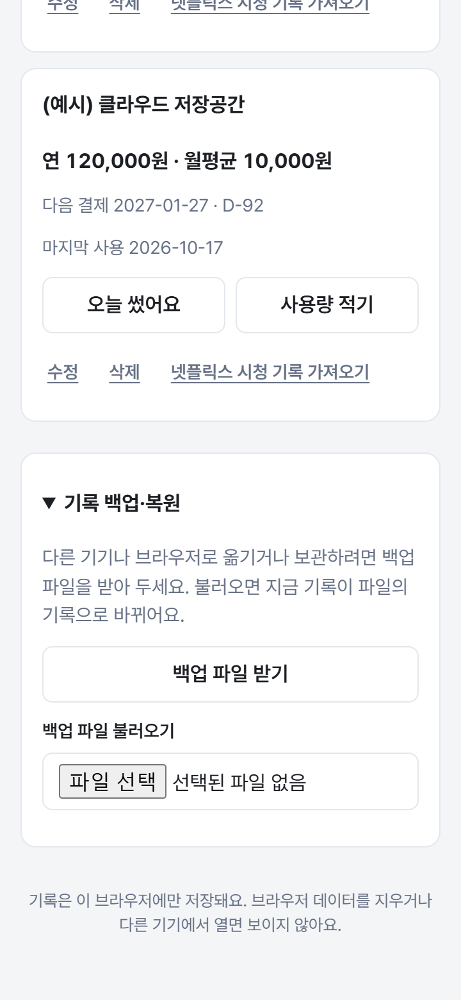 |  |

두 그림을 픽셀로 비교하면 8번은 차이가 없고, 7·9번은 날짜 글자만, 3~6번은 날짜와 일부 줄이 1~2px 옮겨진 정도이며, 1·2번은 폼 위치가 바뀌었다. 탭별 전체 화면 높이는 고민 목록 3,995 → 4,550px, 할인 비교 2,816 → 2,835px, 묶음 비교 2,754 → 3,026px이고 결정 기록·구독은 같다.

## 2. 새로 생긴 화면

v1에 없던 화면이다. 개발 서버(`http://localhost:5173/BuyorNot/`, AI 서버 주소 있음)를 새 브라우저 컨텍스트에서 열어 같은 360×780으로 찍었다. 1~6은 [new_screens_noai.py](v2_screens/new/new_screens_noai.py)로 찍었고 AI 서버 요청은 0번이었다. 7~10은 [new_screens_ai.py](v2_screens/new/new_screens_ai.py)로 찍은 **실제 AI 결과**다(모의 응답 없음, 아래 '실제 호출' 참고).

| 1. 가격표 사진 탭(고르기 전) | 2a. 놓을 자리 확인을 연 카드 | 2b. 저장한 결과와 캘린더 줄 |
| :---: | :---: | :---: |
| 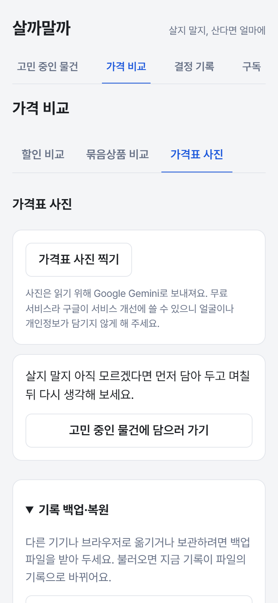 | 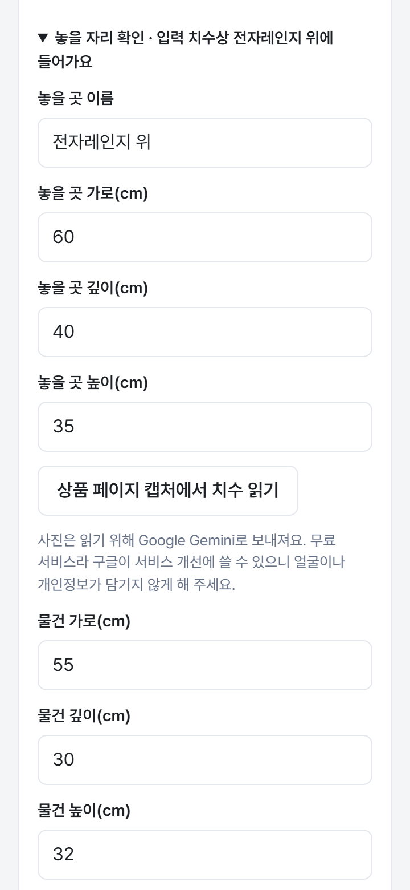 | 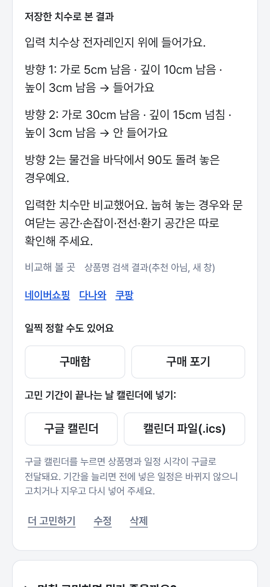 |
| F31 가격표 사진, 14단계(14-10). 고르기 전부터 Gemini 전송 안내가 보인다 | F44 놓을 자리 확인, 15단계(15-3). 접힌 제목에 저장한 결과가 붙는다. 캡처에서 치수 읽기 버튼은 15-6 | F44 결과(두 방향)와 F35 캘린더 줄(구글 캘린더·.ics), 14단계(14-15) |

| 3. 담아 두기 직후 | 4. 구매함 확인 직후 | 5. 물건이 없을 때 첫 화면 |
| :---: | :---: | :---: |
| 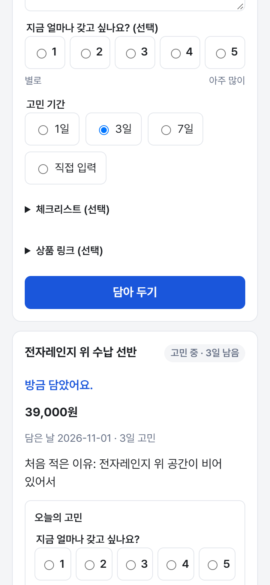 | 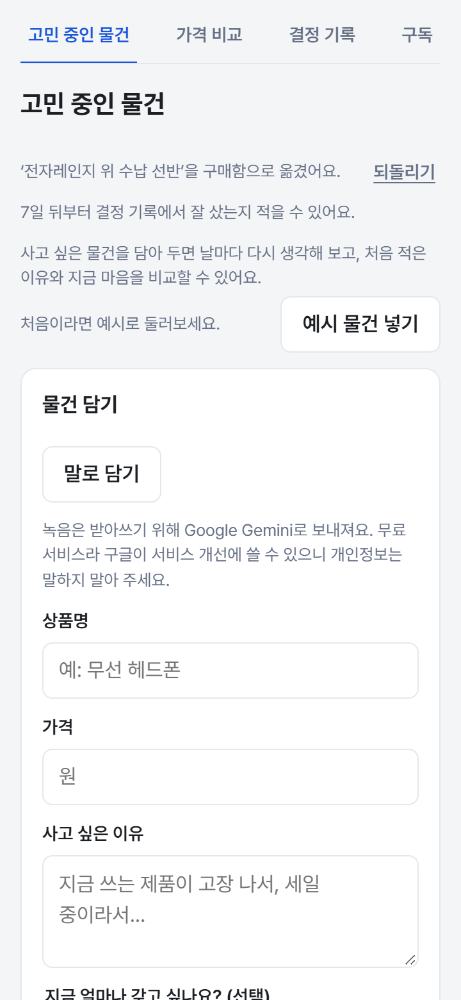 | 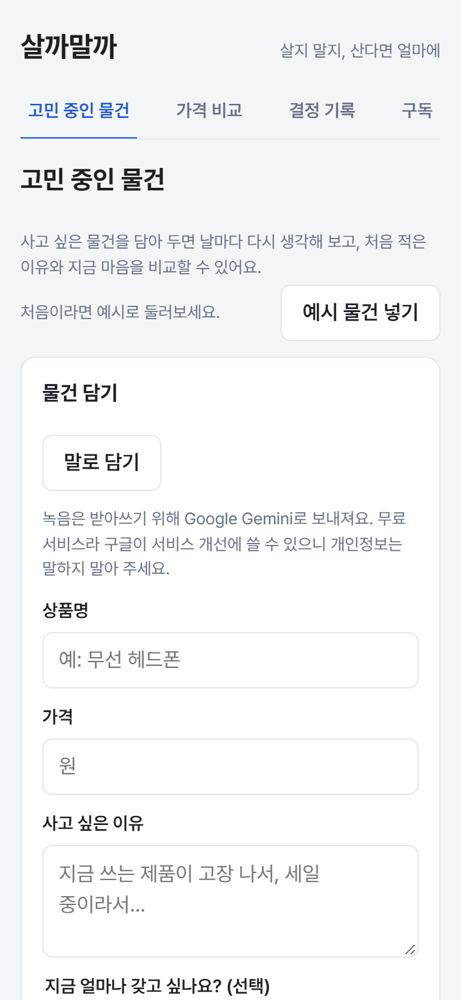 |
| F24, 평가 1회차 뒤 16단계(16-1). 새 카드로 옮기고 이름 아래 "방금 담았어요." | F18, 평가 B 뒤 17단계(17-3). "7일 뒤부터 결정 기록에서 잘 샀는지 적을 수 있어요." | F24, 평가 B 뒤 17단계(17-4). 설명 문장이 담기 폼 위. 1절 1번 '지금'과 같은 그림(바이트까지 같음) |

| 6. 맨 아래(AI 성적표 자리) | 7. 실제 AI: 가격표 읽기 | 8. 실제 AI: 온라인 가격 확인 |
| :---: | :---: | :---: |
| 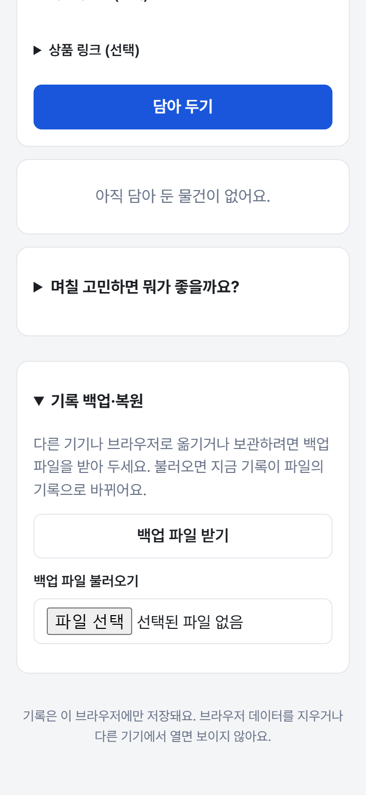 | 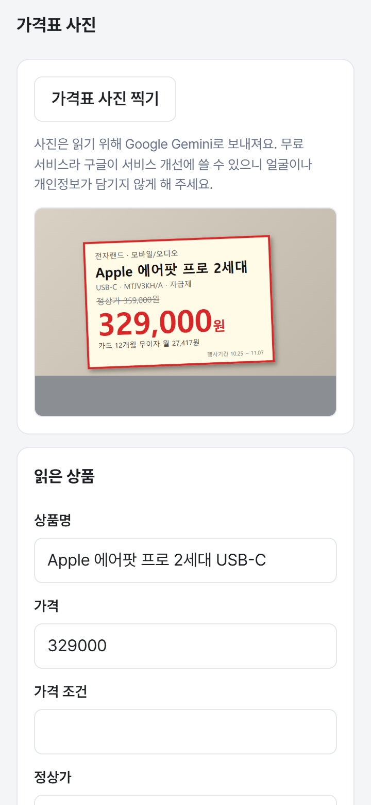 | 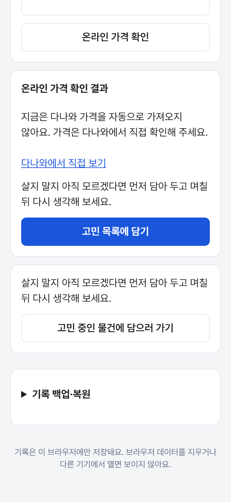 |
| F43 AI 성적표, 15단계(15-1). `src/ai/evalSummary.json`이 비어 있어 카드가 없다. 실제 자료 평가 뒤에 생긴다 | F31, 14단계. 11/01 18:29:15 호출, 서버 3,564ms. 상품명·가격·정상가를 사진대로 읽었다 | F31, 문구는 16단계(16-4). 18:29:20, 서버 2ms. 다나와 조회가 꺼져 모델을 부르지 않고 다나와 링크만 보인다 |

| 9. 실제 AI: 묶음 사진으로 채우기 | 10a. 실제 AI: 치수 읽기와 캡처 크게 보기 | 10b. 실제 AI: 치수 읽기 확인 상자 |
| :---: | :---: | :---: |
| 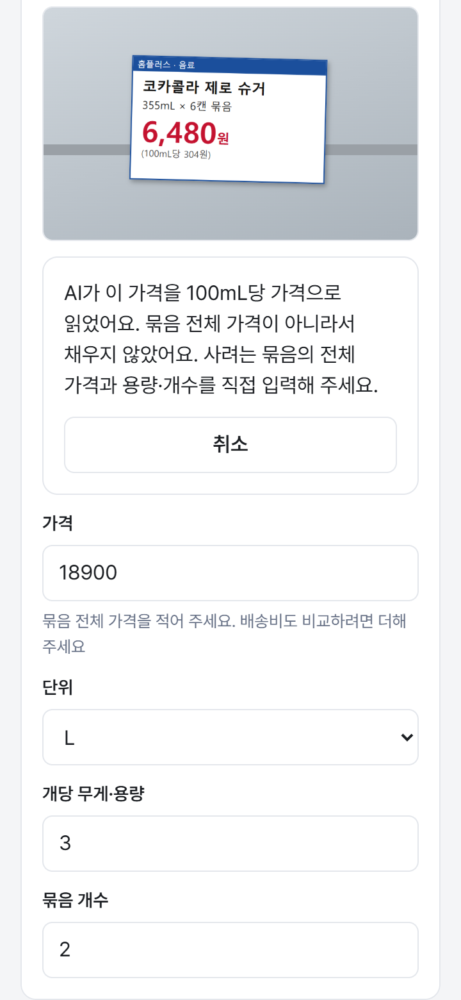 | 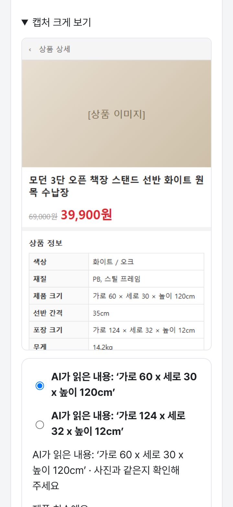 | 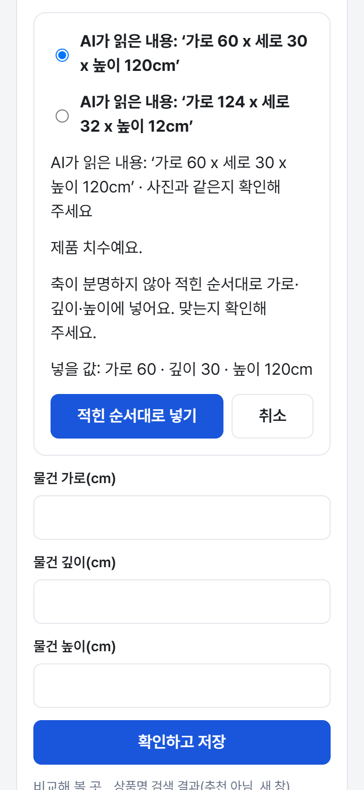 |
| F32, 14단계, 거절 문장은 16단계(16-4). 18:29:22, 서버 2,082ms. 이번에도 6,480원을 100mL당 가격으로 읽어 채우지 않았다(평가 C와 같은 결과, 3번 중 3번) | F44, 15단계(15-6), 문구·크게 보기는 16단계(16-2). 18:29:26, 서버 1,688ms. 제품·포장 두 표기를 사진과 같은 숫자로 읽었다 | 같은 호출. 첫 표기를 고르면 "AI가 읽은 내용: ‘…’ · 사진과 같은지 확인해 주세요"와 넣을 값이 보인다. 상자 첫 줄이 상자 설명으로 이어진 것은 17단계(17-2) |

**실제 호출.** 스킬 `testing-ai-screens`의 '브라우저로 확인할 때' 규칙을 따랐다. 모의 응답은 걸지 않았고, 실제 호출 전에 같은 컨텍스트의 페이지에서 `/api/read-size`에 빈 본문 `{}`을 보내 400(`bad_request`)을 받았다. 서버 로그(`wrangler dev`)의 `POST /api/` 줄은 17줄에서 22줄이 되었다. 늘어난 5줄은 빈 요청 400 한 번, `/api/read-tag` 200 두 번(가격표·묶음), `/api/lowest-price` 200 한 번(모델 호출 없음), `/api/read-size` 200 한 번이다. 모델 호출은 3번이고, 사진마다 한 번만 올렸으며, 끝난 뒤 컨텍스트를 닫았다. 사진은 평가 C의 평가자 A가 쓴 합성 사진 세 장이다(평가용 자료가 아니다). 한 장에 한 번씩이라 정확도를 말할 수 있는 숫자는 아니다.

## 3. 숫자

| 항목 | v1 | 지금 | 차이 | 잰 방법 |
| --- | --- | --- | --- | --- |
| 자동 테스트 | 532개 모두 통과, 파일 61개, 약 32초 | 1,551개 모두 통과, 파일 99개, 34.38초 | +1,019개, 파일 +38 | `npx vitest run`(시간은 출력의 Duration) |
| 타입 검사 | 통과 | 통과 | 같음 | `npx tsc -b` |
| 린트 | 경고·오류 0 | 경고·오류 0(파일 181개, 규칙 116개) | 같음 | `npx oxlint`(출력 없음, 종료 코드 0. `--format json`의 diagnostics 0개) |
| 빌드 JS | 330.67 kB (gzip 100.76 kB) | 379.42 kB (gzip 117.04 kB) | +48.75 kB (gzip +16.28 kB) | `npm run build`(AI 서버 주소 없이, 배포 설정과 같음) |
| 빌드 CSS | 56.43 kB (gzip 17.15 kB) | 57.16 kB (gzip 17.38 kB) | +0.73 kB (gzip +0.23 kB) | `npm run build` |
| 앱 코드 | 37개 파일 6,805줄 | 63개 파일 10,172줄 | +26개, +3,367줄 | `src`에서 `*.test.ts(x)`와 `src/test/`를 뺀 파일을 `wc -l`. 같은 규칙으로 v1 태그에서 다시 세어 37개·6,805줄이 나오는 것을 확인 |
| 테스트 코드 | 62개 파일 7,299줄 | 101개 파일 22,219줄 | +39개, +14,920줄 | 저장소 전체의 `*.test.ts(x)`와 `src/test/`(v1과 같은 규칙, v1 태그에서 다시 세어 확인). 지금은 `src` 89개 18,048줄 + `worker/test` 9개 2,877줄 + `eval` 3개 1,294줄 |
| PRD | v0.22, F01~F30, AC01~AC50 | v0.43, F01~F44, AC01~AC80 | 기능 번호 +14, 검증 사례 +30 | `PRD.md` 머리말과 번호. 지금 구현된 것은 F01~F33·F35·F43·F44, F34·F36~F42는 2·3단계 계획 |
| TODO | 195개 중 191개 완료 | 237개 중 228개 완료 | 작업 +42, 남은 것 4 → 9 | `TODO.md`의 `- [ ]`·`- [x]` 줄 수(v1 태그에서 같은 방법으로 195·191 확인). 남은 9개는 13-4~13-7, 14-17, 15-8, 16-6, 16-7, 17-7 |
| 문서 크기 | PRD 97KB · DEVLOG 101KB · TODO 38KB · README 11KB · 상세 설명 20KB | PRD 199KB · DEVLOG 191KB · TODO 53KB · README 36KB · 상세 설명 20KB | PRD +102 · DEVLOG +90 · TODO +15 · README +25 · 상세 설명 0(한 줄만 바뀜) | `git cat-file -s`의 바이트 ÷ 1024, 반올림(v1 숫자도 이 방법으로 나옴) |
| (새) AI 켠 빌드 JS | 없음 | 379.56 kB (gzip 117.10 kB) | 주소 없는 빌드보다 +0.14 kB | `VITE_AI_SERVER_URL=https://localhost:8787 npm run build`. AI 코드는 주소가 없어도 번들에 들어 있고 화면에서만 숨는다 |
| (새) `worker/src` | 없음 | 11개 파일 1,200줄 | 새로 생김 | `git ls-tree` 파일을 `wc -l` |
| (새) `worker/test` | 없음 | 10개 파일 2,888줄(테스트 9개 2,877줄 + 다나와 페이지 사본 1개) | 새로 생김 | 같음 |
| (새) `eval/` | 없음 | 16개 파일 3,286줄(평가·요약 스크립트 7개 1,390줄, 테스트 3개 1,294줄, 합성 사례 4개, README, tsconfig) | 새로 생김 | 같음 |
| (새) `.claude/skills/` | 없음 | 스킬 13개(SKILL.md 13개, 검사 스크립트 7개, 21개 파일 1,368줄) | 새로 생김 | `git ls-tree -d .claude/skills/` |
| (새) v1 뒤 커밋 | 0 | 127개(10/27 1 · 10/29 4 · 10/30 70 · 10/31 52) | +127 | `git log --oneline v1..HEAD \| wc -l` |
| (새) 바뀐 파일 | 0 | 202개 파일, +33,719줄 −174줄(새 파일 176, 고친 파일 26) | | `git diff --stat v1..HEAD`. 나눠 보면 `src` 68개 +14,178, `docs` 65개 +8,009(평가 기록 42개 +6,524), `worker` 23개 +4,122, `eval` 16개 +3,286, 루트 문서·설정 8개 +2,748, `.claude` 21개 +1,368 |
| (새) 의존성 | React 19.3.0 · TypeScript 6.0.3 · Vite 8.3.4 · Vitest 5.0.3 · jsdom 30.1.2 · oxlint 1.87.0 · Pretendard 1.3.9 | 같은 판 + wrangler 4.154.0(개발용) | wrangler만 더함 | `package-lock.json` |

## 4. 기능

PRD v0.43 기준으로 v1 뒤에 생긴 것이다.

### 4-1. 중간 과제 AI 기능 (14·15단계)

| 기능 | 내용 | 보이는 조건 |
| --- | --- | --- |
| F31 가격표 사진으로 온라인 가격 확인 | 가격 비교의 세 번째 탭. 매장 가격표를 찍으면 상품명·가격·정상가를 고칠 수 있는 칸에 읽어 오고, '온라인 가격 확인'으로 다나와의 같은 상품과 비교한다. 다나와 자동 조회는 서버 기본값이 꺼짐이라 지금은 다나와 링크만 보인다. '고민 목록에 담기'로 담기 폼의 빈 칸을 채운다 | AI 서버 주소가 있는 빌드 |
| F32 두 상품 사진으로 묶음 비교 채우기 | 상품 카드마다 '사진으로 채우기'. 확인 상자에서 '채우기'를 눌러야 가격·단위·용량·개수가 바뀐다. 단가 가격표는 채우지 않고 이유를 보인다 | AI 서버 주소가 있는 빌드 |
| F33 말로 담기 | 담기 폼 맨 위. 20초까지 녹음해 상품명·가격·이유(와 고민 기간)를 빈 칸에 채운다 | AI 서버 주소가 있는 빌드 |
| F35 고민 끝나는 날 캘린더 | 고민 기간이 남은 카드에 구글 캘린더 링크와 `.ics` 파일. 서버·AI를 쓰지 않는다 | 늘 |
| F43 AI 성적표 | 백업·복원 아래 접이식 카드. 저장소에 커밋한 평가 요약만 읽는다. 평가 스크립트 4개(`eval/`)는 있으나 실제 자료 정확도가 없어 요약이 비어 있고 카드도 안 보인다 | 서버 주소 + 요약에 결과가 있을 때 |
| F44 놓을 자리 확인 | 고민 카드의 접이식. 놓을 곳과 물건의 가로·깊이·높이(cm)를 두 방향으로 비교하고, 안 들어가요·빠듯해요면 사기 전 점검(F15)의 걸리는 점으로도 나온다. 서버 주소가 있으면 상품 페이지 캡처에서 치수를 읽어 칸에 넣을 수 있다 | 직접 입력은 늘, 치수 읽기는 서버 주소가 있을 때 |
| AI 서버 (10장 AI 공통) | `worker/`의 Cloudflare Workers. Gemini 키를 숨기고 사진·녹음을 대신 보낸다. 출처 검사, IP당 1분 10번, 본문 크기 검사, 파일 머리 검사, 긴급 차단(`AI_ENABLED`), 40초 상한과 503 때 한 번 더(전체 55초), 출력 길이 상한(15-8a). 앱은 사진 요청 하나를 60초까지 기다린다 | 배포 전(14-17·15-8) |

AI가 읽은 값은 고칠 수 있는 칸이나 확인 상자에만 들어가고, 사용자가 누르기 전에는 저장하지 않는다. 살지 말지는 판단하지 않는다.

### 4-2. 평가 회차 개선 (16·17단계)

| 단계 | 작업 | PRD |
| --- | --- | --- |
| 개발 1회차(평가 1회차 뒤, 판정 R29) | 16-1 담은 직후 새 카드로 포커스와 "방금 담았어요." | F24 · AC70 |
| | 16-2 치수 읽기 "AI가 읽은 내용"과 캡처 크게 보기 | F44 · AC67·AC71 |
| | 16-3 상품명을 바꾸면 사진 초안의 다나와 링크 지우기 | F31 · AC69 |
| | 16-4 결과 화면 문구(F31 맨 위 줄, F32 단가 거절, 가격 비교 예시 안내) | F31·F32·F06 · AC56·AC72~AC74 |
| | 준비 중 더함: 다른 탭 때문에 담기가 반영되지 않으면 담았다고 알리지 않고 입력을 그대로 둠(판정 R30) | F24 |
| 개발 2회차(평가 B 뒤, 판정 R38) | 17-1 Gemini 제한(`429 upstream_limited`)과 키 없음(`503 disabled`)을 다른 실패와 나누고 문구 | AI 공통·F43 · AC60·AC75·AC76 |
| | 17-2 F32·F44 확인 상자 첫 줄을 상자 설명으로, F32 "AI가 읽은 내용" | F32·F44 · AC77 |
| | 17-3 구매함으로 옮긴 직후 회고 안내 한 줄 | F18 · AC78 |
| | 17-4 물건이 없을 때 서비스 설명 문장을 담기 폼 위로 | F24 · AC79 |
| | 17-8 담은 물건을 바로 결정·삭제하면 담은 직후 안내도 지움(판정 R43) | F24 · AC80 |
| 그 사이 | 15-8a 치수 읽기 실제 호출의 40초 실패를 고침(출력 상한, 치수를 글자로 받기, 판정 R24~R27) | F44 |

### 4-3. 스킬과 평가 과정

- 스킬 13개(`.claude/skills/`): updating-prd, checking-ui-copy, checking-privacy, tuning-prompts, consulting-gpt, adding-ai-endpoint, evaluating-ai, checking-before-commit, writing-tests-from-spec, updating-devlog, syncing-todo, testing-ai-screens, applying-ai-results. 기계로 볼 수 있는 규칙은 검사 스크립트 7개로 두었다(README 4장, [.claude/skills/README.md](../.claude/skills/README.md)).
- 평가 → 결정 → 개발 → 평가를 두 번 했다. 평가 1회차 → 개발 1회차(16단계) → 평가 B → 개발 2회차(17단계) → 평가 C. 평가자 5명(실제 사용자·교수·보안·접근성·기능 기획), 세 관점 토론 2라운드, GPT 상의(50~52번), 판정 R29·R38·R44. 고정 기준은 [평가/평가기준.md](평가/평가기준.md), 교수 관점 점수는 약 69 → 75 → 78이다.
- 평가 B에서 '치수 읽기가 사진에 없는 숫자를 냈다'는 기록이 앞선 화면 확인이 남긴 모의 응답이었음을 서버 로그로 찾아 정정했고, 그 일을 `testing-ai-screens`의 브라우저 확인 규칙으로 바꿨다(17-5). 이 문서 2절의 실제 호출도 그 규칙을 따랐다.
- Claude가 정하고 제작자가 아직 확인하지 않은 결정 34개를 [평가/판정표.md](평가/판정표.md)에 모았다. 34줄 모두 제작자 판정 전이다.

### 4-4. v1 기준점 5절에 남긴 것의 지금 상태

| v1 5절 항목 | 지금 |
| --- | --- |
| 13-4 분석 기간과 실제 낸 금액 | 그대로(TODO 미완료) |
| 13-5 카드의 출처·수집 기간 정리 | 그대로 |
| 13-6 배달 구독 순혜택 | 그대로 |
| 13-7 발표 자료·README에 구현 / 검증 중 / 확장 구분 | 그대로. README는 AI 기능마다 보이는 조건과 '아직 재지 못했다'를 적었지만 작업은 열려 있다 |
| 자취생 1~2주 사용으로 효과 확인 | 그대로. 평가 C의 '다음에 할 것' 10번(지인 시험 사용)으로 남음 |
| 고민 기간 종료·구독 결제일 알림 | 일부. 고민 기간 종료는 캘린더 일정(F35)으로 넣을 수 있다. 앱 알림과 구독 결제일 알림은 없다 |
| 로그인과 서버 저장 | 하지 않음. 서버가 생겼지만 사진·녹음을 Gemini로 넘길 뿐 사용자 기록은 저장하지 않는다(PRD '하지 않는 것') |
| 구독 분석 마무리, 기기 사용 시간 연동 | 그대로 |
| 스마트폰 실기기 확인 | 그대로(평가 C 5-5의 14번) |
| 캘린더 알림(.ics) | **해결**: F35(14-15) |
| 홈 화면에 추가(manifest) | 그대로(`public/`에 favicon만) |
| 가격 비교의 한 번 쓸 때 비용(P1)·"안 사면" 한 줄(P5) | 그대로 |
| 배달 대신 기본 저녁, 참은 돈 저금통, 받을 돈 찾기 | 그대로 |
| 두 탭 동시 저장 시 나중 저장이 남음 | 그대로(탭 사이 잠금 없음). 담기가 다른 탭 때문에 반영되지 않을 때 담았다고 알리던 것은 고침(R30) |
| 다른 탭에서 결정·삭제하면 이 탭의 입력이 안내 없이 닫힘 | 그대로 |
| localStorage 출처 단위, 암호화 없음, frame-ancestors 없음 | 그대로 |
| 비슷한 기록 알림이 '헤드폰 블랙'을 놓칠 수 있음 | 그대로 |
| `docs/screenshots/`가 10/11 화면 | 그대로. README 2장도 이 그림을 쓰고 "AI 화면은 아직 스크린샷이 없습니다"라고 적혀 있다. 이 문서의 `v2_screens/`가 지금 화면이다 |
| `docs/presentation/index.html`이 4차 발표 자료 | 그대로. `시연_순서.md`는 README 절 번호만 고침 |
| 저장소 맨 위 `g-after.png`·`g-top.png` | 그대로 |

## 5. 기술과 저장

- **새 서버.** `worker/`의 Cloudflare Workers(`wrangler.jsonc`의 이름 `buyornot-ai`). 주소는 4개다.

  | 주소 | 하는 일 | 본문 상한 |
  | --- | --- | --- |
  | `/api/read-tag` | 가격표·묶음 사진 읽기(F31·F32) | 4.1MB |
  | `/api/lowest-price` | 다나와 검색 결과에서 같은 상품 고르기(F31). `DANAWA_ENABLED` 기본 `false`라 지금은 모델을 부르지 않는다 | 10KB |
  | `/api/voice-fill` | 녹음 받아쓰기로 칸 채우기(F33) | 2.1MB |
  | `/api/read-size` | 상품 페이지 캡처의 치수 읽기(F44) | 4.1MB |

  모델은 `gemini-3.5-flash-lite`(`worker/src/gemini.ts`)다. 설정은 `ALLOWED_ORIGINS`(배포값 `https://lumos0107.github.io`), `AI_ENABLED`, `DANAWA_ENABLED`, 비밀 값 `GEMINI_API_KEY`이고, 서버는 사진·녹음·읽은 글을 저장하지 않는다.
- **앱과 서버 연결.** 빌드 변수 `VITE_AI_SERVER_URL`이 있을 때만 AI 탭·버튼이 보인다. 운영 빌드는 https 주소만 받고 그 출처를 CSP `connect-src`에 더한다(`src/csp.ts`). AI 코드는 주소가 없어도 번들에 들어 있다(3절, 차이 0.14 kB).
- **WishItem의 새 필드 `fit`.** 선택 필드 `fit?: { place, space, item, basis?, savedAt }`이다. `space`·`item`은 가로·깊이·높이를 mm 정수로 둔다. 판정(들어가요·빠듯해요·안 들어가요)은 저장하지 않고 볼 때마다 계산한다. 결정한 물건에도 남고, 저장·복원 때 `isFit`으로 검사한다(`src/logic/fit.ts`, `src/logic/storage.ts`).
- **저장 키와 백업 형식.** 바뀌지 않았다. localStorage 키는 v1과 같은 3개(`buyornot.wishlist.v1` · `buyornot.settings.v1` · `buyornot.subscriptions.v1`)이고, 백업 파일은 이름 `buyornot-backup-YYYY-MM-DD.json`, `backupVersion: 1`, 각 부분 `schemaVersion: 1` 그대로다. 달라진 것은 물건 기록에 `fit`이 붙을 수 있다는 것뿐이다. v1 코드의 검사(`isWishItem`)는 모르는 필드를 막지 않아 지금 백업도 v1이 받아들일 것으로 보인다(코드로만 확인, 실제로 불러오지는 않음). 새로 내려받는 파일은 캘린더 `buyornot-YYYY-MM-DD.ics` 하나다.
- **디자인.** 색·글꼴 값은 그대로다(`src/index.css`는 73줄 더해졌고 색 값 변경 없음).
- **배포 상태.** 배포하지 않았다. `ai-stage1`은 main에 합치지 않았고 push도 하지 않았다. 공개 사이트 https://lumos0107.github.io/BuyorNot/ 는 2026-11-01에도 v1 빌드 파일(`index-BpxObitS.js` · `index-BWd0Oos2.css`)을 내보낸다. AI 서버도 배포 전이다(14-17·15-8, 제작자 몫).

## 6. 아직 v1 그대로인 것과 다음

v1 그대로인 것: 공개 사이트, 구독·결정 기록·할인·묶음 계산 화면(1절의 3~9번), 저장 키와 백업 형식, 디자인 값, 의존성 판, 4-4 표의 '그대로' 항목.

다음에 할 일과 제작자만 정할 수 있는 일은 [평가/2026-10-31-3회차.md](평가/2026-10-31-3회차.md)의 5-2(다음에 할 것 12개), 5-3(하지 않을 것), 5-5(제작자 결정 15개)에 있다. 그중 이 비교와 직접 이어지는 것은 다음과 같다.

- `ai-stage1`을 main에 합치고 push하면 1절의 지금 화면(AI 서버 주소 없이)이 공개 사이트에 나간다(5-5의 2번). AI 기능까지 보이려면 서버 배포와 `.env.production`이 먼저다.
- 실제 자료 정확도는 아직 0개다. 2절의 실제 호출 3번도 한 장에 한 번씩이라 정확도가 아니고, 묶음 라벨은 같은 합성 사진에서 3번 모두 거절됐다(평가 C 7절의 미해결과 같은 관측).
- README 2장 스크린샷은 10/11 화면 그대로다. 바꿀 때 이 문서의 `v2_screens/`를 쓸 수 있다.
