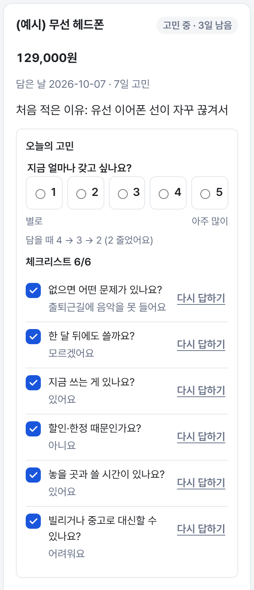
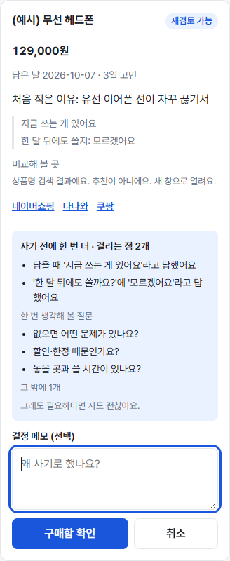
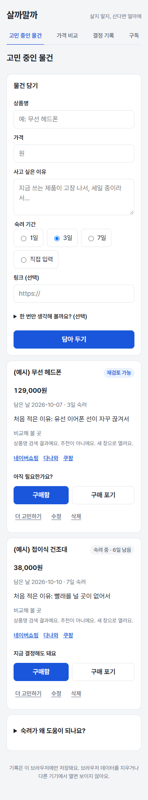
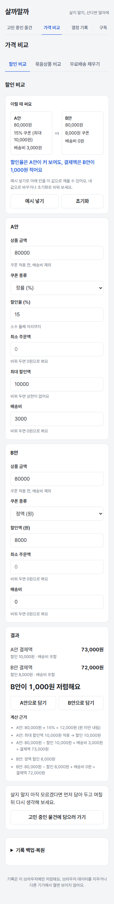
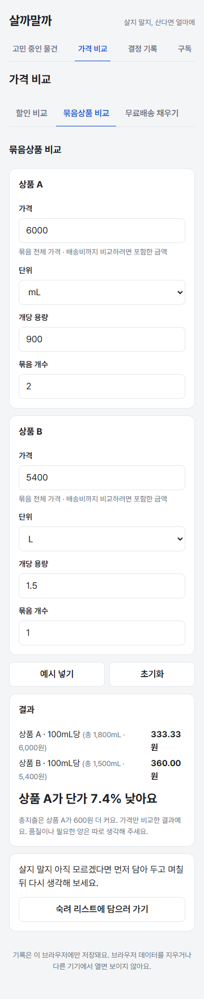
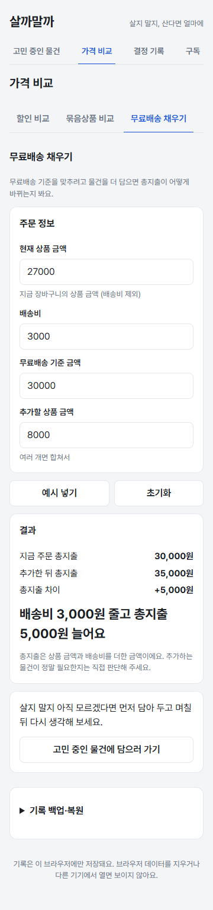
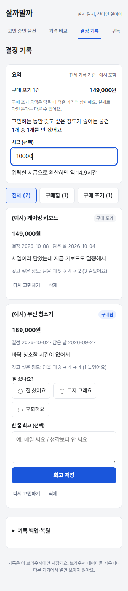
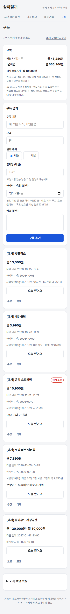

# 살까말까 상세 설명

> 2026-10-11까지의 README 전체 내용이다. 발표용으로 줄인 README는 [README](../README.md)에 있다.

사고 싶은 물건은 한 번 더 생각하고, 사기로 했다면 더 싸게 사도록 돕는 모바일 우선 웹사이트입니다. 20~30대 자취생을 대상으로 만들었습니다.

- 웹사이트: https://lumos0107.github.io/BuyorNot/
- 저장소: https://github.com/lumos0107/BuyorNot
- 상태: 1차 기능(고민 목록·할인 비교·묶음상품 비교), 2차 확장(고민 돕기·기록 돌아보기·무료배송 비교·구독 정리함), 3차 추가(사기 전 점검·되돌리기·구독 사용량·백업), 4차 추가(고민 노트, 비교 문구·구독 확인 필요, 담기 폼 줄이기, 사용량 직접 적기, 체크리스트)와 구독 이용 분석 1단계(넷플릭스 시청 기록 가져오기) 구현·배포 (2026-10-11), 발표 준비 중 (목표일 2026-10-17)

## 풀려는 문제

| 문제 | 살까말까가 주는 도움 |
| --- | --- |
| 사고 싶은 순간에 바로 결제한다 | 구매 이유와 짧은 질문의 답을 적어 두고, 고민 기간이 지난 뒤 다시 판단. 사려고 할 때 내 기록에서 찾은 걸리는 점(비슷한 물건, 할인 때문인지 등)을 보여 줌 |
| 할인율만 봐서는 실제 결제액을 알기 어렵다 | 최소 주문액·최대 할인액·배송비까지 반영해 두 조건을 비교 |
| 용량과 묶음 수량이 달라 가격을 비교하기 어렵다 | 같은 단위로 환산한 가격과 총지출을 함께 표시 |
| 무료배송 기준을 채우려다 더 쓴다 | 추가 구매 전후의 총지출과 차이를 표시 |
| 안 쓰는 구독이 매달 빠져나간다 | 다음 결제일, 오래 쓰지 않은 구독(해지 후보), 쓴 날 수로 본 하루에 드는 돈을 표시 |

## 기능

| 화면 | 하는 일 |
| --- | --- |
| 고민 중인 물건 | 상품·가격·사고 싶은 이유·고민 기간(1·3·7일 또는 1~30일)과 지금 얼마나 갖고 싶은지(1~5, 선택)를 담아 둔다(체크리스트 6개와 링크는 접어 둔 선택 칸). 담은 직후 "3일 뒤에 처음 적은 이유와 갖고 싶은 정도의 변화를 다시 보여 드릴게요"처럼 적은 값이 언제 쓰이는지 알려 준다. 비슷한 이름의 기록이 있으면 "3일 전에 '(예시) 게이밍 키보드'를 구매 포기했어요"처럼 알려 준다. **고민 노트**: 카드의 "오늘의 고민"에서 앱을 연 날마다 갖고 싶은 정도를 다시 고르고(같은 날은 한 번, "담을 때 4 → 3 → 2 (2 줄었어요)"), 질문 6개를 **체크리스트**("체크리스트 3/6")로 늘 보여 주고 그 자리에서 답한다(답한 줄은 답과 "다시 답하기", 아직인 줄은 "답하기"). 질문은 담는 순간이 아니라 차분해진 뒤에 답하도록 담기 폼이 아닌 카드에서 묻는다. 기간이 지나면 "재검토 가능"으로 바뀐다. 구매함을 누르면 확인 전에 "사기 전에 한 번 더"로 갖고 싶은 정도의 변화, 내 기록에서 찾은 걸리는 점, 그 밖에 답한 것, 아직 답하지 않은 질문을 보여준다(단정하지 않음). 고민 기간 중에는 두 결정 버튼을 같은 모양으로 두고 "일찍 정할 수도 있어요"라고만 적는다. 결정 직후 "되돌리기", 더 고민하기(1·3·7일 연장), 결정 메모, 상품명 검색 링크(네이버쇼핑·다나와·쿠팡, 추천 아님)를 제공한다. |
| 가격 비교 · 할인 비교 | 두 조건(쿠폰 없음·정률·정액, 최소 주문액, 최대 할인액, 배송비)의 실제 결제액을 비교하고 계산 근거를 한 줄씩 보여준다. 결과에서 "A안·B안으로 담기"를 누르면 결제액과 비교 내용을 고민 목록 담기 폼에 채운다. |
| 가격 비교 · 묶음상품 비교 | g·kg·mL·L·개 단위를 환산해 100g·100mL·1개당 가격과 총지출을 비교하고, "단가는 상품 A가 낮지만, 총지출은 상품 B가 600원 적어요"처럼 한 문장으로 정리한다. 무게와 부피처럼 종류가 다른 단위는 비교하지 않는다. 결과의 상품을 고민 목록에 담을 수 있다. |
| 가격 비교 · 무료배송 채우기 | 무료배송 기준을 채우려고 상품을 더 담을 때 추가 전후의 총지출과 차이를 보여준다. 추가 상품이 필요한지는 사용자가 판단한다. |
| 결정 기록 | 구매·포기한 물건을 최신 결정 순으로 보여주고 전체·구매함·구매 포기로 거른다. 요약 카드에 구매 포기 건수와 금액(담을 때 적은 가격의 합이라 실제로 아낀 돈과 다를 수 있음)과 고민 효과("고민하는 동안 갖고 싶은 정도가 줄어든 물건 2개 중 2개를 안 샀어요", 기록된 변화와 결정만 보여 줌)를 보여주고, 시급을 넣으면 몇 시간어치인지 환산한다. 카드에는 갖고 싶은 정도의 변화를 남긴다. 구매하고 7일이 지나면 "잘 샀나요?"를 묻는다. 잘못 결정한 기록은 "다시 고민하기"로 되돌린다. |
| 구독 | 월·연 구독(OTT·음악·배달·쇼핑 멤버십 등)을 적어 두면 다음 결제일(D-n), 월·연 합계, 기록상 31일 이상 쓰지 않은 구독(해지 후보)을 보여준다. 사용 기록이 없는 구독은 해지 후보가 아니라 "확인 필요"로 보여준다(기록하지 않았을 뿐 쓰는 구독일 수 있어서). "사용량 적기"로 스크린 타임이나 배달 앱 주문 내역에서 본 최근 30일 사용 시간·횟수를 한 달에 한 번 적으면 "최근 30일 18시간 · 1시간에 약 750원", "최근 30일 6번 사용 · 1번에 약 670원"처럼 보여준다(적은 지 30일이 지나면 다시 적으라고 안내). 매일 쓴 날만 누르는 "오늘 썼어요"("최근 30일 중 3일 사용 · 쓴 날 하루에 약 4,500원")도 남겨 두었다. 예시 구독에는 예시 사용량이 들어 있고, "이용 기록 가져오기"로 넷플릭스 시청 기록 CSV를 가져오면 최근 30일 이용 일수와 기록 수를 출처·파일 기간·가져온 날과 함께 보여준다(제목은 저장하지 않음, F26 1단계). 자동 연동(스크린 타임 등)은 [연동 계획](구독_사용시간_연동_계획.md)에 적었다. 알림은 보내지 않는다. |
| 기록 백업·복원 (화면 맨 아래) | 물건 기록·시급·구독을 파일 하나로 받고, 다른 브라우저에서 불러온다. 불러올 때 파일을 검증하고, 확인한 뒤에만 지금 기록을 바꾼다. |

<p>
  
  
  
</p>
<p>
  
  
</p>
<p>
  
  
  
</p>

처음 열었을 때 "예시 물건 넣기"를 누르면 고민 중 2개(같은 단계: 체크리스트 6/6)와 구매 포기·구매함(회고를 물을 수 있는 기록) 예시가 하나씩 들어가고, 담기 폼도 "(예시) 전기 포트"와 체크리스트 답까지 채워져 담아 두기만 누르면 됩니다. 예시에는 며칠에 걸친 갖고 싶은 정도 기록(헤드폰 4 → 3 → 2 등)이 들어 있어 고민 노트와 고민 효과를 바로 볼 수 있습니다. 가격 비교 화면의 "예시 넣기"는 PRD의 검증 사례 값을, 구독 화면의 "예시 구독 넣기"는 월 구독 4개(하나는 마지막 사용 40일 전이라 해지 후보, 둘은 배달의민족 배민클럽·쿠팡 와우 같은 배달·쇼핑 멤버십)와 연 구독 1개를 채워 줍니다. 예시 이름에는 "(예시)"가 붙고, "예시만 지우기"로 예시만 골라 지울 수 있습니다.

## 예시(가짜) 데이터와 만든 이유

예시는 모두 이름에 "(예시)"가 붙고, "예시만 지우기"로 예시만 골라 지울 수 있다.

| 예시 데이터 | 만든 이유 |
| --- | --- |
| 예시 물건 4개 (고민 중 2개, 구매 포기 1개, 구매 1개) | 며칠이 지나야 보이는 기능(갖고 싶은 정도의 변화, 산 지 7일 뒤 회고)을 처음 쓰는 사람과 발표에서 바로 보여 주려고, 과거 날짜로 만든 가상 기록 |
| 담기 폼의 "(예시) 전기 포트"와 체크리스트 답 | 입력 방법을 한 번에 보여 주려고 |
| 예시 구독 5개와 예시 사용량 | 웹에서는 스크린 타임 같은 실제 사용 시간을 읽을 수 없어, 계산 화면을 보여 주려고 넣은 숫자. 직접 넣은 구독에는 예시 숫자를 쓰지 않는다 |
| 가격 비교의 예시 값 | PRD 검증 사례의 값 그대로 |
| `docs/samples/netflix-sample.csv` | 개인 시청 기록을 공개 저장소에 올리지 않으려고 만든 가짜 파일 |
| 페르소나 김지우 | 가상 인물 |

결정 기록에 보이는 금액과 "갖고 싶은 정도가 줄어든 물건 …" 문장은 예시 데이터로 계산한 값이다. 실제 효과는 아직 확인하지 못했다(README 5절).

### 계산 규칙 요약

- 할인 비교: 최소 주문액은 배송비를 뺀 상품 금액으로 판단한다. 정률 할인은 원 미만을 내리고, 최대 할인액과 상품 금액을 넘지 않는다. 결제액 = 상품 금액 − 할인 + 배송비. 할인율은 0.01% 단위 정수로 바꿔 계산해 부동소수점 오차로 1원이 틀어지지 않게 했다.
- 묶음상품 비교: 총량을 기준 단위의 1/1000 정수(BigInt)로 계산하고, 단가 비교는 나눗셈 대신 정수 곱셈으로 한다. 화면에 보이는 단가(소수 둘째 자리)가 같지만 실제로 다르면 "아주 작은 차이"로 안내한다.
- 무료배송 채우기: 총지출 = 상품 금액 + (기준 이상이면 0, 아니면 배송비). 지금 금액이 이미 기준 이상이면 "이미 무료배송이에요"를 먼저 보여준다.
- 고민 기간: 종료 시각 = 등록 시각 + 일수 × 24시간. 연장하면 max(지금, 기존 종료 시각) + 일수 × 24시간. 정각이 지나면 '재검토 가능' 표시는 자동으로 바뀌지만, 구매·포기는 사용자가 직접 결정한다.
- 구매 후 회고: 구매 결정 시각 + 7일 정각부터 묻는다.
- 사기 전 점검: 비슷한 기록, 답(지금 쓰는 게 있음, 한 달 뒤 안 쓸 것 같음, 할인·한정 때문, 놓을 곳·시간 없음, 빌리거나 중고로 대신 가능), 이유의 할인 문구, 남은 고민 기간을 걸리는 점으로 센다. 할인 문구는 사용자가 쓴 부분에서만 찾고, 가격 비교에서 가져온 문장("가격 비교: B안 결제액 72,000원 (할인 8,000원 · 배송비 포함)" 형식)은 뺀다. 답하지 않은 질문은 세지 않고 "한 번 생각해 볼 질문"으로 따로 보여준다. 걸리는 점이 되지 않은 답은 "그 밖에 답한 것"으로 보여줄 뿐 필요하다고 판정하지 않는다.
- 고민 노트: 갖고 싶은 정도는 하루에 하나(같은 날 다시 고르면 바꿈, 날짜는 고른 순간의 기기 현지 날짜). "줄었어요·늘었어요·그대로예요"는 처음 값(담을 때 정도, 없으면 가장 이른 기록)보다 뒤 날짜의 기록이 있을 때만 처음 값과 가장 늦은 날의 값을 비교해 붙인다. 같은 날 안의 변화는 값만 보여준다. 카드·사기 전 점검·결정 기록이 같은 판정을 쓴다.
- 비슷한 기록: 마지막 어절(물건 종류)이 같거나, 공백을 지운 이름 하나가 다른 하나로 끝나면 알린다. '헤드폰 거치대' 같은 액세서리는 본체와 구분하지만, '헤드폰 블랙'처럼 색상·모델이 뒤에 붙으면 놓칠 수 있다.
- 구독: 월 구독은 결제일이 없는 달이면 말일(31일 → 2월 28일), 연 구독은 갱신일이 지났으면 1년씩 더한다(2월 29일 → 평년 2월 28일). 마지막 사용일(직접 적은 날과 "오늘 썼어요"로 기록한 날 중 늦은 날)이 31일 이상 지나면 해지 후보, 사용 기록이 아예 없으면 "확인 필요". 월 합계는 카드에 보이는 월 환산의 합, 연 합계는 실제 요금의 합. 쓴 날 하루에 드는 돈 = 월 요금 ÷ 최근 30일 중 쓴 날 수(10원 단위 반올림). 예시 사용량은 시간(1시간에) 또는 횟수(1번에)로 계산한다.

자세한 규칙과 검증 사례(1차 AC01~AC17, 2차 AC18~AC28, 3차 AC29~AC35, 4차 AC36~AC47)는 [PRD](../PRD.md)에 있습니다.

## 저장 방식과 제한

- 물건 기록·시급·구독은 사용 중인 브라우저의 localStorage에 따로 저장됩니다(`buyornot.wishlist.v1`, `buyornot.settings.v1`, `buyornot.subscriptions.v1`). 회원가입과 서버가 없습니다.
- 1차 버전에서 저장한 물건 기록은 이후 버전에서도 그대로 읽힙니다(2·4차에 더한 항목은 모두 선택값, 4차의 갖고 싶은 정도 기록 포함).
- 카카오톡 같은 앱 안의 브라우저와 기본 브라우저도 서로 다른 브라우저라 기록이 따로 저장됩니다. 브라우저 데이터를 지우거나 다른 기기·브라우저에서 열면 기록이 보이지 않습니다. 옮기거나 보관하려면 화면 맨 아래 "기록 백업·복원"에서 백업 파일을 받아 두세요.
- 같은 브라우저의 다른 탭에서 저장하면 열려 있는 탭도 그 내용으로 맞춥니다. 다른 탭이 먼저 저장한 내용을 말없이 덮어쓰지 않고, 그 내용을 불러온 뒤 알려 줍니다.
- 저장된 데이터를 읽을 수 없으면 덮어쓰지 않고 안내한 뒤, 사용자가 확인했을 때만 초기화합니다. 저장에 실패하면 "다시 저장" 버튼을 보여줍니다.
- 가격 비교의 입력값은 저장하지 않습니다.
- GitHub Pages의 같은 주소(`lumos0107.github.io`) 아래 다른 페이지와는 브라우저 저장 공간을 함께 씁니다(브라우저가 주소의 경로가 아니라 출처 단위로 나누기 때문). 기록은 암호화하지 않으니, 함께 쓰는 기기에서는 백업 후 지우는 것이 좋습니다.

## 실행과 테스트

Node.js 24 기준입니다.

```bash
npm ci            # 의존성 설치
npm run dev       # 개발 서버 (http://localhost:5173/BuyorNot/)
npm test          # 자동 테스트 (Vitest, 507개)
npm run build     # 타입 검사 + 빌드 → dist/
npm run preview   # 빌드 결과 미리보기 (http://localhost:4173/BuyorNot/)
npm run lint      # oxlint
```

main 브랜치에 push하면 GitHub Actions가 테스트 → 빌드 → GitHub Pages 배포를 자동으로 실행합니다 ([deploy.yml](../.github/workflows/deploy.yml)).

## 기술 구성

- React 19 · TypeScript 6 · Vite 8
- 보안: 배포본에 콘텐츠 보안 정책(meta)으로 스크립트·스타일·글꼴·연결을 이 사이트로만 제한, 글꼴(Pretendard, OFL-1.1)은 외부 CDN 없이 함께 배포, 배포 권한은 deploy 작업에만, 사용자 링크는 http·https만 받음, 백업 파일은 5MB까지
- Vitest 5 + Testing Library: 계산·시각 규칙은 순수 함수 단위 테스트, 화면은 사용자 조작 기준 테스트
- localStorage, GitHub Pages

```
src/
  logic/     계산·검증·시각 규칙 (순수 함수): discount, bundle, shipping, wishlist, similar, impulse,
             summary, settings, subscriptions, usage, usageRecords, netflixCsv, desire, questions,
             draft, backup, records, storage, number, dates
  store/     useWishlist(저장 상태·시각 갱신), useSettings, useSubscriptions — 다른 탭의 저장도 반영
  screens/   WishlistScreen, CompareScreen, HistoryScreen, SubscriptionScreen, BackupSection
  ui/        Tabs(ARIA 탭 패턴), Field(레이블·안내·오류 연결), Button, ResetConfirm, ExampleBar, useFocusFirstError
  App.tsx    메뉴 전환(상태 기반), 저장 상태 배너
```

## 개발 방식

바이브 코딩 과제로, 두 AI에 역할을 나눠 진행했습니다.

- **Claude**: 개발. 테스트를 먼저 쓰고 실패를 확인한 뒤 구현하는 방식(TDD)으로 코드와 문서를 작성했습니다. 이미 있는 동작을 확인하는 테스트는 코드를 잠깐 망가뜨려 실제로 실패하는지 확인했습니다.
- **GPT (Codex CLI)**: 검토. 단계가 끝날 때마다 PRD 일치 여부, 계산 오류, 접근성, 테스트 충분성을 검토했습니다. 검토 12회(1차 5회·2차 3회·3차 2회·4차 2회)와 후속 확인 5회에서 지적 133건이 나왔고 124건을 반영했습니다. 3건은 GPT와 합의해 일부만 반영했고, 1건(두 탭이 거의 동시에 저장할 때의 잠금)은 드문 경우라 제작자 결정으로 넣지 않았으며, 5건은 근거를 들어 반영하지 않거나 보류했습니다. 의견이 다른 지적은 근거를 붙여 다시 상의했고, 그 과정은 DEVLOG에 남겼습니다.
- **제작자**: 범위와 기술을 결정하고 결과를 확인했습니다. 3차 기능(사기 전 점검, 구독 사용량, 되돌리기, 백업 등)은 제작자의 요청과, 제작자가 따로 받은 GPT 아이디어 중 고른 것입니다. 4차의 고민 노트는 "충동구매 방지라면 정말 필요한지 확인하고, 고민하게 만들고, 고민하다 보면 구매욕이 줄어드는 느낌이어야 한다"는 제작자의 방향에서 나왔고, 비교 문구·구독 확인 필요는 제작자가 따로 받은 GPT 개선점 분석에서 고른 것입니다.

AI에 요청한 내용, 생성 결과, 발견한 오류, 수정 이유, 검증 결과는 [DEVLOG](../DEVLOG.md)에 단계별로 남겼습니다. 대표 사례:

- 화면 테스트가 잡은 버그: "총지출이 더 큰 쪽"을 단가 판정에서 거꾸로 유추해 A 2,000원·B 1,500원일 때 "B가 500원 더 커요"로 표시하던 문제
- GPT 검토가 잡은 크래시: 묶음 개수에 아주 큰 수를 넣으면 `Infinity`가 `BigInt`로 변환되며 화면이 깨지던 문제 → 입력 상한과 BigInt 총량 계산으로 수정
- 직접 실행해 확인한 지적: 표시 동률 판정에 `Math.round`를 쓰면 화면의 Intl 반올림(1.005 → "1.01")과 어긋남 → 화면과 같은 포맷 함수로 판정
- 테스트가 찾은 계획서 모순: PRD의 검증 사례 "결제일 31일, 오늘 2월 28일 → 3월 31일"이 같은 PRD의 "결제일이 오늘이면 D-0" 규칙과 맞지 않음 → 사례를 둘로 나눠 정정
- GPT 검토가 찾은 접근성 문제: 접힌 영역 안의 오류가 보이지 않거나, 결정·삭제 뒤 포커스가 사라짐 → 영역을 펼치고 첫 오류 입력이나 화면 제목으로 포커스를 옮김
- 측정으로 확인한 지적: 한국어를 낱말 단위로 줄바꿈하게 바꾼 뒤 띄어쓰기 없는 긴 상품명이 360px 카드를 2,546px까지 늘림(GPT 코드 검토) → 긴 이름·답은 칸 안에서 끊도록 고치고, 고치기 전 CSS로 측정이 실제로 넘침을 잡는지 확인

## 문서

| 문서 | 내용 |
| --- | --- |
| [PRD](../PRD.md) | 요구사항(1차 F01~F06, 2차 F07~F14, 3차 F15~F21, 4차 F22~F28), 계산 규칙, 검증 사례(AC01~AC47), 완성 기준 |
| [TODO](../TODO.md) | 단계별 개발 계획(1차 1~6단계, 2차 7~12단계, 3·4차 추가 작업, 13단계 구독 이용 분석), 작업 번호, 확인 방법과 진행 체크 |
| [DEVLOG](../DEVLOG.md) | 단계별 개발 기록: AI 요청·결과·오류·수정·검증·커밋 |
| [구독 사용량 연동 계획](구독_사용시간_연동_계획.md) | 스크린 타임·사용 통계로 실제 사용량을 가져오는 방법과 제약, 단계 계획 |
| [발표 자료](presentation/index.html) | HTML 슬라이드(방향키로 넘김)와 [시연 순서](presentation/시연_순서.md) |
| [초기 아이디어](ideas/구매_판단_웹사이트_아이디어.md) | 주제 선정 과정과 핵심 기능 후보 |
| [아이디어 모음](ideas/생활소비_결정도구_아이디어.md) | 같은 결의 생활 소비 도구 아이디어와 기능 조합 |

## 범위 밖

로그인·서버, 쇼핑몰 가격 수집, 결제, AI 구매 추천·실제 상품 추천, 복합 쿠폰·카드 혜택 계산, 알림(고민 기간 종료·구독 결제일), 기기 간 자동 동기화(백업 파일로 옮기기는 가능), 구독 사용량 자동 연동(계획만)은 이번 버전에 없습니다.

제작: 강승준
